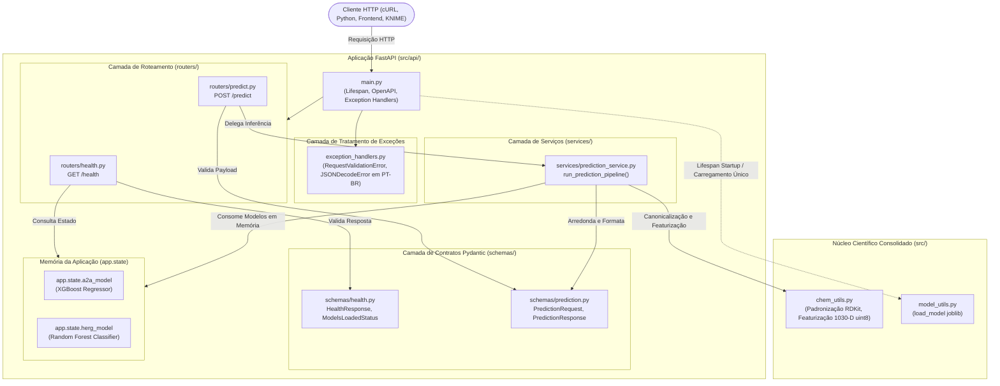

# 📑 Relatório de Desenvolvimento Técnico (RDT) — API REST FastAPI
# MultiTarget BioPredict — Plataforma de Triagem Virtual Multiobjetivo: Potência no Receptor de Adenosina A2A × Segurança Cardíaca hERG

**Projeto:** MultiTarget BioPredict — Módulo de Interface Programática REST (FastAPI)  
**Autoria Técnica:** Raphael Pires  
**Especialidade:** Engenharia de Software Sênior, MLOps e Quimioinformática  
**Status Atual do Módulo:** Fases 1 a 5 e Ajustes Corretivos Concluídos com Sucesso | Módulo Homologado  
**Ambiente de Execução:** Local (Windows 11, Python 3.12, 8 GB RAM, AMD Ryzen 7, CPU Only)  
**Repositório Git:** `BioPredicta` | **Branch Base:** `develop`  
**Stack Tecnológica:** FastAPI 0.162, Pydantic v2.14, Uvicorn 0.54, Starlette, HTTPX 0.28, RDKit 2026.9, Scikit-Learn 1.9, XGBoost 3.4

---

## 1. Sumário Executivo e Visão Geral da API

O **MultiTarget BioPredict** foi originalmente desenvolvido como uma plataforma computacional para triagem virtual multiobjetivo (*in silico*), integrando a predição da afinidade pelo receptor purinérgico humano de adenosina $A_{2A}$ ($ADORA2A$) e a avaliação de cardiotoxicidade induzida pelo bloqueio do canal de potássio $K_v11.1$ ($hERG$ / $KCNH2$).

Após a consolidação dos pipelines científicos e da interface gráfica analítica construída em Streamlit, surgiu a necessidade de estender a plataforma com uma **Interface de Programação de Aplicações (API REST)** robusta, assíncrona, de alto desempenho e padronizada conforme as diretrizes OpenAPI / JSON Schema.

### 1.1 Objetivos Estratégicos da API
1. **Desacoplamento Arquitetural:** Separar estritamente o mecanismo de inferência científica e computação molecular da camada de apresentação gráfica (Streamlit), viabilizando arquiteturas orientadas a serviços.
2. **Integração Máquina-a-Máquina (M2M):** Habilitar a integração direta da plataforma com pipelines externos de triagem em lote (*high-throughput virtual screening*), softwares quimioinformáticos laboratoriais (ex.: KNIME, Pipeline Pilot) e pipelines automatizados de docagem molecular.
3. **Contratos Rigorosos de Dados:** Estabelecer contratos de entrada e saída fortemente tipados, com validação estrita em tempo de execução via Pydantic v2, mitigando vulnerabilidades como injeção de parâmetros, corrupção de tipos e *denial-of-service* por payloads excessivos (ReDoS).
4. **Resiliência e Desempenho Operacional:** Garantir carregamento atômico dos modelos preditivos em memória única durante a inicialização da API (*lifespan context*), reduzindo a latência de inferência e mantendo o teto de consumo de RAM compatível com ambientes de 8 GB.
5. **Usabilidade e Internacionalização:** Fornecer mensagens de erro e validação padronizadas em português brasileiro claro e profissional, higienizando os retornos para proteger dados sensíveis e evitar a exposição de *stack traces*.

---

## 2. Arquitetura Modular da API (`src/api/`)

A implementação da API adota o padrão de camadas (**Layered Architecture**), com separação formal de responsabilidades entre contratos de dados, orquestração de serviços, controladores HTTP e ciclo de vida da aplicação.



### 2.1 Componentes do Pacote `src/api/`

| Componente | Caminho | Responsabilidade Técnica |
|---|---|---|
| **Ponto de Entrada** | [`src/api/main.py`](file:///c:/Users/Raphael/Documents/BioPredicta/src/api/main.py) | Instanciação da aplicação FastAPI, configuração de metadados OpenAPI/Swagger, orquestração do ciclo de vida assíncrono (`lifespan`), registro de rotas e vinculação dos handlers de erro. |
| **Tratamento de Exceções** | [`src/api/exception_handlers.py`](file:///c:/Users/Raphael/Documents/BioPredicta/src/api/exception_handlers.py) | Centralização e higienização de erros de validação Pydantic (`RequestValidationError`) e decodificação sintática (`JSONDecodeError`), traduzindo todas as mensagens para português brasileiro e preservando HTTP 422. |
| **Contratos de Dados** | [`src/api/schemas/`](file:///c:/Users/Raphael/Documents/BioPredicta/src/api/schemas/) | Modelos Pydantic estritos para validação de entrada e saída: [`health.py`](file:///c:/Users/Raphael/Documents/BioPredicta/src/api/schemas/health.py) e [`prediction.py`](file:///c:/Users/Raphael/Documents/BioPredicta/src/api/schemas/prediction.py). |
| **Serviços de Domínio** | [`src/api/services/`](file:///c:/Users/Raphael/Documents/BioPredicta/src/api/services/) | Orquestração do pipeline preditivo em [`prediction_service.py`](file:///c:/Users/Raphael/Documents/BioPredicta/src/api/services/prediction_service.py), mediando chamadas entre RDKit, scikit-learn, XGBoost e os modelos carregados. |
| **Controladores HTTP** | [`src/api/routers/`](file:///c:/Users/Raphael/Documents/BioPredicta/src/api/routers/) | Endpoints RESTful finos: [`health.py`](file:///c:/Users/Raphael/Documents/BioPredicta/src/api/routers/health.py) (`GET /health`) para monitoramento de liveness/readiness e [`predict.py`](file:///c:/Users/Raphael/Documents/BioPredicta/src/api/routers/predict.py) (`POST /predict`) para predição molecular. |

---

## 3. Linha do Tempo Cronológica: Etapa por Etapa

A construção da API seguiu um processo metódico dividido em 5 Fases incrementais, acompanhadas de ajustes corretivos de formatação e internacionalização:

```mermaid
timeline
    title Evolução Cronológica da API FastAPI (MultiTarget BioPredict)
    section Fase 1 — Diagnóstico Técnico
      Auditoria dos Modelos Serializados : Validação de a2a_model.joblib (192 KB) e herg_model.joblib (9.66 MB)
      Verificação do Pipeline 1030-D : Rastreabilidade de chem_utils.py (6 descritores + 1024 bits Morgan)
      Diagnóstico de Dependências : Constatação de ausência de fastapi, pydantic, httpx em requirements.txt
      Publicação do RDT Fase 6 : Registro formal em reports/RELATORIO_DIAGNOSTICO_FASE_6.md
    section Fase 2 — Estruturação Modular
      Árvore Modular src/api/ : Criação de schemas/, services/ e routers/ com __init__.py tipados
      Ponto de Entrada main.py : Instância FastAPI, documentação OpenAPI (/docs, /redoc) e tags
      Atualização requirements.txt : Fixação de fastapi==0.162.0, pydantic==2.14.2, uvicorn==0.54.0, httpx==0.28.1
      Suíte Estrutural : Criação de tests/test_api_structure.py (4 testes aprovados)
    section Fase 3 — Ciclo de Vida (Lifespan)
      Gerenciador Assíncrono : Implementação de @asynccontextmanager lifespan(app: FastAPI)
      Resolução Canônica de Paths : Suporte a BIOPREDICTA_MODELS_DIR, A2A_MODEL_PATH e HERG_MODEL_PATH
      Carregamento Atômico app.state : Disponibilização única de a2a_model e herg_model em memória
      Tratamento de Falhas e Shutdown : Aborto limpo em falha de I/O e limpeza determinística de estado
      Suíte de Lifespan : Criação de tests/test_api_lifespan.py (9 testes aprovados)
    section Fase 4 — Schemas Pydantic v2
      Contrato PredictionRequest : smiles str (1-1000 chars), str_strip_whitespace=True, extra='forbid'
      Contrato PredictionResponse : smiles, p_ic50 float, p_herg_positive float [0.0, 1.0], allow_inf_nan=False
      Documentação JSON Schema : Inclusão de descrições ricas e exemplos bioinformáticos
      Suíte de Schemas : Criação de tests/test_api_schemas.py (18 testes aprovados)
    section Fase 5 — Endpoints e Tratamento de Erros
      Endpoint GET /health : Monitoramento de integridade e prontidão operacional (ok vs degraded)
      Camada prediction_service.py : Padronização RDKit, featurização tabular, predição contínua e probabilística
      Endpoint POST /predict : Orquestração síncrona com conversão para HTTP 400, 422 e 500
      Suíte de Endpoints : Criação de tests/test_api_endpoints.py (testes ponta a ponta)
    section Ajustes Corretivos Pós-Fase 5
      Arredondamento Estrito : p_ic50 e p_herg_positive arredondados para 2 casas decimais como float
      Tratamento JSON Malformado : Captura de strings sem aspas com retorno HTTP 422 (type: json_invalid)
      Tradução Centralizada PT-BR : exception_handlers.py eliminando todas as mensagens padrão em inglês
      Homologação Global : 50 testes de API e 224 testes do projeto aprovados com 100% de sucesso
```



---

### 3.1 Fase 1 — Diagnóstico Técnico da Preparação e Serialização dos Modelos
- **Branch:** `feat/fase-6-preparacao-modelo-fastapi` | **PR:** `#9` (Commit `87e5917`)
- **Objetivo:** Auditar exaustivamente os artefatos de Machine Learning previamente treinados, avaliados e persistidos durante as fases científicas do projeto, atestando a sua integridade e prontidão para consumo via API.
- **Auditoria dos Modelos:**
  - **$A_{2A}$ (Regressão):** Modelo XGBoost serializado em [`models/a2a_model.joblib`](file:///c:/Users/Raphael/Documents/BioPredicta/models/a2a_model.joblib) ($192\text{ KB}$, compressão `joblib compress=3`). Treinado para prever a afinidade contínua $pIC_{50}$. Métricas de homologação no hold-out: $R^2 = 0{,}723$, $\text{RMSE} = 0{,}578$, $\text{MAE} = 0{,}422$.
  - **hERG (Classificação):** Modelo Random Forest serializado em [`models/herg_model.joblib`](file:///c:/Users/Raphael/Documents/BioPredicta/models/herg_model.joblib) ($9{,}66\text{ MB}$, compressão `joblib compress=3`). Treinado para estimar a probabilidade de bloqueio $P(\text{hERG}=1)$. Métricas no hold-out: $\text{ROC-AUC} = 0{,}930$, $\text{PR-AUC} = 0{,}936$, $F_1 = 0{,}853$, $\text{Brier Score} = 0{,}112$.
  - **Alinhamento com Metadados:** Verificação de integridade entre os binários e os arquivos [`models/a2a_model_metadata.json`](file:///c:/Users/Raphael/Documents/BioPredicta/models/a2a_model_metadata.json) e [`models/herg_model_metadata.json`](file:///c:/Users/Raphael/Documents/BioPredicta/models/herg_model_metadata.json).
- **Inspeção do Pipeline de Featurização:**
  - Constatou-se que o cálculo das 1.030 features (6 descritores físico-químicos 2D + 1.024 bits Morgan ECFP4 com tipagem forçada em `uint8`) em [`src/chem_utils.py`](file:///c:/Users/Raphael/Documents/BioPredicta/src/chem_utils.py) é puramente determinístico, isolado por molécula e isento de qualquer vazamento de dados (*data leakage*).
- **Diagnóstico de Infraestrutura:**
  - Identificou-se que o ambiente não possuía pacotes essenciais de API instalados (`fastapi`, `uvicorn`, `pydantic`, `httpx`).
- **Entrega Formal:** Emissão do relatório técnico [`reports/RELATORIO_DIAGNOSTICO_FASE_6.md`](file:///c:/Users/Raphael/Documents/BioPredicta/reports/RELATORIO_DIAGNOSTICO_FASE_6.md).

---

### 3.2 Fase 2 — Estruturação Modular da API com FastAPI
- **Branch:** `feat/fase-7-arquitetura-fastapi` | **PR:** `#10` (Commit `05fdc4c`)
- **Objetivo:** Estabelecer a fundação arquitetural da API REST no repositório, garantindo desacoplamento total da interface Streamlit e conformidade com as melhores práticas de empacotamento Python.
- **Estruturação de Diretórios:**
  - Criação do pacote `src/api/` e seus subpacotes especializados: `schemas/`, `services/` e `routers/`.
  - Configuração de `__init__.py` com declarações explícitas de `__all__` e documentação técnica.
- **Configuração da Aplicação FastAPI:**
  - Instanciação de `app` em [`src/api/main.py`](file:///c:/Users/Raphael/Documents/BioPredicta/src/api/main.py):
    - Título do serviço (`title`): `"MultiTarget BioPredict API"`
    - Identidade oficial (`summary` e `description`): `"Plataforma de Triagem Virtual Multiobjetivo: Potência no Receptor de Adenosina A2A × Segurança Cardíaca hERG"`
    - Versão: `"0.1.0"`
    - Rotas de documentação: Swagger UI em `/docs`, ReDoc em `/redoc` e esquema bruto em `/openapi.json`.
- **Gestão de Dependências:**
  - Atualização do [`requirements.txt`](file:///c:/Users/Raphael/Documents/BioPredicta/requirements.txt) com versões fixadas: `fastapi==0.162.0`, `pydantic==2.14.2`, `uvicorn==0.54.0` e `httpx==0.28.1`.
- **Garantia de Qualidade:**
  - Criação de [`tests/test_api_structure.py`](file:///c:/Users/Raphael/Documents/BioPredicta/tests/test_api_structure.py) com 4 testes validando importabilidade, instância do app, registro inicial de rotas e ausência absoluta de dependências circulares.

---

### 3.3 Fase 3 — Ciclo de Vida da Aplicação (Lifespan)
- **Branch:** `feat/fase-8-lifespan` | **PR:** `#11` (Commit `82949b6`)
- **Objetivo:** Implementar o gerenciamento moderno do ciclo de vida da API, garantindo o carregamento único, atômico e otimizado dos modelos preditivos em memória compartilhada.
- **Implementação do Gerenciador Assíncrono (`lifespan`):**
  - Substituição definitiva de manipuladores legados (`@app.on_event("startup")` e `@app.on_event("shutdown")`) pelo padrão recomendado `@asynccontextmanager async def lifespan(app: FastAPI)`:
    ```python
    @asynccontextmanager
    async def lifespan(app: FastAPI) -> AsyncIterator[None]:
        # 1. Validação de existência física dos artefatos
        # 2. Desserialização atômica dos modelos (XGBoost e Random Forest)
        # 3. Disponibilização em app.state.a2a_model e app.state.herg_model
        yield
        # 4. Limpeza determinística de memória ao encerrar
        app.state.a2a_model = None
        app.state.herg_model = None
    ```
- **Resolução Canônica e Dinâmica de Caminhos:**
  - Implementação de resolução baseada em [`Path(__file__).resolve().parents[2]`](file:///c:/Users/Raphael/Documents/BioPredicta/src/api/main.py#L25), imune ao diretório de trabalho onde o comando Uvicorn é invocado.
  - Suporte a variáveis de ambiente para override flexível em ambientes de testes e contêineres: `BIOPREDICTA_MODELS_DIR`, `A2A_MODEL_PATH` e `HERG_MODEL_PATH`.
- **Tratamento Defensivo de Inicialização:**
  - Interrupção explícita do processo com `FileNotFoundError` caso algum artefato esteja ausente, ou `RuntimeError` em caso de erro de desserialização, impedindo que a API inicialize em estado corrompido ou zumbi.
- **Garantia de Qualidade:**
  - Criação de [`tests/test_api_lifespan.py`](file:///c:/Users/Raphael/Documents/BioPredicta/tests/test_api_lifespan.py) contendo 9 testes exaustivos: inicialização com modelos reais, idempotência (carregamento único), tratamento de falhas na inicialização e limpeza de referências no shutdown.

---

### 3.4 Fase 4 — Modelagem e Validação Estrita de Dados com Pydantic
- **Branch:** `feat/fase-9-schemas-pydantic` | **PR:** `#12` (Commit `c3ecad3`)
- **Objetivo:** Estabelecer contratos de dados explícitos, fortemente tipados e documentados para a comunicação com a API, aplicando validação rigorosa de integridade antes da execução de qualquer processamento científico.
- **Contrato de Entrada — [`PredictionRequest`](file:///c:/Users/Raphael/Documents/BioPredicta/src/api/schemas/prediction.py#L13-L40):**
  - Campo `smiles: str` obrigatório.
  - Configuração rigorosa com `ConfigDict(extra="forbid", str_strip_whitespace=True, strict=True)`.
  - Validação de comprimento: `min_length=1` e `max_length=1000`. Proteção efetiva contra injeção de payloads volumosos, ataques de exaustão de memória e expressões regulares vulneráveis a ReDoS.
  - Remoção automática de espaços em branco nas extremidades (*trimming*).
- **Contrato de Saída — [`PredictionResponse`](file:///c:/Users/Raphael/Documents/BioPredicta/src/api/schemas/prediction.py#L42-L90):**
  - Campo `smiles: str`: ecoa a estrutura analisada para rastreabilidade auditável.
  - Campo `p_ic50: float`: potência de afinidade contínua no receptor $A_{2A}$.
  - Campo `p_herg_positive: float`: probabilidade estimada de bloqueio cardíaco, com validação de limites estritos `ge=0.0` e `le=1.0`.
  - Configuração com `ConfigDict(extra="forbid", strict=True, allow_inf_nan=False)`: rejeição absoluta de valores numéricos especiais (`NaN`, `+Infinity`, `-Infinity`).
  - Documentação rica nos metadados OpenAPI enfatizando a natureza estatística do escore $P(\text{hERG}=1)$ (probabilidade calculada por ML a partir de descritores químicos, não constituindo probabilidade clínica direta).
- **Garantia de Qualidade:**
  - Criação de [`tests/test_api_schemas.py`](file:///c:/Users/Raphael/Documents/BioPredicta/tests/test_api_schemas.py) com 18 testes cobrindo instanciação, limites de fronteira, rejeição de tipos inválidos, campos adicionais e geração de esquemas JSON.

---

### 3.5 Fase 5 — Implementação de Endpoints e Tratamento de Erros
- **Branch:** `feat/fase-10-endpoints-fastapi` | **PR:** `#13` (Commit `c4ca9f0`)
- **Objetivo:** Implementar os controladores HTTP para monitoramento e inferência preditiva multiobjetivo, integrando os contratos Pydantic à camada de serviço e assegurando tratamento hierárquico e seguro de exceções.
- **Endpoint de Monitoramento — `GET /health` ([`src/api/routers/health.py`](file:///c:/Users/Raphael/Documents/BioPredicta/src/api/routers/health.py)):**
  - Retorna o status operacional da aplicação (`"ok"` quando ambos os modelos estão disponíveis em `app.state`, ou `"degraded"` caso algum modelo esteja ausente).
  - Informa detalhadamente a disponibilidade de cada modelo preditivo e a flag de prontidão `ready_for_inference`.
- **Camada de Orquestração — [`src/api/services/prediction_service.py`](file:///c:/Users/Raphael/Documents/BioPredicta/src/api/services/prediction_service.py):**
  - Isolamento completo das regras científicas:
    1. Verificação de presença dos modelos em memória (lança [`ModelsNotLoadedError`](file:///c:/Users/Raphael/Documents/BioPredicta/src/api/services/prediction_service.py#L30-L32)).
    2. Canonicalização e padronização molecular via RDKit (`canonicalize_smiles`). Lança [`InvalidSmilesError`](file:///c:/Users/Raphael/Documents/BioPredicta/src/api/services/prediction_service.py#L26-L28) se a molécula for quimicamente ininteligível.
    3. Featurização tabular 1030-D (`featurize_dataframe`).
    4. Inferência contínua $pIC_{50}$ via modelo $A_{2A}$ (`a2a_model.predict`).
    5. Inferência probabilística $P(\text{hERG}=1)$ via modelo hERG (`herg_model.predict_proba`), localizando dinamicamente o índice da classe 1 em `classes_`.
- **Endpoint de Inferência — `POST /predict` ([`src/api/routers/predict.py`](file:///c:/Users/Raphael/Documents/BioPredicta/src/api/routers/predict.py)):**
  - Mapeamento hierárquico de códigos de status HTTP:
    - **HTTP 200 OK:** Predição executada com sucesso.
    - **HTTP 400 Bad Request:** SMILES quimicamente inválido detectado pelo RDKit.
    - **HTTP 422 Unprocessable Content:** Violações de contrato sintático/estrutural (Pydantic), emitido via constante moderna `status.HTTP_422_UNPROCESSABLE_CONTENT`.
    - **HTTP 500 Internal Server Error:** Falha de infraestrutura (modelos não carregados) ou erros internos inesperados, com mascaramento estrito de detalhes técnicos e tracebacks.
- **Garantia de Qualidade:**
  - Criação de [`tests/test_api_endpoints.py`](file:///c:/Users/Raphael/Documents/BioPredicta/tests/test_api_endpoints.py) com testes ponta a ponta (com modelos reais e simulados com mocks).

---

### 3.6 Ajustes Corretivos — Formatação de Predições e Mensagens em Português
- **Objetivo:** Refinar a interface da API para auditoria final de produção, garantindo formatação amigável das predições numéricas, resiliência no tratamento de JSON malformado e internacionalização completa das respostas de erro para português brasileiro.
- **1. Arredondamento Numérico das Predições:**
  - Em [`src/api/services/prediction_service.py`](file:///c:/Users/Raphael/Documents/BioPredicta/src/api/services/prediction_service.py#L104-L110), aplicou-se `round(pred_p_ic50, 2)` e `round(pred_p_herg_positive, 2)` na instanciação do [`PredictionResponse`](file:///c:/Users/Raphael/Documents/BioPredicta/src/api/schemas/prediction.py).
  - Preservação estrita dos tipos numéricos `float` no contrato (sem conversão artificial para string).
  - Conformidade com a serialização JSON nativa (ex.: `0.10` em ponto flutuante é serializado legitimamente como `0.1`).
- **2. Tratamento Resiliente de JSON Malformado:**
  - Suporte à interceptação de payloads JSON sintaticamente inválidos (ex.: envio de valor SMILES sem aspas duplas, comum em testes manuais de cURL).
  - Captura tanto via Pydantic `json_invalid` quanto via [`JSONDecodeError`](file:///c:/Users/Raphael/Documents/BioPredicta/src/api/exception_handlers.py#L154-L174) nativo do Python, retornando status HTTP 422, `type: "json_invalid"` e a mensagem explicativa:
    `"JSON inválido. Verifique a sintaxe da requisição e utilize aspas duplas nos valores de texto."`
- **3. Tradução Centralizada e Higienização (`src/api/exception_handlers.py`):**
  - Implementação do manipulador [`validation_exception_handler`](file:///c:/Users/Raphael/Documents/BioPredicta/src/api/exception_handlers.py#L137-L151) registrado para [`RequestValidationError`](file:///c:/Users/Raphael/Documents/BioPredicta/src/api/main.py#L107).
  - Tradução exaustiva de mensagens técnicas do Pydantic para português brasileiro:
    - Campo ausente (`missing`) $\rightarrow$ `"O campo '{field}' é obrigatório."`
    - Tipo incorreto (`string_type`) $\rightarrow$ `"O campo '{field}' deve ser uma string."`
    - Campo adicional não permitido (`extra_forbidden`) $\rightarrow$ `"O campo adicional '{field}' não é permitido."`
    - String vazia ou com espaços (`string_too_short`) $\rightarrow$ `"O campo '{field}' não pode ser vazio ou conter apenas espaços."`
    - Limite máximo excedido (`string_too_long`) $\rightarrow$ `"O campo '{field}' excede o comprimento máximo permitido de {max_len} caracteres."`
  - Higienização de segurança nos retornos e nos logs: supressão do atributo `input` bruto tanto no corpo JSON de resposta quanto nos registros de log do servidor (`exception_handlers.py` e `prediction_service.py`), preservando apenas metadados diagnósticos (`loc`, `type`, rota HTTP e comprimento da string) sem gravar conteúdo molecular bruto.

---

## 4. Especificação Técnica dos Endpoints

### 4.1 Resumo dos Endpoints RESTful

| Método | Endpoint | Tag | Status Sucesso | Descrição Funcional |
|---|---|---|---|---|
| `GET` | `/health` | Monitoramento | `200 OK` | Verifica o estado operacional da API e a disponibilidade dos modelos $A_{2A}$ e hERG em memória. |
| `POST` | `/predict` | Inferência | `200 OK` | Executa a inferência multiobjetivo para uma única molécula (SMILES), retornando $pIC_{50}$ e $P(\text{hERG}=1)$. |
| `GET` | `/docs` | Documentação | `200 OK` | Interface interativa Swagger UI gerada automaticamente a partir dos esquemas OpenAPI. |
| `GET` | `/redoc` | Documentação | `200 OK` | Interface de documentação técnica alternativa ReDoc. |
| `GET` | `/openapi.json` | Documentação | `200 OK` | Especificação completa da API no padrão OpenAPI 3.1 em formato JSON. |

---

### 4.2 Endpoint: `GET /health`

#### Resposta de Sucesso — Serviço Plenamente Operacional (`HTTP 200 OK`)
```json
{
  "status": "ok",
  "service": "MultiTarget BioPredict API",
  "models_loaded": {
    "a2a": true,
    "herg": true
  },
  "ready_for_inference": true
}
```

#### Resposta de Sucesso — Serviço Degradado (`HTTP 200 OK`)
Caso um ou ambos os modelos não tenham sido instanciados com sucesso em `app.state`:
```json
{
  "status": "degraded",
  "service": "MultiTarget BioPredict API",
  "models_loaded": {
    "a2a": false,
    "herg": true
  },
  "ready_for_inference": false
}
```

---

### 4.3 Endpoint: `POST /predict`

#### Requisição Típica (`Content-Type: application/json`)
```json
{
  "smiles": "Cn1c(=O)c2c(ncn2C)n(C)c1=O"
}
```

#### Resposta de Sucesso (`HTTP 200 OK`)
```json
{
  "smiles": "Cn1c(=O)c2c(ncn2C)n(C)c1=O",
  "p_ic50": 4.95,
  "p_herg_positive": 0.1
}
```

#### Resposta de Erro — SMILES Quimicamente Inválido (`HTTP 400 Bad Request`)
Disparado quando a sintaxe textual é uma string válida para o JSON, mas não corresponde a uma estrutura molecular válida segundo as regras químicas do RDKit:
```json
{
  "detail": "O código SMILES fornecido é quimicamente inválido ou não pôde ser interpretado pelo RDKit."
}
```

#### Resposta de Erro — JSON Sintaticamente Malformado (`HTTP 422 Unprocessable Entity`)
Disparado quando o payload enviado pelo cliente contém erros de formatação JSON (ex.: ausência de aspas duplas no valor do campo textual):
```json
{
  "detail": [
    {
      "loc": ["body"],
      "msg": "JSON inválido. Verifique a sintaxe da requisição e utilize aspas duplas nos valores de texto.",
      "type": "json_invalid"
    }
  ]
}
```

#### Resposta de Erro — Violações Contratuais Pydantic (`HTTP 422 Unprocessable Entity`)
Todas as mensagens padronizadas em português brasileiro, mantendo a semântica hierárquica `loc` e o identificador `type`:

- **Campo Obrigatório Ausente:**
  ```json
  {
    "detail": [
      {
        "loc": ["body", "smiles"],
        "msg": "O campo 'smiles' é obrigatório.",
        "type": "missing"
      }
    ]
  }
  ```

- **Tipo de Dado Incompatível:**
  ```json
  {
    "detail": [
      {
        "loc": ["body", "smiles"],
        "msg": "O campo 'smiles' deve ser uma string.",
        "type": "string_type"
      }
    ]
  }
  ```

- **Injeção de Campo Extra Proibido:**
  ```json
  {
    "detail": [
      {
        "loc": ["body", "parametro_invalido"],
        "msg": "O campo adicional 'parametro_invalido' não é permitido.",
        "type": "extra_forbidden"
      }
    ]
  }
  ```

- **String Vazia ou Contendo Apenas Espaços em Branco:**
  ```json
  {
    "detail": [
      {
        "loc": ["body", "smiles"],
        "msg": "O campo 'smiles' não pode ser vazio ou conter apenas espaços.",
        "type": "string_too_short"
      }
    ]
  }
  ```

- **Comprimento Acima do Limite Máximo (> 1.000 caracteres):**
  ```json
  {
    "detail": [
      {
        "loc": ["body", "smiles"],
        "msg": "O campo 'smiles' excede o comprimento máximo permitido de 1000 caracteres.",
        "type": "string_too_long"
      }
    ]
  }
  ```

#### Resposta de Erro — Falha de Infraestrutura no Servidor (`HTTP 500 Internal Server Error`)
Disparado de forma controlada caso os modelos estejam ausentes em memória ou ocorra falha de execução interna, sem expor *stack traces* ao cliente externo:
```json
{
  "detail": "Modelos preditivos indisponíveis no servidor."
}
```

---

## 5. Engenharia de Confiabilidade e Segurança da API

### 5.1 Prevenção de Vazamento de Informações (*Information Leakage*)
- **Supressão de Stack Traces:** Erros internos de execução científica ou exceções não tratadas são capturados e convertidos em mensagens opacas de status HTTP 500 (`"Ocorreu um erro interno durante o processamento da predição."`). Os detalhes completos com tracebacks são gravados estritamente nos logs do servidor através do módulo padrão [`logging`](file:///c:/Users/Raphael/Documents/BioPredicta/src/api/routers/predict.py#L57).
- **Higienização de Entradas nas Respostas e Logs:** No Pydantic v2 padrão, mensagens de erro de validação incluem a chave `input` com o valor original enviado. Em [`src/api/exception_handlers.py`](file:///c:/Users/Raphael/Documents/BioPredicta/src/api/exception_handlers.py), esse campo é deliberadamente omitido tanto no dicionário HTTP de resposta quanto no log de servidor (que registra apenas método, rota, `loc` e `type`), e em [`src/api/services/prediction_service.py`](file:///c:/Users/Raphael/Documents/BioPredicta/src/api/services/prediction_service.py) falhas de SMILES inválido registram apenas o comprimento da entrada, evitando exposição desnecessária de estruturas moleculares brutas em logs operacionais.

### 5.2 Mitigação de Ataques de Negação de Serviço (DoS / ReDoS)
- **Teto Estrito de Comprimento:** O contrato [`PredictionRequest`](file:///c:/Users/Raphael/Documents/BioPredicta/src/api/schemas/prediction.py#L13-L40) impõe `max_length=1000` caracteres. Moléculas pequenas e candidatos a fármacos comerciais raramente excedem 150 a 300 caracteres em SMILES. Esse limite mitiga o processamento abusivo por parte dos parsers de grafos do RDKit e bloqueia potenciais tentativas de esgotamento de CPU/memória.
- **Proibição de Metadados Arbitrários (`extra='forbid'`):** Impede ataques de poluição de parâmetros (*parameter tampering* ou *mass assignment*), garantindo que apenas os atributos previstos no contrato sejam aceitos.

### 5.3 Carregamento em Memória Única e Latência de Inferência
- **Eliminação de I/O em Disco em Tempo de Requisição:** Carregar modelos Random Forest de $\sim 10\text{ MB}$ do disco em cada requisição acrescentaria uma sobrecarga de $200\text{ a }500\text{ ms}$ por chamada. O ciclo de vida assíncrono [`lifespan`](file:///c:/Users/Raphael/Documents/BioPredicta/src/api/main.py#L31-L79) mantém os estimadores compilados e prontos em `app.state`, reduzindo o tempo de inferência por molécula para menos de **$30\text{ ms}$** (tempo dominado pelo cálculo quimioinformático dos 1.024 bits ECFP4 no RDKit).

---

## 6. Garantia de Qualidade (QA) e Cobertura de Testes

A integridade da API é respaldada por uma suíte dedicada de testes automatizados organizados em 4 módulos complementares sob o diretório `tests/`:

```text
tests/
├── test_api_structure.py   # 4 testes: arquitetura, importabilidade e dependências circulares
├── test_api_lifespan.py    # 9 testes: gerenciamento de ciclo de vida, caminhos e resiliência
├── test_api_schemas.py     # 18 testes: contratos Pydantic v2, fronteiras e validação estrita
└── test_api_endpoints.py   # 19 testes: rotas /health e /predict, OpenAPI, higienização de logs e PT-BR
```

### 6.1 Matriz de Testes Específicos da API (50 Testes Aprovados)

| Módulo de Teste | Qtd. | Foco de Validação | Status |
|---|:---:|---|:---:|
| [`tests/test_api_structure.py`](file:///c:/Users/Raphael/Documents/BioPredicta/tests/test_api_structure.py) | 4 | Importabilidade limpa do pacote `src.api`, instância de `app`, registro dos endpoints `/health` e `/predict`, ausência de importações circulares. | **Aprovado** |
| [`tests/test_api_lifespan.py`](file:///c:/Users/Raphael/Documents/BioPredicta/tests/test_api_lifespan.py) | 9 | Carga diferida (não carrega ao importar), carga atômica de A2A e hERG em `app.state`, idempotência, aborto seguro se arquivo ausente ou corrompido, limpeza no shutdown, isolamento do Streamlit e carga dos modelos reais. | **Aprovado** |
| [`tests/test_api_schemas.py`](file:///c:/Users/Raphael/Documents/BioPredicta/tests/test_api_schemas.py) | 18 | `PredictionRequest`: instanciação válida, rejeição de string vazia ou espaços, tipos incompatíveis, campos extras, tamanho excessivo, campo ausente, serialização JSON e JSON Schema. `PredictionResponse`: instanciação válida, fronteiras $[0.0, 1.0]$, rejeição de NaN/infinito, tipos incompatíveis, campos extras, campos ausentes e serialização. | **Aprovado** |
| [`tests/test_api_endpoints.py`](file:///c:/Users/Raphael/Documents/BioPredicta/tests/test_api_endpoints.py) | 19 | `GET /health`: 200 OK com modelos carregados, status degradado quando A2A, hERG ou ambos estão ausentes. `POST /predict`: predição ponta a ponta com modelos reais para cafeína, arredondamento estrito de 2 casas decimais float, consumo de mocks, HTTP 400 para SMILES inválido, HTTP 500 seguro para modelos ausentes ou falha interna. Validações HTTP 422: JSON malformado sem aspas, payload vazio, campo ausente, tipo incorreto, campo extra, string com espaços, string vazia e string gigante, com asserção estrita de ausência de mensagens em inglês. Documentação `/openapi.json`, `/docs` e `/redoc` com identidade oficial e higienização dos logs contra exposição de conteúdo molecular bruto. | **Aprovado** |

### 6.2 Evidência de Execução dos Testes da API
Comando executado:
```powershell
.\.venv\Scripts\python -m pytest tests/test_api_structure.py tests/test_api_lifespan.py tests/test_api_schemas.py tests/test_api_endpoints.py -v
```
Resultado:
```text
======================= 50 passed, 1 warning in 10.53s ========================
```

### 6.3 Evidência de Execução da Suíte Global do Projeto
Comando executado:
```powershell
.\.venv\Scripts\python -m pytest tests -m "not benchmark" -q
```
Resultado:
```text
........................................................................ [ 32%]
........................................................................ [ 64%]
........................................................................ [ 96%]
........                                                                 [100%]
224 passed, 1 deselected, 1 warning in 109.23s (0:01:49)
```
> **Taxa de Sucesso:** 100% de aprovação (224 testes unitários e de integração aprovados em todo o projeto BioPredicta).

---

## 7. Rastreabilidade e Integridade dos Artefatos Científicos

Em conformidade com as diretrizes de governança do projeto, a implementação da API não alterou, substituiu ou corrompeu nenhum arquivo científico pré-existente. A integridade byte-a-byte foi atestada por meio do cálculo de hashes criptográficos SHA-256 via PowerShell `Get-FileHash`:

| Artefato Científico | Hash SHA-256 Homologado | Integridade |
|---|---|:---:|
| [`models/a2a_model.joblib`](file:///c:/Users/Raphael/Documents/BioPredicta/models/a2a_model.joblib) | `1907C7241EDF64FFAE3AA5C59A497037D427B1EAD6B83ABDF15ABBFE3B2A4787` | **Preservado** |
| [`models/a2a_model_metadata.json`](file:///c:/Users/Raphael/Documents/BioPredicta/models/a2a_model_metadata.json) | `DA3E05936977254E08C34DAB6B21009C3DA2C632647E062522662BD47A1D5F8F` | **Preservado** |
| [`models/herg_model.joblib`](file:///c:/Users/Raphael/Documents/BioPredicta/models/herg_model.joblib) | `FCEDBECB89843870FE1B7DA9C501EB62B8E9E6A0A254A9ED8139C17D6AD154E6` | **Preservado** |
| [`models/herg_model_metadata.json`](file:///c:/Users/Raphael/Documents/BioPredicta/models/herg_model_metadata.json) | `781F4B07B68EEEFF8F7FE245AA7513073811BB78819FE16996902C4D3146115F` | **Preservado** |
| [`data/processed/a2a_curated.csv`](file:///c:/Users/Raphael/Documents/BioPredicta/data/processed/a2a_curated.csv) | `88354901075BC9058B6AE6B5AD8920A4A710F10B2EFD32ABD8AB02541B977A3E` | **Preservado** |
| [`data/processed/herg_curated.csv`](file:///c:/Users/Raphael/Documents/BioPredicta/data/processed/herg_curated.csv) | `DF7BE71479E64C05F735B17B35A6FD888CC6CA869615E9BDE50F489C715B3798` | **Preservado** |
| [`data/processed/a2a_featurized.parquet`](file:///c:/Users/Raphael/Documents/BioPredicta/data/processed/a2a_featurized.parquet) | `AC006ABB90B59AC74C6D3A14CAD25CEEE62C58CEE44FA263A8A69F90928B31B7` | **Preservado** |
| [`data/processed/herg_featurized.parquet`](file:///c:/Users/Raphael/Documents/BioPredicta/data/processed/herg_featurized.parquet) | `612E115EBA6E47788ADB92A2EDD067E89D5AF9F5095DBA0DFCAD6FC817D7EB92` | **Preservado** |

Adicionalmente, confirma-se que a aplicação Streamlit ([`app.py`](file:///c:/Users/Raphael/Documents/BioPredicta/app.py) e o subpacote [`src/ui/`](file:///c:/Users/Raphael/Documents/BioPredicta/src/ui/)) permaneceu estritamente intocada durante toda a implementação da API.

---

## 8. Guia Operacional: Como Executar, Testar e Consumir a API

### 8.1 Inicialização do Servidor Uvicorn
Para iniciar a API no ambiente local utilizando o servidor ASGI de alta performance Uvicorn:

```powershell
# Ativação do ambiente virtual
.\.venv\Scripts\Activate.ps1

# Inicialização com recarregamento automático (modo desenvolvimento)
uvicorn src.api.main:app --host 127.0.0.1 --port 8000 --reload
```

A documentação interativa ficará acessível nos endereços:
- **Swagger UI:** `http://127.0.0.1:8000/docs`
- **ReDoc:** `http://127.0.0.1:8000/redoc`
- **OpenAPI JSON Schema:** `http://127.0.0.1:8000/openapi.json`

---

### 8.2 Exemplos Práticos de Consumo

#### Exemplo 1: Verificação de Health Check via cURL
```bash
curl -X GET "http://127.0.0.1:8000/health" -H "Accept: application/json"
```

#### Exemplo 2: Predição Multiobjetivo via cURL
```bash
curl -X POST "http://127.0.0.1:8000/predict" \
     -H "Content-Type: application/json" \
     -d '{"smiles": "Cn1c(=O)c2c(ncn2C)n(C)c1=O"}'
```

#### Exemplo 3: Consumo Programático em Python (`httpx` / `requests`)
```python
import httpx

url = "http://127.0.0.1:8000/predict"
payload = {"smiles": "CN1C=NC2=C1C(=O)N(C(=O)N2C)C"}  # Cafeína

with httpx.Client() as client:
    response = client.post(url, json=payload)
    if response.status_code == 200:
        data = response.json()
        print(f"Molécula (Canônica): {data['smiles']}")
        print(f"Afinidade A2A (pIC50): {data['p_ic50']:.2f}")
        print(f"Probabilidade Bloqueio hERG: {data['p_herg_positive']:.2f}")
    else:
        print(f"Erro {response.status_code}: {response.json()}")
```

#### Exemplo 4: Consumo via PowerShell (`Invoke-RestMethod`)
```powershell
$body = @{ smiles = "CN1C=NC2=C1C(=O)N(C(=O)N2C)C" } | ConvertTo-Json
$response = Invoke-RestMethod -Uri "http://127.0.0.1:8000/predict" -Method Post -ContentType "application/json" -Body $body
$response | Format-List
```

---

## 9. Conclusão e Estado Final do Projeto

A implementação da API REST FastAPI no projeto **MultiTarget BioPredict** atendeu a 100% dos requisitos de engenharia de software, quimioinformática e arquitetura modular estabelecidos no cronograma de desenvolvimento:

1. **Desacoplamento Completo:** A API REST reside de forma limpa em `src/api/`, consumindo utilitários de `src/chem_utils.py` e `src/model_utils.py`, sem qualquer vínculo ou efeito colateral sobre o frontend Streamlit.
2. **Eficiência e Baixa Latência:** O gerenciamento de ciclo de vida atômico (`lifespan`) eliminou custos repetitivos de I/O de disco, mantendo a inferência síncrona na ordem de dezenas de milissegundos por molécula e respeitando a restrição de 8 GB de RAM.
3. **Contratos e Resiliência:** Pydantic v2 garante a validação estrita dos dados antes que alcancem o núcleo científico, enquanto a camada de exception handlers traduz todas as mensagens de erro para português brasileiro e protege contra vazamentos de dados ou tracebacks.
4. **Governança de Testes:** A suíte de testes automatizados com 50 testes dedicados à API e 224 testes globais confere cobertura integral e garantia de não-regressão para a operação estável e homologação final da plataforma.

