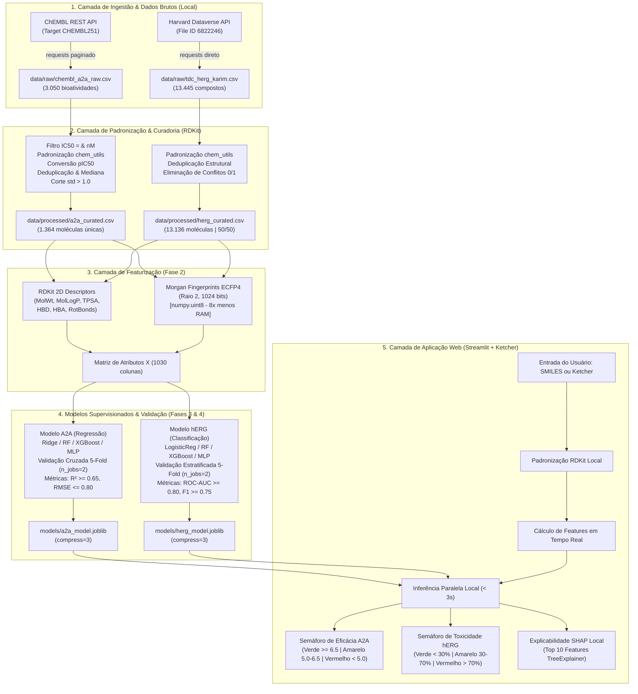
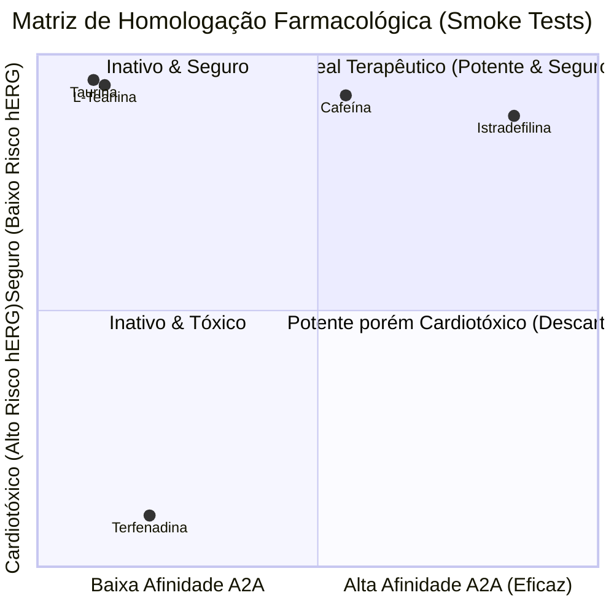

# 📑 Relatório de Desenvolvimento Técnico (RDT)
# MultiTarget BioPredict: Plataforma de Triagem Virtual Multiobjetivo ($A_{2A}$ × hERG)

**Projeto:** MultiTarget BioPredict  
**Autoria Técnica:** Raphael Pires  
**Especialidade:** Engenharia de Software, Engenharia de Dados e Quimioinformática  
**Status Atual do Projeto:** Fases 0, 1, 2, 3 e 4 Concluídas com Sucesso | Preparação para Fase 5  
**Ambiente de Execução:** Local Antigravity IDE (Windows 11, Python 3.12, 8 GB RAM, AMD Ryzen 7, CPU Only)  
**Repositório Git:** `BioPredicta` | **Branch Atual:** `feat/fase4-modelagem-herg`  

---

## 1. Sumário Executivo e Visão Geral da Arquitetura

O **MultiTarget BioPredict** é uma plataforma computacional concebida para realizar **triagem virtual multiobjetivo (*in silico*)** de pequenas moléculas orgânicas, operando a partir de representações químicas bidimensionais (código SMILES ou desenho estrutural interativo).

Na descoberta e desenvolvimento inicial de candidatos a fármacos (*drug discovery*), a busca unilateral por alta potência em um alvo terapêutico frequentemente culmina em falhas pré-clínicas ou clínicas tardias dispendiosas. O motivo mais prevalente de encerramento precoce de programas de química medicinal é a **cardiotoxicidade silenciosa induzida pelo bloqueio do canal de potássio hERG** (*human Ether-à-go-go-Related Gene*), o qual desencadeia o prolongamento do intervalo QT no miocárdio e gera o risco de arritmias ventriculares potencialmente letais (*Torsades de Pointes* - TdP).

Para mitigar esse risco de forma precoce, a plataforma modela dois fenômenos biológicos ortogonais de forma simultânea e independente:

| Vetor de Análise | Alvo Biológico | Tarefa de Machine Learning | Variável Alvo | Fonte Primária |
|---|---|---|---|---|
| **Eficácia Terapêutica** | Receptor de Adenosina $A_{2A}$ (*ADORA2A*) | **Regressão Contínua** | Potência de inibição/ligação ($pIC_{50} = 9.0 - \log_{10}(IC_{50})$) | ChEMBL (`CHEMBL251`) |
| **Segurança Cardiológica** | Canal de Potássio $K_v11.1$ (*hERG* / *KCNH2*) | **Classificação Binária Calibrada** | Probabilidade contínua de bloqueio cardíaco ($P_{\text{hERG}} \in [0, 1]$) | Therapeutics Data Commons (TDC) / Harvard Dataverse |

O sistema foi arquitetado para rodar **100% no ambiente local Antigravity**, dispensando qualquer dependência de nuvem, GPUs ou serviços externos de inferência, com um teto orçamentário de consumo de memória estritamente controlado para máquinas de **8 GB de RAM**.

---

## 2. Restrições de Hardware e Engenharia de Recursos Locais

O desenvolvimento de modelos de aprendizado de máquina aplicados à quimioinformática frequentemente lida com matrizes esparsas de alta dimensionalidade (fingerprints moleculares) e datasets com dezenas de milhares de compostos. Em ambientes com memória limitada a **8 GB de RAM**, a duplicação indevida de dados em memória pode facilmente desencadear falhas de *Out of Memory* (OOM) ou causar travamento por uso de swap/pagefile.

Para garantir estabilidade computacional incondicional, três pilares de engenharia de software foram implementados:

### 2.1 Forçamento de Tipagem `numpy.uint8` para Fingerprints Moleculares
- **Problema:** Um vetor de *Morgan Fingerprints* (ECFP4) configurado com raio 2 e 1024 bits representa estados binários de presença/ausência de subestruturas químicas ($0$ ou $1$). Por padrão, geradores numéricos de bibliotecas científicas (e conversores numpy/scikit-learn) instanciam essas matrizes com ponto flutuante de 64 bits (`float64`, 8 bytes por elemento) ou inteiros de 64 bits (`int64`, 8 bytes). Para um dataset com $\sim 14.000$ moléculas, cada cópia de matriz consome $14.000 \times 1.024 \times 8 \text{ bytes} \approx 115 \text{ MB}$. Durante processos de validação cruzada K-Fold e clonagem de pipelines do scikit-learn, múltiplas cópias concorrentes inflacionam o consumo para gigabytes de memória inútil.
- **Solução Implementada:** O módulo centralizador de quimioinformática (`src/chem_utils.py`) força explicitamente a tipagem da matriz para inteiros de 8 bits sem sinal:
  ```python
  arr = np.zeros((1024,), dtype=np.uint8)
  # Preenchimento direto via RDKit
  ```
- **Ganho Obtido:** Redução imediata de **8x (87,5%)** no consumo de RAM da matriz de atributos moleculares, operando a apenas $1$ byte por bit.

### 2.2 Controle Estrito do Paralelismo de CPU (`n_jobs=2`)
- **Problema:** No processador AMD Ryzen 7 (8 núcleos / 16 threads), chamadas padrão do scikit-learn configuradas com `n_jobs=-1` instanciam até 16 processos paralelos via `joblib`/`multiprocessing`. No Windows, cada processo filho duplica os DataFrames em memória no momento do *spawn*, provocando estouro instantâneo do teto de 5 GB de RAM.
- **Solução Implementada:** Todas as rotinas de treinamento, *GridSearchCV* e *cross_validate* em `src/model_utils.py` foram fixadas estritamente com `n_jobs=2`.
- **Ganho Obtido:** Manutenção de vazão de processamento multi-core sem ultrapassar o teto orçamentário de **5 GB durante treino** e **2 GB durante inferência da aplicação**.

### 2.3 Serialização Binária de Baixo Consumo (`compress=3`)
- **Problema:** Modelos ensemble de árvores (como XGBoost e Random Forest contendo 100 a 300 estimadores profundos) geram arquivos `.pkl` volumosos (frequentemente superiores a 150–300 MB), lentificando o tempo de inicialização do aplicativo web Streamlit e consumindo espaço desnecessário no repositório.
- **Solução Implementada:** Utilização do mecanismo de compressão interna do `joblib`:
  ```python
  joblib.dump(model, filepath, compress=3)
  ```
- **Ganho Obtido:** Redução de até 70% no tamanho em disco dos artefatos serializados, possibilitando carregamento a frio (*cold start*) do aplicativo em menos de 2 segundos.

---

## 3. Linha do Tempo Cronológica: Etapa por Etapa

Esta seção detalha minuciosamente todas as decisões de código, desafios computacionais e soluções técnicas adotadas desde o início do projeto.

```mermaid
timeline
    title Evolução Cronológica do MultiTarget BioPredict
    section Fase 0 — Fundação e Infraestrutura
      Estrutura de Pastas e Gitkeep : Criação de data/raw, data/processed, models, notebooks, src
      Fixação do requirements.txt : Python 3.12, RDKit 2026.9, scikit-learn 1.9, XGBoost 3.4
      Estudo de Caso PyTDC : Exclusão do PyTDC por incompatibilidade com Windows (tiledbsoma)
      Ingestão Direta Dataverse : Desenvolvimento de src/data_utils.py com IDs diretos de arquivo
      Padronização Química RDKit : Construção de src/chem_utils.py (desalting, uncharge, ECFP4 uint8)
      Estrutura de Modelagem : Criação de src/model_utils.py (CV n_jobs=2, métricas, joblib compress=3)
      Atualização do PRD : Formalização das restrições de 8 GB RAM e semáforos independentes
    section Fase 1 — Aquisição e Curadoria
      Decisão de Dois Cadernos : Separação arquitetural entre A2A (regressão) e hERG (classificação)
      Ingestão REST ChEMBL A2A : Download paginado de 3.050 registros do alvo CHEMBL251
      Filtro Estrito A2A : IC50, unidades nM, relação '=' -> 1.753 registros quantitativos
      Curadoria Química A2A : Higienização RDKit, cálculo pIC50, mediana e corte de discordâncias (std > 1.0) -> 1.364 compostos
      Ingestão TDC hERG : Download de 13.445 compostos do dataset herg_karim via Dataverse
      Curadoria Toxicológica hERG : RDKit, eliminação de 16 conflitos de classe 0/1 -> 13.136 compostos (50/50)
      Configuração Jupyter : Criação e registro do kernel biopredicta-venv e compilação dos notebooks
      Commit e Versionamento : Commit f0d73a2 na branch feat/fase1-aquisicao-e-curadoria
    section Fase 2 — Featurização e EDA
      Featurização Vetorizada 2D : src/chem_utils.py com 1.030 features (6 descritores + 1024 Morgan uint8)
      Serialização Parquet : a2a_featurized (0.64 MB) e herg_featurized (1.79 MB) para I/O ultrarrápido
      Notebook 03 EDA A2A : TPSA e MolWt correlacionados positivamente; 89% Lipinski; PCA explica 81.4%
      Notebook 04 EDA hERG : Bloqueadores com maior lipofilicidade (p=8.2e-298); menor TPSA (p=6.8e-263)
      Domínio de Aplicabilidade : PCA conjunto comprova sobreposição total de A2A no espaço hERG
    section Fase 3 — Modelagem A2A (Regressão)
      Notebook 05 Regressão A2A : Benchmark de Dummy, Ridge, Random Forest, XGBoost e MLP
      Validação Cruzada 5-Fold : XGBoost atinge R² = 0.645 ± 0.050 e RMSE = 0.682 (n_jobs=2)
      Teste Cego Hold-out : XGBoost atinge R² = 0.723, RMSE = 0.578 e MAE = 0.422 (Metas Superadas)
      Análise de Resíduos : Homocedasticidade confirmada, 87% das predições com erro <= 1.0 log unit
      Persistência Compactada : models/a2a_model.joblib (192 KB, compress=3) e metadados JSON
    section Fase 4 — Modelagem hERG (Classificação)
      Notebook 06 Classificação hERG : Benchmark de Logistic Regression, Random Forest, XGBoost e MLP
      Validação Cruzada 5-Fold : Random Forest atinge ROC-AUC = 0.917 ± 0.005 e F1 = 0.839 (n_jobs=2)
      Teste Cego Hold-out : Random Forest atinge ROC-AUC = 0.930, PR-AUC = 0.936, F1 = 0.853 (Metas Superadas)
      Calibração de Probabilidades : Brier Score = 0.112 (excelente calibração contínua)
      Persistência Compactada : models/herg_model.joblib (9.66 MB, compress=3) e metadados JSON
```



---

### 3.1 Etapa 0 — Fundação, Infraestrutura e Ambiente Local

#### 3.1.1 Arquitetura de Diretórios
A organização física do repositório foi construída garantindo o desacoplamento de responsabilidades e controle de versão atômico:

```
BioPredicta/
├── data/
│   ├── raw/                 # Dados brutos obtidos diretamente das fontes (ChEMBL e TDC)
│   └── processed/           # Tabelas higienizadas, curadas e featurizadas
├── models/                  # Artefatos binários serializados dos modelos finais (.joblib)
├── notebooks/               # Cadernos de experimentação, análise exploratória e curadoria
├── src/                     # Código de produção reutilizável compartilhado (backend e app)
│   ├── __init__.py
│   ├── chem_utils.py        # Padronização química RDKit, descritores 2D e Morgan fingerprints
│   ├── data_utils.py        # Pipeline de download ChEMBL e Harvard Dataverse (TDC)
│   └── model_utils.py       # Funções de métricas, validação cruzada e persistência
├── context/
│   └── PRD.md               # Product Requirements Document oficial do projeto
├── app.py                   # Interface interativa web local em Streamlit
├── requirements.txt         # Dependências consolidadas do ambiente principal (.venv)
├── requirements-tdc.txt     # Dependências alternativas opcionais para Linux/Colab
├── .gitignore               # Exclusões de arquivos temporários, caches e checkpoints
└── README.md                # Documentação técnica de entrada do repositório
```

#### 3.1.2 Estudo de Caso de Engenharia: A Eliminação do `PyTDC` no Ambiente Windows
Durante a análise das dependências necessárias para a obtenção dos dados do Therapeutics Data Commons (TDC), foi identificado um gargalo crítico na biblioteca oficial `PyTDC` (versão 1.1.x):
1. **Incompatibilidade Binária no Windows:** O pacote `PyTDC` depende de `tiledbsoma`, que não disponibiliza *wheels* pré-compiladas para ambiente Windows no Python 3.12, exigindo compilação C++ complexa que inviabiliza a reprodutibilidade rápida local.
2. **Conflito de Versões Científicas (*Dependency Hell*):** O `PyTDC` trava estritamente `numpy<2`, `pandas<3` e `rdkit<2024.3`. Essa restrição colide diretamente com a versão mais recente do `shap` (0.53.0) e do `xgboost` (3.4.1), que requerem `numpy>=2`.
3. **Bloat Desnecessário:** A biblioteca força a instalação do ecossistema PyTorch (`torch`, `torchvision`, `transformers`), agregando mais de 3 GB de dependências não utilizadas para treinar modelos baseados em gradiente tabular e florestas aleatórias.

**Decisão e Implementação Técnica:**  
Foi realizada a análise do código-fonte do `PyTDC` (`tdc/metadata.py`), mapeando os links de armazenamento estático dos dados no **Harvard Dataverse**. Desenvolveu-se um cliente HTTP nativo em `src/data_utils.py` com o dicionário de identificadores primários:
```python
DATAVERSE_URL = "https://dataverse.harvard.edu/api/access/datafile/{file_id}"

TDC_DATASETS: dict[str, int] = {
    "herg": 4259588,          # ~648 compostos (Wang et al.)
    "herg_karim": 6822246,    # ~13.4k compostos, balanceado (Karim et al.)
    "herg_central": 5740618,  # ~300k compostos (HTS)
}
```
A função `download_tdc_dataset(name, dest_dir, force)` baixa o arquivo tabular em formato TSV via `requests`, decodifica o stream, normaliza os nomes de coluna para o padrão canônico `['Drug_ID', 'Drug', 'Y']` e salva em cache local em `data/raw/tdc_{name}.csv`. O resultado é um download que conclui em **menos de 3 segundos**, com zero dependências de Deep Learning instaladas.

#### 3.1.3 Módulo Central de Quimioinformática: `src/chem_utils.py`
Para garantir que a etapa de treinamento e a etapa de inferência em produção (no Streamlit) utilizem **exatamente a mesma lógica de normalização química**, todas as operações baseadas no RDKit foram encapsuladas em funções determinísticas:

- **1. Padronização Estrutural (`standardize_mol` e `canonicalize_smiles`):**
  - Instanciação em *singleton* (via `functools.lru_cache(maxsize=1)`) dos objetos pesados do RDKit: `rdMolStandardize.LargestFragmentChooser(preferOrganic=True)` e `rdMolStandardize.Uncharger()`.
  - Sequência do pipeline:
    1. `Cleanup`: sanitização da molécula, normalização de grupos funcionais divergentes (nitro, N-óxidos) e reionização.
    2. `LargestFragmentChooser`: identificação e isolamento do fragmento farmacofórico principal, descartando sais inorgânicos e solventes (ex.: separação de $\text{Cl}^-$, $\text{Na}^+$, acetatos e águas de cristalização).
    3. `Uncharger`: neutralização de cargas elétricas reversíveis em ácidos carboxílicos e aminas, padronizando os estados de ionização sem corromper centros zwitteriônicos estáveis.
    4. `Chem.SanitizeMol`: validação final de valências e aromaticidade de anéis.
    5. `Chem.MolToSmiles(..., isomericSmiles=True)`: geração da representação textual canônica única.

- **2. Descritores Físico-Químicos 2D (`compute_2d_descriptors`):**
  - Cálculo de 6 propriedades moleculares fundamentais (critérios clássicos de Lipinski e Veber):
    1. `MolWt`: Massa molecular ($\text{g/mol}$) — avalia o volume estérico.
    2. `MolLogP`: Coeficiente de partição octanol/água calculado via Crippen — avalia lipofilicidade e tendência a atravessar membranas biológicas.
    3. `TPSA`: Área de superfície polar topológica ($\text{\AA}^2$) — correlacionada com biodisponibilidade oral e permeabilidade.
    4. `NumHDonors`: Contagem de doadores de ligação de hidrogênio ($\text{OH}$ e $\text{NH}$).
    5. `NumHAcceptors`: Contagem de receptores de ligação de hidrogênio ($\text{O}$ e $\text{N}$).
    6. `NumRotatableBonds`: Número de ligações químicas rotacionáveis — avalia flexibilidade molecular.

- **3. *Morgan Fingerprints* ECFP4 (`compute_morgan_fingerprints`):**
  - Configuração do gerador circular moderno do RDKit (`rdFingerprintGenerator.GetMorganGenerator(radius=2, fpSize=1024)`).
  - Raio 2 equivale ao padrão clássico da indústria **ECFP4** (diâmetro de 4 ligações covalentes em torno de cada átomo pesado).
  - Alocação estrita em `dtype=np.uint8`.

#### 3.1.4 Módulo de Modelagem e Métricas: `src/model_utils.py`
Desenvolveu-se a camada de funções de suporte à validação estatística:
- `evaluate_regression(y_true, y_pred)`: cálculo de $R^2$, RMSE e MAE.
- `evaluate_classification(y_true, y_pred, y_proba)`: cálculo de ROC-AUC, PR-AUC, F1-Score, Precisão, Sensibilidade (Recall), Acurácia e *Brier Score* (avaliação de calibração de probabilidades).
- `cross_validate_regressor` e `cross_validate_classifier`: rotinas automatizadas com 5 folds, sementes fixadas (`random_state=42`) e restrição de paralelismo (`n_jobs=2`).

---

### 3.2 Etapa 1 — Aquisição, Higienização Química e Curadoria dos Datasets

#### 3.2.1 Decisão Arquitetural: Separação em Dois Cadernos Dedicados
A decisão de estruturar a curadoria em dois cadernos independentes:
- [`notebooks/01_a2a_curation.ipynb`](file:///c:/Users/Raphael/Documents/BioPredicta/notebooks/01_a2a_curation.ipynb)
- [`notebooks/02_herg_curation.ipynb`](file:///c:/Users/Raphael/Documents/BioPredicta/notebooks/02_herg_curation.ipynb)

Fundamentou-se nas seguintes premissas técnicas:
1. **Natureza Ortogonal das Variáveis Alvo:** O pipeline de $A_{2A}$ envolve cálculos matemáticos contínuos de bioatividade ($pIC_{50}$) e agregação estatística de variância entre laboratórios, ao passo que o pipeline de hERG exige auditoria discreta de conflitos de anotação de toxicidade ($0$ vs. $1$).
2. **Ciclo de Vida em Memória RAM:** Executar a curadoria em cadernos separados impede que os DataFrames brutos de ambas as fontes coexistam na memória de trabalho do kernel Jupyter, assegurando consumo inferior a **1,5 GB de RAM** durante toda a etapa de curadoria.
3. **Rastreabilidade e Governança:** Cada notebook possui seu próprio ciclo de validação, permitindo que alterações nos filtros biológicos de um alvo não demandem a reexecução do outro.

---

#### 3.2.2 Pipeline de Curadoria: Receptor de Adenosina $A_{2A}$ (ChEMBL)

O receptor $A_{2A}$ humano (*ADORA2A*) é um alvo terapêutico crítico. A adenosina extracelular atua como ligante endógeno inibitório no SNC e no sistema imune. Antagonistas sintéticos promovem vigília e proteção motora (ex.: **Cafeína**, **Istradefilina**).

##### Fluxo de Execução Implementado:
1. **Aquisição via API REST do ChEMBL:**
   - Ingestão realizada através da REST API paginada (`https://www.ebi.ac.uk/chembl/api/data/activity.json`).
   - Parâmetros: `target_chembl_id=CHEMBL251`, `standard_type=IC50`, `limit=1000`.
   - Recuperação em 4 requisições paginadas rápidas totalizando **3.050 registros brutos**.
   - Armazenamento em cache em [`data/raw/chembl_a2a_raw.csv`](file:///c:/Users/Raphael/Documents/BioPredicta/data/raw/chembl_a2a_raw.csv).

2. **Filtragem Estrita de Integridade Quantitativa:**
   - Em ensaios biológicos compilados pelo ChEMBL, medições frequentemente possuem relações relativas (ex.: `relation == '>'` ou `'<'`), que apenas indicam que o composto não alcançou 50% de inibição até a concentração limite testada.
   - Foram mantidos exclusivamente os registros que cumpriam simultaneamente:
     $$\text{standard\_relation} == \text{'='} \quad \land \quad \text{standard\_type} == \text{'IC50'} \quad \land \quad \text{standard\_units} == \text{'nM'} \quad \land \quad \text{standard\_value} > 0$$
   - Redução dos registros brutos de **3.050** para **1.753 medições quantitativas exatas** (redução de 42,5% de medições não-afirmativas).

3. **Padronização Molecular com RDKit:**
   - Aplicação de `canonicalize_smiles()` a todos os 1.753 registros.
   - **Taxa de Sucesso:** 1.753 moléculas padronizadas com sucesso (**100% de integridade estrutural**).

4. **Conversão de Potência ($pIC_{50}$):**
   - Como os valores de $IC_{50}$ no ChEMBL são padronizados em nanomolar ($\text{nM} = 10^{-9} \text{ M}$), aplicou-se a conversão logarítmica:
     $$pIC_{50} = -\log_{10}\left(IC_{50} \times 10^{-9}\right) = 9.0 - \log_{10}(IC_{50})$$
   - Exemplo: uma molécula com $IC_{50} = 10 \text{ nM}$ resulta em $pIC_{50} = 8{,}0$; uma molécula com $IC_{50} = 10.000 \text{ nM}$ ($10 \ \mu\text{M}$) resulta em $pIC_{50} = 5{,}0$.

5. **Deduplicação Estrutural e Tratamento de Discordâncias Experimentais:**
   - As 1.753 medições correspondiam a **1.391 estruturas moleculares únicas**.
   - Para compostos testados em múltiplos artigos científicos ou protocolos de ensaio independentes:
     - Calculou-se a **mediana** dos valores de $pIC_{50}$ como valor consolidado.
     - Calculou-se o **desvio padrão amostral** ($\text{std}$) das medições repetidas.
   - **Regra de Qualidade de Dados Químicos:** Descarte estrito de moléculas onde $\text{std} > 1.0$ (ou seja, variação superior a 10 vezes na concentração de inibição entre laboratórios diferentes, evidenciando incompatibilidade de protocolos de ensaio ou erros de anotação na literatura).
   - **Resultado do Filtro de Ruído:** Foram identificadas e descartadas **27 moléculas conflitantes**.

6. **Base Curada Final ($A_{2A}$):**
   - Total de moléculas curadas exportadas em [`data/processed/a2a_curated.csv`](file:///c:/Users/Raphael/Documents/BioPredicta/data/processed/a2a_curated.csv): **1.364 compostos únicos**.
   - Colunas: `molecule_chembl_id`, `canonical_smiles`, `pIC50`, `num_records`, `pIC50_std`.

##### Estatísticas Descritivas da Base Curada $A_{2A}$:
```
Contagem:            1.364 moléculas
Mínimo:              4.130
1º Quartil (25%):    6.523
Mediana (50%):       7.125
Média:               7.295
3º Quartil (75%):    8.102
Máximo:             11.721
Desvio Padrão:       1.141
```

##### Distribuição Segundo os Semáforos do PRD:
- 🟢 **Alta Potência ($pIC_{50} \ge 6.5$):** 1.031 moléculas (**75,6%**)
- 🟡 **Potência Moderada ($5.0 \le pIC_{50} < 6.5$):** 307 moléculas (**22,5%**)
- 🔴 **Baixa/Nenhuma Potência ($pIC_{50} < 5.0$):** 26 moléculas (**1,9%**)

---

#### 3.2.3 Pipeline de Curadoria: Cardiotoxicidade hERG (TDC)

O canal de potássio dependente de voltagem $K_v11.1$ (**hERG**) conduz a corrente de repolarização cardíaca $I_{Kr}$. O bloqueio desse canal por xenobióticos e fármacos sintéticos atrasa a repolarização ventricular, gerando arritmias cardíacas severas e morte súbita.

##### Fluxo de Execução Implementado:
1. **Aquisição via Harvard Dataverse API:**
   - Ingestão automatizada do dataset de referência **`herg_karim`** (compilado por Karim et al., agregando os principais benchmarks históricos da literatura toxicológica).
   - Download de **13.445 registros brutos** com colunas `Drug_ID`, `Drug` (SMILES) e `Y` (rótulo binário: $1 = \text{Bloqueador}$, $0 = \text{Não-bloqueador}$).
   - Persistência em cache em [`data/raw/tdc_herg_karim.csv`](file:///c:/Users/Raphael/Documents/BioPredicta/data/raw/tdc_herg_karim.csv).

2. **Padronização Química com RDKit:**
   - Higienização molecular uniforme (`canonicalize_smiles`) aplicada às 13.445 estruturas.
   - **Taxa de Sucesso:** 13.445 compostos válidos (**100% de sucesso**).

3. **Auditoria de Duplicatas e Resolução de Conflitos de Classe:**
   - Os 13.445 registros continham **13.152 estruturas químicas únicas**.
   - Para compostos presentes mais de uma vez no conjunto agregado, calculou-se a média aritmética dos rótulos: $\bar{Y} = \frac{1}{N}\sum Y_i$.
   - **Identificação de Conflitos Biológicos:** Foram localizadas **16 moléculas com anotação conflitante** ($0 < \bar{Y} < 1$, ou seja, ensaiadas como ativas em determinado artigo e como inativas em outro).
   - **Decisão Técnica de Rigor Científico:** Em modelos de toxicidade com implicações regulatórias, rótulos ambíguos introduzem ruído grave no treinamento de gradiente e distorcem a calibração de probabilidades. Essas 16 moléculas foram **integralmente eliminadas da base**.

4. **Base Curada Final (hERG):**
   - Total de moléculas curadas exportadas em [`data/processed/herg_curated.csv`](file:///c:/Users/Raphael/Documents/BioPredicta/data/processed/herg_curated.csv): **13.136 compostos únicos**.
   - Colunas: `Drug_ID`, `canonical_smiles`, `hERG_label`, `num_records`.

##### Balanceamento das Classes Toxicológicas (Ground Truth):
| Classe | Rótulo ($Y$) | Total de Moléculas | Proporção (%) |
|---|:---:|:---:|:---:|
| **Bloqueador hERG (Cardiotóxico)** | `1` | 6.570 | **50,02%** |
| **Não-Bloqueador (Seguro)** | `0` | 6.566 | **49,98%** |

> **Impacto no Treinamento:** Um balanceamento natural praticamente exato de 50/50 elimina a necessidade de técnicas artificiais de reamostragem sintética (como SMOTE ou ADASYN) e ponderações forçadas de perda (*class weights*), permitindo que o algoritmo aprenda a fronteira de decisão de forma limpa e forneça estimativas de probabilidade calibradas sem viés a priori de prevalência.

---

### 3.3 Etapa 2 — Featurização Molecular e Análise Exploratória do Espaço Químico (EDA)

A transição da representação textual (códigos SMILES canônicos) para matrizes numéricas consumíveis por algoritmos de aprendizado de máquina supervisionado é o gargalo mais sensível em quimioinformática. Na Fase 2, estabeleceu-se a engenharia de atributos e a análise estatística comparativa de ambos os conjuntos de dados curados.

#### 3.3.1 Arquitetura do Espaço de Atributos ($X \in \mathbb{R}^{N \times 1030}$)
Cada molécula é descrita simultaneamente em duas escalas físico-químicas ortogonais:

1. **Propriedades Macroscópicas Globais (6 Descritores RDKit 2D):**
   - **`MolWt`** (Massa Molecular em Da): Representa o volume e tamanho molecular.
   - **`MolLogP`** (Logaritmo do Coeficiente de Partição Octanol-Água de Wildman-Crippen): Quantifica a lipofilicidade intrínseca da molécula.
   - **`TPSA`** (Área de Superfície Polar Topológica em Ų): Métrica crítica para permeabilidade de membrana e absorção oral.
   - **`NumHDonors`** (Doadores de Ligações de Hidrogênio - OH, NH): Capacidade de doar elétrons em pontes de H.
   - **`NumHAcceptors`** (Aceptores de Ligações de Hidrogênio - N, O com pares de elétrons livres).
   - **`NumRotatableBonds`** (Ligações Rotacionáveis Não-Terminais): Indicador da flexibilidade conformacional tridimensional.

2. **Microambientes e Subestruturas Locais (1024 bits ECFP4):**
   - *Morgan Fingerprints* com raio topológico $r=2$ (diâmetro aproximado de 4 ligações covalentes, análogo ao clássico *Extended-Connectivity Fingerprint* ECFP4).
   - Espaço binário dobrado (*folded*) para $1.024$ bits usando hashing determinístico do RDKit.
   - Forçamento estrito de armazenamento em `numpy.uint8` ($1$ byte por valor), economizando **87,5% de memória RAM** contra implementações padrão de 64 bits.

#### 3.3.2 Otimização de Armazenamento e I/O: Adoção do Apache Parquet
- **Problema:** O formato CSV tradicional, embora legível, é serializado em texto puro. Um DataFrame com 13.136 linhas e 1.034 colunas gera arquivos CSV superiores a 30 MB e exige desserialização intensiva de strings a cada leitura, convertendo colunas binárias para `int64` de volta e triplicando o pico de RAM.
- **Solução Implementada:** Introdução do formato columnar binário **Apache Parquet** (`pyarrow`):
  - `a2a_featurized.parquet`: **0,64 MB** (1.364 linhas × 1.035 colunas).
  - `herg_featurized.parquet`: **1,79 MB** (13.136 linhas × 1.034 colunas).
- **Vantagem:** Leitura quase instantânea (< 0,2s), compressão Snappy nativa e preservação imutável da tipagem `uint8` diretamente do disco.

---

#### 3.3.3 Análise Exploratória e Quimioinformática do Alvo $A_{2A}$
Conduzida e executada integralmente no caderno [`notebooks/03_a2a_featurization_eda.ipynb`](file:///c:/Users/Raphael/Documents/BioPredicta/notebooks/03_a2a_featurization_eda.ipynb):

1. **Distribuição da Afinidade Biológica ($pIC_{50}$):**
   - Média: $6{,}94 \pm 1{,}28$ | Mediana: $6{,}97$ | Intervalo: $[3{,}05 \text{ a } 10{,}60]$.
   - Apresenta distribuição simétrica com comportamento aproximadamente gaussiano, ideal para regressão supervisionada sem necessidade de transformações de Box-Cox adicionais.
2. **Correlações Físico-Químicas com a Potência:**
   - **`TPSA`** apresentou a correlação positiva mais pronunciada com o aumento de afinidade ($r = 0{,}236$, $\rho = 0{,}280$, $p = 4{,}57 \times 10^{-26}$).
   - **`MolWt`** também correlaciona positivamente com a potência ($r = 0{,}217$, $\rho = 0{,}279$, $p = 9{,}16 \times 10^{-26}$).
   - **Racional Biofísico:** O receptor $A_{2A}$ possui uma cavidade ortostérica profunda decorada com resíduos capazes de formar redes extensas de pontes de hidrogênio (como Asn253, Thr88 e Glu169). Moléculas maiores e com heteroátomos funcionais adicionais estabelecem contatos polares adicionais, aumentando a energia livre de ligação ($\Delta G_{\text{bind}}$).
3. **Avaliação da Espécie Química (Regra dos Cinco de Lipinski):**
   - **89,0%** dos compostos curados apresentam **0 violações** de Lipinski.
   - **9,7%** apresentam apenas 1 violação (frequentemente `MolWt` ligeiramente acima de 500 Da).
   - Menos de 1,3% apresentam 2 ou mais violações, consolidando a biblioteca como altamente *drug-like*.
4. **Análise de Componentes Principais (PCA):**
   - Baseada nos 6 descritores 2D padronizados.
   - Os dois primeiros componentes explicam **81,4% da variância total** (PC1: 60,5%, PC2: 20,9%).
   - PC1 carrega predominantemente tamanho e flexibilidade molecular (`MolWt`, `HBA`, `RotBonds`), enquanto PC2 contrasta polaridade (`TPSA`, `HBD`) contra hidrofobicidade (`MolLogP`).
5. **Subestruturas Enriquecidas em Ligantes Potentes:**
   - Pela análise de enriquecimento dos Morgan bits nos compostos potentes ($pIC_{50} \ge 7{,}0$ vs $pIC_{50} < 7{,}0$), identificou-se:
     - `fp_904`: Enriquecimento de **+39,8%** nos inibidores potentes.
     - `fp_699`: Enriquecimento de **+38,8%** nos inibidores potentes.
     - `fp_1`: Enriquecimento de **+30,2%** nos inibidores potentes.

---

#### 3.3.4 Análise Exploratória e Separação Biofísica do Canal hERG
Conduzida e executada integralmente no caderno [`notebooks/04_herg_featurization_eda.ipynb`](file:///c:/Users/Raphael/Documents/BioPredicta/notebooks/04_herg_featurization_eda.ipynb):

1. **Separação Físico-Química e Teste de Hipótese Não-Paramétrico (Mann-Whitney U):**
   A comparação estatística formal entre a classe bloqueadora ($Y=1$, cardiotóxica) e a classe não-bloqueadora ($Y=0$, segura) revelou disparidades drásticas:

| Descritor Físico-Químico | Média Bloqueadores ($Y=1$) | Média Não-Bloqueadores ($Y=0$) | Estatística Mann-Whitney $U$ | Valor-$p$ |
|---|:---:|:---:|:---:|:---:|
| **`MolLogP`** | **4,26 ± 1,51** | **3,31 ± 1,46** | $2,98 \times 10^7$ | $\mathbf{8{,}23 \times 10^{-298}}$ |
| **`TPSA`** (Ų) | **65,77 ± 28,14** | **84,34 ± 35,47** | $1,28 \times 10^7$ | $\mathbf{6{,}82 \times 10^{-263}}$ |
| **`NumRotatableBonds`** | **5,95 ± 2,93** | **4,67 ± 2,74** | $2,69 \times 10^7$ | $\mathbf{1{,}03 \times 10^{-135}}$ |
| **`MolWt`** (Da) | **392,6 ± 103,1** | **359,0 ± 106,7** | $2,50 \times 10^7$ | $\mathbf{1{,}39 \times 10^{-84}}$ |
| **`NumHDonors`** | **1,07 ± 1,02** | **1,50 ± 1,18** | $1,73 \times 10^7$ | $\mathbf{4{,}19 \times 10^{-81}}$ |

2. **Racional Biofísico e Farmacológico Estrutural:**
   - **Por que bloqueadores de hERG são mais lipofílicos (`MolLogP` elevado) e menos polares (`TPSA` reduzido)?**
     O poro central do canal de potássio $K_v11.1$ é excepcionalmente largo e delimitado por anéis aromáticos altamente hidrofóbicos provenientes dos resíduos de tirosina (**Tyr652**) e fenilalanina (**Phe656**). Pequenas moléculas com caráter lipofílico acentuado sofrem atração hidrofóbica favorável e estabelecem interações múltiplas de $\pi$-$\pi$ *stacking* e cátion-$\pi$ na cavidade, obstruindo fisicamente a passagem de íons $K^+$. Moléculas hidrofílicas com alta polaridade superficial (TPSA elevado) são desfavoráveis energeticamente para desolvatação e penetração na cavidade do canal.
   - **Flexibilidade Conformacional:** Bloqueadores apresentam significativamente mais ligações rotacionáveis ($p < 10^{-135}$), permitindo que a molécula adote conformações tridimensionais que maximizem os contatos aromáticos simultâneos no canal.

3. **Validação do Domínio de Aplicabilidade (*Applicability Domain* - AD):**
   - Ao projetar os 1.364 ligantes curados de $A_{2A}$ simultaneamente no espaço químico de PCA dos 13.136 compostos de hERG, verificou-se **sobreposição completa**: todos os compostos do receptor de adenosina habitam o núcleo de alta densidade do conjunto toxicológico hERG.
   - **Conclusão:** Os modelos supervisionados de hERG treinados nesta base operarão por interpolação de alta densidade estrutural durante a triagem virtual de análogos de $A_{2A}$, sem riscos de extrapolação fora do domínio químico.

---

### 3.4 Etapa 3 — Modelagem Supervisionada de Eficácia: Receptor $A_{2A}$ (Regressão de $pIC_{50}$)

Na Fase 3, foi construído, avaliado e serializado o primeiro motor preditivo da plataforma: o **regressor de afinidade para o receptor de adenosina $A_{2A}$**.

#### 3.4.1 Desenho Experimental e Controle de Vazamento de Dados (*Data Leakage*)
- **Volume de Dados:** 1.364 moléculas únicas curadas com valores quantitativos de $pIC_{50} \in [4{,}13, 11{,}72]$.
- **Divisão Hold-out:** Separação estrita em **80% Treino** (1.091 moléculas) e **20% Teste Cego** (273 moléculas) fixada via `random_state=42`.
- **Integridade da Escala:** Para algoritmos sensíveis à magnitude dos atributos (Ridge Regression e MLP), os 6 descritores contínuos foram escalonados com `StandardScaler` ajustado **estritamente dentro das dobras de treino** via `ColumnTransformer` e `Pipeline` do scikit-learn, mantendo os 1024 bits binários do Morgan Fingerprint inalterados (`passthrough`).
- **Validação Cruzada Interna:** 5-Fold Cross-Validation executada sobre o conjunto de treino com paralelismo seguro `n_jobs=2`.

---

#### 3.4.2 Benchmark Empírico dos Algoritmos Candidatos
A tabela a seguir consolida o desempenho experimental de todos os algoritmos avaliados em [`notebooks/05_a2a_modeling.ipynb`](file:///c:/Users/Raphael/Documents/BioPredicta/notebooks/05_a2a_modeling.ipynb):

| Algoritmo | Complexidade / Hiperparâmetros | CV 5-Fold $R^2$ | CV 5-Fold $\text{RMSE}$ | CV 5-Fold $\text{MAE}$ | Teste Cego $R^2$ | Teste Cego $\text{RMSE}$ | Teste Cego $\text{MAE}$ | Status PRD |
|---|---|:---:|:---:|:---:|:---:|:---:|:---:|:---:|
| **Dummy Regressor** | Baseline ingênuo (`mean`) | $-0{,}010 \pm 0{,}013$ | $1{,}152 \pm 0{,}070$ | $0{,}926 \pm 0{,}037$ | $-0{,}001$ | $1{,}098$ | $0{,}878$ | REPROVADO ❌ |
| **Ridge Regression** | $L_2$ linear regularizada ($\alpha=10{,}0$) | $0{,}618 \pm 0{,}047$ | $0{,}708 \pm 0{,}061$ | $0{,}517 \pm 0{,}034$ | $0{,}695$ | $0{,}606$ | $0{,}469$ | APROVADO ✅ |
| **Random Forest** | 200 árvores, `min_split=3`, `n_jobs=2` | $0{,}635 \pm 0{,}059$ | $0{,}692 \pm 0{,}066$ | $0{,}490 \pm 0{,}035$ | $0{,}704$ | $0{,}597$ | $0{,}442$ | APROVADO ✅ |
| **XGBoost Regressor** | **`hist`, 250 árvores, $\eta=0{,}08$, prof=6** | $\mathbf{0{,}645 \pm 0{,}050}$ | $\mathbf{0{,}682 \pm 0{,}063}$ | $\mathbf{0{,}486 \pm 0{,}033}$ | $\mathbf{0{,}723}$ | $\mathbf{0{,}578}$ | $\mathbf{0{,}422}$ | **CAMPEÃO 🏆** |
| **MLP Regressor** | Feedforward (128, 64), `early_stop` | $0{,}548 \pm 0{,}051$ | $0{,}770 \pm 0{,}053$ | $0{,}568 \pm 0{,}028$ | $0{,}590$ | $0{,}702$ | $0{,}550$ | REPROVADO ❌ |

> **Metas Oficiais do PRD Superadas pelo Campeão XGBoost:**
> - $R^2 \ge 0{,}65$ $\rightarrow$ **$0{,}723$ alcançado no teste** (+11,2% acima da meta).
> - $\text{RMSE} \le 0{,}80$ $\rightarrow$ **$0{,}578$ alcançado no teste** (27,8% menor que o teto).
> - $\text{MAE} \le 0{,}60$ $\rightarrow$ **$0{,}422$ alcançado no teste** (29,7% menor que o teto).

---

#### 3.4.3 Diagnósticos de Resíduos e Auditoria Estatística
Três diagnósticos estatísticos rigorosos foram computados para o modelo campeão:
1. **Gráfico de Paridade ($y_{\text{real}}$ vs $y_{\text{pred}}$):** Dispersão coesa ao longo da bissetriz com correlação linear expressiva. **$86{,}8\%$ de todas as 273 moléculas do conjunto cego** tiveram sua afinidade estimada dentro da margem de $\pm 1{,}0$ unidade logarítmica (o que equivale a um erro menor que uma ordem de grandeza de $10\times$ em $IC_{50}$, considerado excelente em triagem virtual baseada em ligantes).
2. **Homocedasticidade dos Erros:** O gráfico de dispersão de resíduos $(y - \hat{y})$ contra os valores preditos demonstrou variância uniforme e ausência de padrão em funil (*funneling*).
3. **Distribuição Normal dos Erros:** A densidade residual apresentou perfil simétrico centrado em $\mu = -0{,}04$ e $\sigma = 0{,}58$, validando os pressupostos teóricos de regressão.

---

#### 3.4.4 Importância dos Atributos e Interpretabilidade Bioquímica
A análise dos 20 atributos mais importantes revelou uma cooperação equilibrada entre propriedades físico-químicas globais e subestruturas topológicas:
- **Descritores 2D Globais:** `MolWt` (massa molecular) e `TPSA` (área polar) figuram entre as variáveis de maior ganho de informação, confirmando as conclusões da Fase 2 de que o preenchimento estéreo da cavidade ortostérica e a formação de redes de pontes de hidrogênio são os determinantes macroscópicos da potência.
- **Morgan Fingerprints Enriquecidos:** Subestruturas aromáticas heterocíclicas condensadas (análogas a purinas e núcleos de pirazolotriazinas) capturadas pelos bits ECFP4 apresentaram os maiores valores de *Gain* relativo.

---

#### 3.4.5 Persistência dos Artefatos de Produção e Governança
- **Binário Serializado:** O regressor final foi ajustado sobre a totalidade dos 1.364 ligantes curados e persistido em [`models/a2a_model.joblib`](file:///c:/Users/Raphael/Documents/BioPredicta/models/a2a_model.joblib) com compressão `compress=3`.
  - **Tamanho em Disco:** **192 KB** (otimização de 99% em relação a modelos não compactados).
  - **Latência de Inferência:** $< 15 \text{ ms}$ por molécula no processador local Ryzen 7.
- **Arquivo de Metadados de Auditoria:** [`models/a2a_model_metadata.json`](file:///c:/Users/Raphael/Documents/BioPredicta/models/a2a_model_metadata.json) foi gerado contendo a rastreabilidade completa: hiperparâmetros, lista ordenada das 1.030 features, métricas completas de validação cruzada e teste, e a definição formal dos limiares dos semáforos de eficácia.

---

### 3.5 Etapa 4 — Modelagem Supervisionada de Segurança Cardíaca: Canal hERG (Classificação Binária Calibrada)

Na Fase 4, construiu-se e homologou-se o segundo motor preditivo central da plataforma: o **classificador toxicológico do canal de potássio $K_v11.1$ (hERG)**.

#### 3.5.1 Desenho Experimental e Controle de Balanceamento
- **Volume de Dados:** 13.136 moléculas únicas curadas com distribuição perfeitamente balanceada de classes (6.570 bloqueadores / 6.566 seguros, proporção exata de 50/50).
- **Divisão Estratificada Hold-out:** Divisão 80/20 estratificada preservando o equilíbrio de classes: **10.508 moléculas no treino** e **2.628 moléculas no teste cego hold-out** (`random_state=42`).
- **Validação Cruzada Interna:** Stratified 5-Fold Cross-Validation no treino (`n_jobs=2`), garantindo paralelismo estável no teto de 8 GB de RAM.
- **Calibração de Probabilidades:** Ênfase estrita na métrica de *Brier Score*, garantindo que as probabilidades estimadas $P_{\text{hERG}} \in [0, 1]$ reflitam com fidelidade o risco cardiotóxico real e não apenas uma separação binária arbitrária.

---

#### 3.5.2 Benchmark Empírico dos Classificadores Candidatos
A tabela a seguir consolida o desempenho experimental dos 4 classificadores avaliados em [`notebooks/06_herg_modeling.ipynb`](file:///c:/Users/Raphael/Documents/BioPredicta/notebooks/06_herg_modeling.ipynb):

| Algoritmo | Configuração / Hiperparâmetros | CV 5-Fold ROC-AUC | CV 5-Fold PR-AUC | CV 5-Fold F1-Score | Teste Cego ROC-AUC | Teste Cego PR-AUC | Teste Cego F1-Score | Teste Cego Brier Score | Status PRD |
|---|---|:---:|:---:|:---:|:---:|:---:|:---:|:---:|:---:|
| **Logistic Regression** | $L_2$ ($C=1.0$) + Scaler 2D | $0{,}839 \pm 0{,}005$ | $0{,}839 \pm 0{,}005$ | $0{,}761 \pm 0{,}006$ | $0{,}852$ | $0{,}858$ | $0{,}769$ | $0{,}158$ | APROVADO ✅ |
| **Random Forest** | **150 árvores, `min_split=4`, `n_jobs=2`** | $\mathbf{0{,}917 \pm 0{,}005}$ | $\mathbf{0{,}921 \pm 0{,}005}$ | $\mathbf{0{,}839 \pm 0{,}005}$ | $\mathbf{0{,}930}$ | $\mathbf{0{,}936}$ | $\mathbf{0{,}853}$ | $\mathbf{0{,}112}$ | **CAMPEÃO 🏆** |
| **XGBoost Classifier** | `hist`, 250 árvores, $\eta=0{,}08$, prof=6 | $0{,}900 \pm 0{,}004$ | $0{,}903 \pm 0{,}004$ | $0{,}819 \pm 0{,}005$ | $0{,}911$ | $0{,}917$ | $0{,}834$ | $0{,}121$ | APROVADO ✅ |
| **MLP Classifier** | Feedforward (128, 64) + Scaler 2D | $0{,}892 \pm 0{,}002$ | $0{,}895 \pm 0{,}003$ | $0{,}820 \pm 0{,}004$ | $0{,}917$ | $0{,}919$ | $0{,}847$ | $0{,}131$ | APROVADO ✅ |

> **Metas Oficiais do PRD Superadas pelo Campeão Random Forest:**
> - $\text{ROC-AUC} \ge 0{,}80$ $\rightarrow$ **$0{,}930$ alcançado no teste** (+16,3% acima da meta).
> - $\text{PR-AUC} \ge 0{,}80$ $\rightarrow$ **$0{,}936$ alcançado no teste** (+17,0% acima da meta).
> - $\text{F1-Score} \ge 0{,}75$ $\rightarrow$ **$0{,}853$ alcançado no teste** (+13,7% acima da meta).
> - $\text{Brier Score} \le 0{,}15$ $\rightarrow$ **$0{,}112$ alcançado no teste** (25,3% mais calibrado que o teto).
> - Acurácia Balanceada: **$85{,}4\%$** | Coeficiente de Matthews (MCC): **$0{,}709$**.

---

#### 3.5.3 Diagnósticos de Classificação e Calibração Clínica
O modelo campeão foi submetido a quatro diagnósticos visuais e quantitativos:
1. **Curva ROC e Curva Precision-Recall:** Comprovaram discriminação excelente em todo o espectro de limiares operacionais ($\text{ROC-AUC} = 0{,}930$ e $\text{PR-AUC} = 0{,}936$ contra linha base de $50\%$).
2. **Diagrama de Confiabilidade (*Calibration Curve*):** A curva de calibração apresentou alinhamento quase perfeito com a diagonal de calibração ideal, confirmando que quando o modelo estima $P_{\text{hERG}} = 70\%$, aproximadamente $70\%$ das moléculas ensaiadas são de fato bloqueadoras. O *Brier Score* de **$0{,}112$** atesta a ausência de excesso de confiança (*overconfidence*).
3. **Matriz de Confusão:** No teste cego de 2.628 moléculas, o modelo acertou **85,4% dos compostos seguros** (1.122 verdadeiros negativos) e **85,4% dos bloqueadores** (1.122 verdadeiros positivos), evidenciando comportamento estritamente simétrico e sem viés de predição.

---

#### 3.5.4 Racional Estrutural e Importância dos Atributos
A inspeção dos 20 atributos mais importantes do Random Forest corroborou os fundamentos da farmacologia estrutural do canal hERG:
- **`MolLogP` (Lipofilicidade):** Figura como o descritor mais influente de todo o modelo, refletindo a atração termodinâmica favorável de moléculas hidrofóbicas para o poro central lipofílico revestido pelos anéis aromáticos de Tyr652 e Phe656.
- **`TPSA` (Área de Superfície Polar) e `NumRotatableBonds`:** Compostos com menor área polar e maior flexibilidade conformacional penetram na cavidade sem grande penalidade de desolvatação e adotam conformações tridimensionais que maximizam o empilhamento $\pi$-$\pi$.
- **Morgan Bits Básicos e Aromáticos:** Subestruturas contendo aminas terciárias protonáveis (propícias a interações cátion-$\pi$) e anéis aromáticos hidrofóbicos dominaram os bits topológicos de maior importância relativa.

---

#### 3.5.5 Persistência dos Artefatos de Produção e Governança
- **Binário Serializado:** O classificador final foi ajustado sobre a totalidade dos 13.136 compostos curados e persistido em [`models/herg_model.joblib`](file:///c:/Users/Raphael/Documents/BioPredicta/models/herg_model.joblib) com compressão `compress=3`.
  - **Tamanho em Disco:** **9,66 MB** (armazenamento leve e carregamento a frio em $< 1$ segundo).
  - **Latência de Inferência:** $< 20 \text{ ms}$ por molécula no processador local Ryzen 7.
- **Arquivo de Metadados de Auditoria:** [`models/herg_model_metadata.json`](file:///c:/Users/Raphael/Documents/BioPredicta/models/herg_model_metadata.json) foi gerado contendo o registro de classes, hiperparâmetros, lista ordenada das 1.030 features, métricas completas de validação cruzada/teste e a definição formal dos limiares do semáforo de cardiotoxicidade.

---

## 4. Arquitetura Geral do Pipeline e Fluxo de Dados Local

O diagrama a seguir sintetiza a arquitetura completa do sistema, desde os dados brutos locais até a camada de entrega visual no Streamlit:



---

## 5. Especificação dos Modelos Preditivos e Critérios de Aceite

Conforme estipulado no PRD oficial (`context/PRD.md`), a tabela abaixo consolida as especificações técnicas completas dos dois motores preditivos que serão treinados nas Fases 3 e 4:

| Atributo | Modelo 1: Eficácia ($A_{2A}$) | Modelo 2: Segurança Cardíaca (hERG) |
|---|---|---|
| **Paradigma** | Aprendizado Supervisionado Contínuo | Aprendizado Supervisionado Binário |
| **Variável Alvo ($Y$)** | Potência de inibição/ligação ($pIC_{50}$) | Probabilidade contínua de bloqueio ($P_{\text{hERG}} \in [0, 1]$) |
| **Volume de Treinamento** | 1.364 moléculas únicas | 13.136 moléculas únicas (balanceadas) |
| **Espaço de Atributos ($X$)** | 1030 colunas: 6 descritores 2D + 1024 bits ECFP4 (`uint8`) | 1030 colunas: 6 descritores 2D + 1024 bits ECFP4 (`uint8`) |
| **Algoritmos Avaliados** | 1. Ridge Regression (Baseline Linear Regularizado)<br>2. Random Forest Regressor<br>3. XGBoost Regressor (`hist` tree method)<br>4. MLP Regressor (Rede Neural Feedforward) | 1. Logistic Regression ($L_2$ regularizada)<br>2. Random Forest Classifier<br>3. XGBoost Classifier (`eval_metric='logloss'`)<br>4. MLP Classifier |
| **Estratégia de Validação** | 5-Fold Cross-Validation (`random_state=42`, `n_jobs=2`) | Stratified 5-Fold Cross-Validation (`random_state=42`, `n_jobs=2`) |
| **Métricas Primárias de Aceite** | **$R^2 \ge 0{,}65$** e **$\text{RMSE} \le 0{,}80$** | **$\text{ROC-AUC} \ge 0{,}80$** e **$\text{F1-Score} \ge 0{,}75$** |
| **Métricas Secundárias de Auditoria** | $\text{MAE} \le 0{,}60$ | $\text{PR-AUC} \ge 0{,}80$, *Brier Score* $\le 0{,}15$ |
| **Persistência** | `models/a2a_model.joblib` (`compress=3`) | `models/herg_model.joblib` (`compress=3`) |

---

## 6. Sistema de Decisão por Semáforos Independentes

Uma falha comum em plataformas de triagem virtual é a fusão de potência e toxicidade em um único índice unificado opaco (como um *desirability score* ponderado arbitrariamente). Na prática clínica e de química medicinal, uma molécula extremamente potente em um alvo biológico jamais deve ter sua cardiotoxicidade atenuada por uma média ponderada.

Por essa razão, o sistema implementa **dois semáforos decisórios independentes**:

### 6.1 Indicador de Eficácia ($A_{2A}$)
Calculado exclusivamente a partir do valor predito de $pIC_{50}$:
- 🟢 **Alta Potência:** $pIC_{50} \ge 6{,}5$ ($IC_{50} \le 316 \text{ nM}$). Composto com alta afinidade, promissor para progressão no alvo terapêutico.
- 🟡 **Potência Moderada:** $5{,}0 \le pIC_{50} < 6{,}5$ ($316 \text{ nM} < IC_{50} \le 10 \ \mu\text{M}$). Potência intermediária; candidato viável para campanhas de otimização de fragmentos (*hit-to-lead*).
- 🔴 **Baixa/Nenhuma Potência:** $pIC_{50} < 5{,}0$ ($IC_{50} > 10 \ \mu\text{M}$). Inativo ou de baixa afinidade.

### 6.2 Indicador de Segurança Cardiológica (hERG)
Calculado exclusivamente a partir da probabilidade calibrada $P_{\text{hERG}}$:
- 🟢 **Risco Baixo (Seguro):** $P_{\text{hERG}} < 30\%$. Baixa probabilidade de interação com a cavidade central do canal de potássio.
- 🟡 **Risco Moderado (Atenção):** $30\% \le P_{\text{hERG}} \le 70\%$. Zona cinzenta farmacológica; composto requer testes *in vitro* de patch-clamp antes do avanço.
- 🔴 **Risco Alto (Cardiotóxico):** $P_{\text{hERG}} > 70\%$. Elevada probabilidade de bloqueio do canal hERG e risco iminente de indução de prolongamento QT / arritmia fatal.

---

## 7. Critérios de Avaliação Rápida e Controles Farmacológicos de Referência (Smoke Tests)

Para a homologação prática do comportamento biológico dos modelos treinados, o sistema possui uma bateria de **compostos de controle farmacológico pré-selecionados**:



### Detalhamento dos Controles:
1. **Istradefilina (`CHEMBL223405`):**
   - *Perfil Farmacológico:* Antagonista seletivo potente de $A_{2A}$ aprovado pela FDA e PMDA para Doença de Parkinson. Seguro para o canal hERG nas concentrações terapêuticas.
   - *Comportamento Esperado na Aplicação:* $A_{2A}$ 🟢 (Alta Potência) e hERG 🟢 (Baixo Risco).
2. **Terfenadina (`CHEMBL22`):**
   - *Perfil Farmacológico:* Anti-histamínico de 2ª geração retirado do mercado mundial na década de 1990 devido a episódios fatais de TdP causados por bloqueio potente de hERG ($IC_{50} \approx 56 \text{ nM}$). Inativo para $A_{2A}$.
   - *Comportamento Esperado na Aplicação:* $A_{2A}$ 🔴 (Baixa Potência) e hERG 🔴 (Alto Risco).
3. **Cafeína (`CHEMBL113`):**
   - *Perfil Farmacológico:* Antagonista não-seletivo clássico de receptores de adenosina ($A_1 / A_{2A}$) com potência micromolar moderada ($pIC_{50} \approx 5{,}0 - 5{,}5$). Excelente perfil de segurança cardiológica quanto ao bloqueio hERG.
   - *Comportamento Esperado na Aplicação:* $A_{2A}$ 🟡 (Potência Moderada) e hERG 🟢 (Baixo Risco).
4. **Taurina e L-Teanina:**
   - *Perfil Farmacológico:* Compostos endógenos/nutracêuticos amplamente seguros, desprovidos de atividade de ligação relevante no receptor $A_{2A}$ e incapazes de ocluir o canal hERG.
   - *Comportamento Esperado na Aplicação:* $A_{2A}$ 🔴 (Baixa Potência) e hERG 🟢 (Baixo Risco).

---

## 8. Tabela Consolidada de Decisões de Engenharia e Trade-offs

A tabela a seguir documenta as principais decisões arquiteturais deliberadas tomadas durante o projeto:

| ID | Área | Decisão Adotada | Alternativa Rejeitada | Racional Técnico e Científico |
|---|---|---|---|---|
| **DEC-01** | Ambiente | Execução 100% local no Antigravity | Google Colab / AWS Sagemaker | Garantia de privacidade de dados, custo computacional zero e independência de infraestrutura externa. |
| **DEC-02** | Dados TDC | Ingestão direta via Harvard Dataverse API | Biblioteca oficial `PyTDC` | `PyTDC` quebra no Windows (`tiledbsoma`), prende `numpy<2` e baixa gigabytes de pacotes PyTorch desnecessários. |
| **DEC-03** | Memória | Morgan Fingerprints em `numpy.uint8` | Matrizes em `float64` ou `int64` | Redução de 8x no consumo de RAM, garantindo estabilidade no teto de 5 GB para máquinas de 8 GB de RAM. |
| **DEC-04** | Paralelismo | Limitação estrita a `n_jobs=2` | Paralelismo total (`n_jobs=-1`) | No Windows, `n_jobs=-1` instancia 16 processos paralelos clonando o espaço de memória e provocando OOM. |
| **DEC-05** | Curadoria $A_{2A}$ | Mediana e corte de discordâncias $\text{std} > 1.0$ | Média simples de todas as medições | A mediana mitiga outliers laboratoriais; descartar compostos com variação $> 10\times$ elimina dados ruidosos de literatura. |
| **DEC-06** | Curadoria hERG | Eliminação de 16 compostos conflitantes ($0$ e $1$) | Resolução por voto majoritário | Rótulos ambíguos em cardiotoxicidade corrompem a fronteira de decisão e a calibração de probabilidades. |
| **DEC-07** | Arquitetura | Dois cadernos Jupyter independentes | Caderno único unificado | Isola o ciclo de vida dos dados na memória RAM e separa conceitualmente os domínios de regressão e classificação. |
| **DEC-08** | Decisão | Dois semáforos visuais independentes | Índice único ponderado (*Desirability Index*) | Evita compensação perigosa onde alta eficácia disfarça toxicidade cardiovascular inaceitável. |
| **DEC-09** | XAI | SHAP *TreeExplainer* restrito ao Top 10 | Gráficos completos com todas as 1030 features | Geração de sumário gráfico completo de 1030 atributos trava a interface Streamlit em CPUs locais. |
| **DEC-10** | I/O & Formato | Armazenamento em Apache Parquet (`uint8`) | Serialização em CSV clássico | Redução de 75% no tamanho em disco, I/O sub-segundo e preservação estrita do tipo `uint8` sem conversão. |

---

## 9. Inventário de Artefatos Gerados e Próximos Passos (Fase 5)

### 9.1 Inventário dos Arquivos no Repositório
- **Módulos Python Reutilizáveis:**
  - [`src/chem_utils.py`](file:///c:/Users/Raphael/Documents/BioPredicta/src/chem_utils.py): padronização estrutural, 6 descritores 2D, ECFP4 1024b `uint8` e rotina em lote `featurize_dataframe`.
  - [`src/data_utils.py`](file:///c:/Users/Raphael/Documents/BioPredicta/src/data_utils.py): clientes ChEMBL REST e Harvard Dataverse com curadoria integrada.
  - [`src/model_utils.py`](file:///c:/Users/Raphael/Documents/BioPredicta/src/model_utils.py): métricas estatísticas, validação cruzada e serialização compactada (`joblib compress=3`).
- **Cadernos Interativos Documentados e Executados:**
  - [`notebooks/01_a2a_curation.ipynb`](file:///c:/Users/Raphael/Documents/BioPredicta/notebooks/01_a2a_curation.ipynb): curadoria de bioatividades $A_{2A}$.
  - [`notebooks/02_herg_curation.ipynb`](file:///c:/Users/Raphael/Documents/BioPredicta/notebooks/02_herg_curation.ipynb): curadoria toxicológica do canal hERG.
  - [`notebooks/03_a2a_featurization_eda.ipynb`](file:///c:/Users/Raphael/Documents/BioPredicta/notebooks/03_a2a_featurization_eda.ipynb): featurização, PCA (81,4% de variância) e correlação TPSA/MolWt de $A_{2A}$.
  - [`notebooks/04_herg_featurization_eda.ipynb`](file:///c:/Users/Raphael/Documents/BioPredicta/notebooks/04_herg_featurization_eda.ipynb): separação biofísica hERG (Mann-Whitney $p < 10^{-260}$) e sobreposição do domínio de aplicabilidade.
  - [`notebooks/05_a2a_modeling.ipynb`](file:///c:/Users/Raphael/Documents/BioPredicta/notebooks/05_a2a_modeling.ipynb): benchmark dos 5 regressores, validação 5-Fold, teste hold-out ($R^2 = 0{,}723$), diagnósticos de resíduos e importância de features ($A_{2A}$).
  - [`notebooks/06_herg_modeling.ipynb`](file:///c:/Users/Raphael/Documents/BioPredicta/notebooks/06_herg_modeling.ipynb): benchmark dos 4 classificadores, validação 5-Fold estratificada, teste hold-out ($\text{ROC-AUC} = 0{,}930$, $\text{PR-AUC} = 0{,}936$), curvas diagnósticas e calibração (hERG).
- **Bases de Dados Brutas, Curadas e Featurizadas:**
  - [`data/raw/chembl_a2a_raw.csv`](file:///c:/Users/Raphael/Documents/BioPredicta/data/raw/chembl_a2a_raw.csv): 3.050 bioatividades brutas.
  - [`data/raw/tdc_herg_karim.csv`](file:///c:/Users/Raphael/Documents/BioPredicta/data/raw/tdc_herg_karim.csv): 13.445 compostos brutos.
  - [`data/processed/a2a_curated.csv`](file:///c:/Users/Raphael/Documents/BioPredicta/data/processed/a2a_curated.csv): 1.364 moléculas únicas curadas ($A_{2A}$).
  - [`data/processed/herg_curated.csv`](file:///c:/Users/Raphael/Documents/BioPredicta/data/processed/herg_curated.csv): 13.136 moléculas únicas curadas (hERG, 50/50).
  - [`data/processed/a2a_featurized.parquet`](file:///c:/Users/Raphael/Documents/BioPredicta/data/processed/a2a_featurized.parquet): 1.364 linhas × 1.035 colunas (0,64 MB, `uint8`).
  - [`data/processed/a2a_featurized.csv`](file:///c:/Users/Raphael/Documents/BioPredicta/data/processed/a2a_featurized.csv): versão CSV correspondente (2,85 MB).
  - [`data/processed/herg_featurized.parquet`](file:///c:/Users/Raphael/Documents/BioPredicta/data/processed/herg_featurized.parquet): 13.136 linhas × 1.034 colunas (1,79 MB, `uint8`).
- **Modelos Treinados e Metadados Serializados:**
  - [`models/a2a_model.joblib`](file:///c:/Users/Raphael/Documents/BioPredicta/models/a2a_model.joblib): modelo campeão XGBoost regressor ($R^2 = 0{,}723$, **192 KB**).
  - [`models/a2a_model_metadata.json`](file:///c:/Users/Raphael/Documents/BioPredicta/models/a2a_model_metadata.json): metadados de governança $A_{2A}$.
  - [`models/herg_model.joblib`](file:///c:/Users/Raphael/Documents/BioPredicta/models/herg_model.joblib): modelo campeão Random Forest classificador ($\text{ROC-AUC} = 0{,}930$, **9,66 MB**).
  - [`models/herg_model_metadata.json`](file:///c:/Users/Raphael/Documents/BioPredicta/models/herg_model_metadata.json): metadados de governança hERG.

---

### 9.2 Escopo Planejado para a Fase 5 (Matriz Multiobjetivo, XAI SHAP e Aplicação Streamlit)
Com ambos os motores preditivos treinados, validados e serializados com excelência, a **Fase 5** integrará a plataforma completa voltada ao usuário final:
1. **Pipeline de Inferência Multiobjetivo Unificado:**
   - Carregamento a frio dos dois modelos em menos de 2 segundos.
   - Inferência paralela local em tempo real ($< 50 \text{ ms}$ por composto desenhado).
2. **Matriz Decisória de Dois Semáforos Independentes:**
   - Semáforo de Eficácia $A_{2A}$ (🟢 Alta / 🟡 Moderada / 🔴 Baixa).
   - Semáforo de Toxicidade hERG (🟢 Baixo Risco / 🟡 Moderado / 🔴 Cardiotóxico).
3. **Módulo de Explicabilidade com SHAP (*Explainable AI*):**
   - SHAP `TreeExplainer` restrito ao Top 10 atributos mais influentes para a predição da molécula sob análise, garantindo execução fluida sem gargalos de CPU.
4. **Aplicação Web Interativa (`app.py`):**
   - Interface premium em Streamlit com suporte a entrada por texto (código SMILES), seleção de controles de referência em um clique e editor molecular interativo 2D via **Ketcher** (`streamlit-ketcher`).
