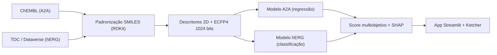

# 🧬 MultiTarget BioPredict

**Triagem Virtual Multiobjetivo: Afinidade ao Receptor A2A × Cardiotoxicidade hERG**

<div align="center">

[](https://www.python.org/)
[](https://www.rdkit.org/)
[](https://scikit-learn.org/)
[](https://xgboost.ai/)
[](https://streamlit.io/)
[](#-status-do-projeto)

</div>

---

## 📌 Proposta de Valor

Na descoberta de fármacos, potência sem segurança é um beco sem saída: muitos
candidatos são descartados em fases tardias por **bloqueio do canal hERG**
(prolongamento do intervalo QT e risco de arritmias fatais).

O **MultiTarget BioPredict** avalia cada molécula em **dois objetivos simultâneos**:

| Objetivo | Alvo | Tarefa de ML | Fonte de dados |
|---|---|---|---|
| 🎯 **Eficácia** | Receptor de adenosina **A2A** (ADORA2A) | Regressão de afinidade (pChEMBL) | ChEMBL |
| ❤️ **Segurança** | Canal de potássio **hERG** (KCNH2) | Classificação bloqueador / não bloqueador | TDC (Therapeutics Data Commons) |

O resultado é uma **triagem virtual multiobjetivo** que prioriza compostos
**potentes em A2A e com baixo risco cardiotóxico**, com explicabilidade (SHAP)
e uma interface interativa para desenho e avaliação de moléculas.

---

## 🏗️ Arquitetura Técnica



| Camada | Tecnologias |
|---|---|
| Linguagem | Python 3.12 |
| Quimioinformática | RDKit (padronização, descritores, Morgan/ECFP4) |
| Machine Learning | scikit-learn, XGBoost |
| Explicabilidade | SHAP |
| Persistência | joblib (artefatos `.joblib` compactados) |
| Aquisição de dados | `chembl_webresource_client`, Harvard Dataverse (TDC) |
| Interface | Streamlit + `streamlit-ketcher` (editor molecular) |
| Ambiente de desenvolvimento | Antigravity (execução local, CPU) |

**Restrições de hardware consideradas:** 8 GB de RAM / Ryzen 7 (CPU only).
Fingerprints são armazenados como `uint8` e a validação cruzada usa paralelismo
limitado (`n_jobs=2`) para evitar estouro de memória.

---

## ⚙️ Configuração do Ambiente

### Pré-requisitos

- Python **3.12**
- Git

### Instalação

```powershell
# 1. Clonar e entrar no repositório
git clone <URL_DO_REPOSITORIO>
cd BioPredicta

# 2. Criar o ambiente virtual
python -m venv .venv

# 3. Ativar
.venv\Scripts\activate          # Windows (PowerShell)
# source .venv/bin/activate     # Linux / macOS

# 4. Instalar dependências fixadas
python -m pip install --upgrade pip
pip install -r requirements.txt
```

### Verificação rápida

```powershell
python -c "from src.chem_utils import canonicalize_smiles; print(canonicalize_smiles('CC(=O)[O-].[Na+]'))"
# Saída esperada: CC(=O)O

streamlit run app.py
```

> **Sobre o PyTDC:** ele **não** faz parte do `requirements.txt`. A versão 1.x
> depende de `tiledbsoma` (sem suporte a Windows), de `torch`/`transformers`
> e fixa `numpy<2`, o que conflita com o restante da stack. Os datasets hERG do
> TDC são baixados direto do Harvard Dataverse:
>
> ```python
> from src.data_utils import download_tdc_dataset
> df = download_tdc_dataset("herg_karim")  # salva em data/raw/tdc_herg_karim.csv
> ```
>
> Para usar o PyTDC em Linux/Colab, veja [`requirements-tdc.txt`](requirements-tdc.txt).

---

## 📂 Organização do Repositório

```
BioPredicta/
├── data/
│   ├── raw/                 # CSVs brutos (ChEMBL e TDC)
│   └── processed/           # Tabelas limpas com descritores e Morgan fingerprints
├── models/                  # Artefatos finais serializados (.joblib compactados)
├── notebooks/               # Notebooks de treino e análise (01_..., 02_...)
├── src/                     # Módulos Python reutilizáveis
│   ├── __init__.py
│   ├── chem_utils.py        # Padronização de SMILES, descritores 2D, ECFP4
│   ├── model_utils.py       # Métricas, validação cruzada, persistência e inferência
│   └── data_utils.py        # Download dos datasets TDC (sem PyTDC)
├── app.py                   # Aplicação Streamlit
├── requirements.txt         # Dependências fixadas (ambiente principal)
├── requirements-tdc.txt     # PyTDC opcional (Linux/Colab, ambiente isolado)
├── .gitignore
└── README.md
```

### Módulos principais — `src/`

#### `src/chem_utils.py`
| Função | Descrição |
|---|---|
| `canonicalize_smiles(smiles)` | SMILES canônico isomérico; remove sais, neutraliza cargas; `None` se inválido |
| `compute_2d_descriptors(mol)` | `MolWt`, `MolLogP`, `TPSA`, `NumHDonors`, `NumHAcceptors`, `NumRotatableBonds` |
| `compute_morgan_fingerprints(mol, radius=2, n_bits=1024)` | Vetor binário ECFP4 (`np.uint8`) |
| `featurize_dataframe(df, smiles_col)` | Featurização em lote gerando matriz de 1030 colunas (6 descritores + 1024 bits `uint8`) |

#### `src/data_utils.py`
| Função | Descrição |
|---|---|
| `fetch_chembl_a2a_dataset()` | Download paginado com cache (`data/raw/chembl_a2a_raw.csv`) de atividades $A_{2A}$ (`CHEMBL251`) |
| `curate_a2a_dataset(df_raw)` | Curadoria $A_{2A}$: filtro quantitativo, RDKit, $pIC_{50}$ e descarte de discordâncias ($\text{std} > 1.0$) |
| `download_tdc_dataset(name)` | Download direto do Harvard Dataverse (`tdc_herg_karim.csv`) sem dependência de PyTDC |
| `curate_herg_dataset(df_raw)` | Curadoria hERG: padronização RDKit, resolução de duplicatas e eliminação de conflitos de rótulo |

---

## 🚦 Status do Projeto

| Fase | Descrição | Status |
|---|---|---|
| **0** | Preparação do ambiente e do repositório | ✅ **Concluída** |
| **1** | Aquisição e curadoria de dados (ChEMBL A2A + TDC hERG) | ✅ **Concluída** |
| **2** | Featurização e análise exploratória (EDA + Espaço Químico) | ✅ **Concluída** |
| **3** | Modelagem A2A (regressão de pIC50 - XGBoost R²=0.723) | ✅ **Concluída** |
| **4** | Modelagem hERG (classificação de cardiotoxicidade - Random Forest ROC-AUC=0.930) | ✅ **Concluída** |
| **5** | Score multiobjetivo, explicabilidade (SHAP) e app Streamlit | ✅ **Concluída** |

---

## 📝 Licença

Distribuído sob a licença MIT.

## 👨‍💻 Autor

Projeto acadêmico desenvolvido por **Raphael Pires**.
