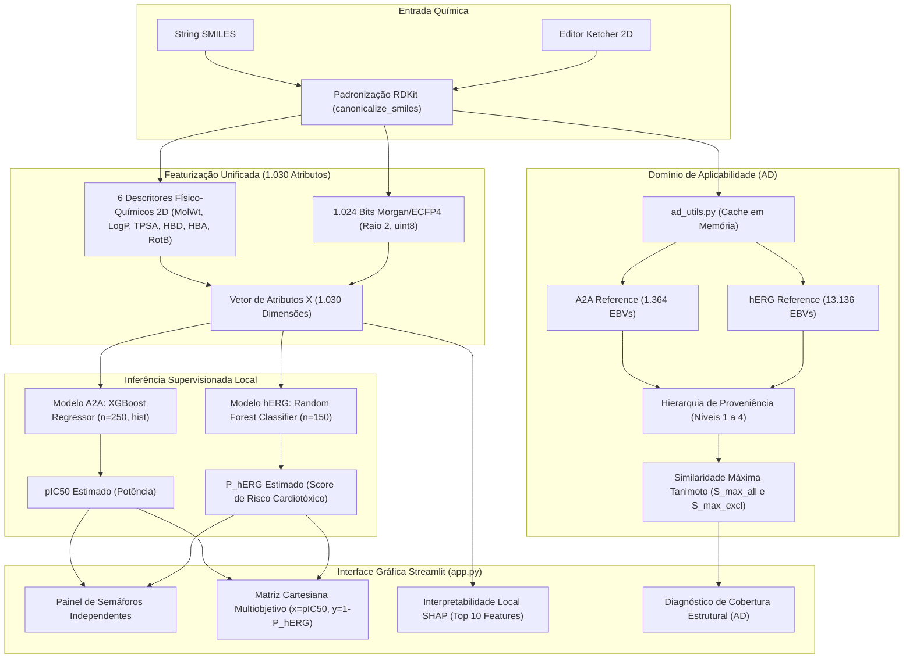

# 🧬 MultiTarget BioPredict

**Plataforma de Triagem Virtual Multiobjetivo: Potência no Receptor de Adenosina $\text{A}_{2\text{A}}$ × Segurança Cardíaca hERG**

<div align="center">

[](https://www.python.org/)
[](https://www.rdkit.org/)
[](https://scikit-learn.org/)
[](https://xgboost.ai/)
[](https://streamlit.io/)
[](https://shap.readthedocs.io/)
[](#-testes-automatizados-e-qualidade)
[](LICENSE)

</div>

---

## 📌 Proposta de Valor e Fundamentação Científica

Na descoberta e no desenvolvimento de fármacos (*drug discovery*), **potência bioquímica sem segurança toxicológica é um beco sem saída**. Uma das principais causas de atrito e reprovação pré-clínica tardia ou retirada pós-comercialização é a **cardiotoxicidade induzida pelo bloqueio do canal de potássio hERG** ($K_v11.1$), que desencadeia prolongamento do intervalo QT no eletrocardiograma e eleva o risco de arritmias ventriculares potencialmente letais (*Torsades de Pointes*).

O **MultiTarget BioPredict** é uma plataforma computacional científica projetada para executar **triagem virtual multiobjetivo simultânea** a partir de estruturas químicas bidimensionais:

| Dimensão | Alvo Biológico | Tarefa de Machine Learning | Dataset Curado de Produção |
| :--- | :--- | :--- | :--- |
| 🎯 **Eficácia Terapêutica** | Receptor de Adenosina **$\text{A}_{2\text{A}}$** (`ADORA2A`) | **Regressão Contínua** de Potência ($\text{pIC}_{50}$) | **1.364 compostos** (ChEMBL `CHEMBL251`) |
| ❤️ **Segurança Cardiológica** | Canal de Potássio **hERG** (`KCNH2` / $K_v11.1$) | **Classificação Binária** com Escore Probabilístico ($P_{\text{hERG}}$) | **13.136 compostos** (TDC / ChEMBL `CHEMBL240`) |

O sistema opera de forma **100% local**, integrando predições com aprendizado de máquina supervisionado, matriz cartesiana multiobjetivo, explicabilidade química interpretável via SHAP (*TreeExplainer*) e um **motor de diagnóstico do Domínio de Aplicabilidade (AD)** com rastreamento estrito de proveniência molecular.

---

## 🏗️ Arquitetura do Sistema e Fluxo de Inferência



---

## ⚡ Principais Funcionalidades

1. **Entrada Química Flexível:** Submissão via string SMILES estruturada ou desenho de moléculas em tempo real com o editor molecular 2D interativo Ketcher (`streamlit-ketcher`).
2. **Featurização Padronizada (1.030 dimensões):**
   * **6 Descritores Físico-Químicos 2D:** Massa Molecular (`MolWt`), Lipofilicidade Wildman-Crippen (`MolLogP`), Área de Superfície Polar Topológica (`TPSA`), Doadores de Ligação de Hidrogênio (`NumHDonors`), Aceptores de Ligação de Hidrogênio (`NumHAcceptors`) e Ligações Rotacionáveis (`NumRotatableBonds`).
   * **1.024 Bits Morgan ECFP4:** Fingerprints circulares de raio 2 codificados nativamente em `numpy.uint8` (economia de $8\times$ em memória).
3. **Decisão Multiobjetivo por Semáforos Independentes:**
   * **Eficácia ($\text{A}_{2\text{A}}$):** Alta Potência ($\text{pIC}_{50} \ge 6{,}5$), Moderada ($5{,}0 \le \text{pIC}_{50} < 6{,}5$) e Baixa/Inativa ($\text{pIC}_{50} < 5{,}0$).
   * **Segurança ($\text{hERG}$):** Baixo Risco ($P_{\text{hERG}} < 0{,}30$), Risco Moderado/Intermediário ($0{,}30 \le P_{\text{hERG}} < 0{,}70$) e Alto Risco ($P_{\text{hERG}} \ge 0{,}70$).
   * *Aviso Metodológico:* $P_{\text{hERG}}$ é um escore preditivo gerado por modelo calibrado, e **não** uma probabilidade clínica direta de evento adverso em humanos.
4. **Matriz Cartesiana de Decisão (A2A × hERG):**
   * Dispersão com Potência $\text{A}_{2\text{A}}$ no eixo $X$ ($\text{pIC}_{50}$) e Índice Complementar no eixo $Y$ ($1 - P_{\text{hERG}}$).
   * A região ideal (alta eficácia e segurança) ocupa o quadrante superior direito ($x \ge 6{,}5$ e $0{,}70 \le y \le 1{,}00$, correspondendo estritamente a $P_{\text{hERG}} < 0{,}30$).
5. **Explicabilidade Química Local (XAI via SHAP):** Decomposição aditiva via `shap.TreeExplainer` com identificação das 10 propriedades e subestruturas determinantes para cada alvo, incluindo renderização estrutural RDKit de alertas moleculares.
6. **Motor de Diagnóstico do Domínio de Aplicabilidade (AD):**
   * Avaliação independente para $\text{A}_{2\text{A}}$ ($1.364$ compostos) e $\text{hERG}$ ($13.136$ compostos).
   * **Hierarquia Rigorosa de Proveniência Molecular (Quatro Casos Implementados):**
     * **Nível 1 (Estrutura):** SMILES canônico idêntico a um registro de treinamento.
     * **Nível 2 (Features):** Vetor completo de 1.030 atributos idêntico ($\Delta X = 0$), apesar de divergência no SMILES (ex.: estereoisômeros em representação 2D).
     * **Nível 3 (Fingerprint):** Fingerprint idêntico (1.024 bits Morgan ECFP4, {\text{Tanimoto}} = 1{,}0000$), mas descritores físico-químicos divergentes (colisão de bits; protegido contra auto-exclusão para evitar o descarte de moléculas distintas).
     * **Nível 4 (Sem correspondência exata):** Nenhuma correspondência exata conhecida, com apresentação de {\max}$ contínuo e rastreamento do vizinho mais próximo.
   * **Regra de Auto-Exclusão:** A métrica Smax_excluding_match exclui exclusivamente correspondências dos dois primeiros casos (Níveis 1 e 2), não do terceiro (Nível 3), preservando no Nível 3 o composto com fingerprint idêntico como vizinho mais próximo devido à divergência comprovada em suas propriedades físico-químicas.
   * Cálculo vetorizado ultrarrápido ($< 10\text{ ms}$) via `DataStructs.BulkTanimotoSimilarity` e verificação $O(1)$ de features por digest `blake2b`.

---

## 📊 Desempenho dos Modelos e Estatísticas de Treinamento

| Métrica / Parâmetro | Alvo 1: Potência $\text{A}_{2\text{A}}$ | Alvo 2: Segurança Cardíaca $\text{hERG}$ |
| :--- | :--- | :--- |
| **Algoritmo Campeão** | **XGBoost Regressor** (`tree_method=hist`) | **Random Forest Classifier** (`n_estimators=150`) |
| **Total de Amostras Curadas** | $1.364$ moléculas | $13.136$ moléculas ($50\%$ / $50\%$ balanceado) |
| **Validação Cruzada (5-Fold)** | $R^2 = 0{,}645 \pm 0{,}050$ \| $\text{RMSE} = 0{,}682$ | $\text{ROC-AUC} = 0{,}917 \pm 0{,}005$ \| $\text{PR-AUC} = 0{,}921$ |
| **Conjunto de Teste Cego (Hold-out 20%)** | **$R^2 = 0{,}723$** \| $\text{RMSE} = 0{,}578$ \| $\text{MAE} = 0{,}422$ | **$\text{ROC-AUC} = 0{,}930$** \| $\text{PR-AUC} = 0{,}936$ \| $\text{F1} = 0{,}853$ |
| **Tamanho do Arquivo Serializado** | **$192\text{ KB}$** (`models/a2a_model.joblib`) | **$9{,}66\text{ MB}$** (`models/herg_model.joblib`) |
| **Similaridade Mediana LOO no Treino** | **$0{,}8219$** ($160$ pares com $S = 1{,}0000$) | **$0{,}8308$** ($3.855$ pares com $S = 1{,}0000$) |

---

## ⚙️ Instalação e Execução Local

### Pré-requisitos
* **Python 3.12** instalado (testado na versão `3.12.10`).
* Git.
* Hardware recomendado: CPU com 8 GB de RAM (sem necessidade de GPU ou CUDA).

### Passo a Passo

```powershell
# 1. Clonar o repositório
git clone https://github.com/SEU_USUARIO/BioPredicta.git
cd BioPredicta

# 2. Criar ambiente virtual
python -m venv .venv

# 3. Ativar o ambiente virtual
# Windows (PowerShell):
.venv\Scripts\Activate.ps1
# Linux / macOS:
# source .venv/bin/activate

# 4. Atualizar pip e instalar as dependências fixadas
python -m pip install --upgrade pip
pip install -r requirements.txt
```

### Inicialização do Aplicativo Web

```powershell
streamlit run app.py
```

O Streamlit iniciará localmente e abrirá a aplicação em `http://localhost:8501`.

---

## 🧪 Testes Automatizados e Qualidade

O repositório conta com uma suíte de **26 testes automatizados** divididos entre verificação funcional e benchmarking de desempenho:

```powershell
# Executar a suíte de testes funcionais (execução rápida, ~8 segundos)
.venv\Scripts\pytest tests/test_applicability_domain.py tests/test_controls_and_interpretation.py tests/test_multiobjective_plot.py -v

# Executar benchmark de desempenho do AD (100 repetições com cache aquecido)
.venv\Scripts\pytest tests/test_ad_performance.py -v -s

# Executar todos os testes de regressão do projeto
.venv\Scripts\pytest -v
```

### Arquitetura da Suíte de Testes
* [`tests/test_applicability_domain.py`](tests/test_applicability_domain.py): Valida a classificação hierárquica dos Níveis 1 a 4 de proveniência, auto-exclusão seletiva, ausência de exclusões arbitrárias, isolamento de endpoints e imunidade à invenção de $S_{\max} = 0$.
* [`tests/test_ad_performance.py`](tests/test_ad_performance.py): Afere latência de consulta (100 repetições) e consumo de heap via `tracemalloc` de forma desacoplada da suíte funcional (não falha por variações de CPU).
* [`tests/test_controls_and_interpretation.py`](tests/test_controls_and_interpretation.py): Valida a identidade química dos 5 controles, limiares canônicos de hERG e separação estrita entre predição e medição *in-sample*.
* [`tests/test_multiobjective_plot.py`](tests/test_multiobjective_plot.py): Garante estabilidade matemática e coordenadas cartesianas absolutas do gráfico multiobjetivo.
* [`tests/test_featurization_regression.py`](tests/test_featurization_regression.py): Verifica a imutabilidade dos Parquets e paridade estrita na extração de atributos para $14.500$ moléculas.

---

## 💻 Governança de Recursos e Uso de Memória

A plataforma foi otimizada para operação irrestrita em computadores locais com **8 GB de RAM**:

* **Consumo de Memória do Domínio de Aplicabilidade (AD):**
  * **Heap rastreado pelo Python (`tracemalloc`):** $\approx 1{,}05\text{ MB}$ ($\text{A}_{2\text{A}}$) e $\approx 7{,}27\text{ MB}$ ($\text{hERG}$), totalizando **$\approx 8{,}32\text{ MB}$**.
  * **Resident Set Size (RSS) total do processo no Sistema Operacional (`psutil`):** Delta de alocação de **$+93{,}39\text{ MB}$** durante a carga inicial dos dois arquivos Parquet. O processo completo em regime de inferência consome $\approx 186\text{ MB}$ de memória física no Windows (menos de $2{,}4\%$ de uma máquina de 8 GB RAM).
  * **Estabilidade de Memória:** Não foi observado crescimento persistente de RSS após 100 consultas no protocolo experimental executado (variação de $-2{,}18\text{ MB}$ pós-aquecimento do cache). Ressalta-se que este ensaio reflete um ambiente controlado mono-thread; a governança de memória sob concorrência multiusuário contínua em produção depende da gestão de sessões do servidor Streamlit.
* **Latência de Inferência Medida (Cache Aquecido):**
  * Diagnóstico AD $\text{A}_{2\text{A}}$ ($1.364$ amostras): **Mediana = $4{,}24\text{ ms}$** (P95 = $5{,}50\text{ ms}$).
  * Diagnóstico AD $\text{hERG}$ ($13.136$ amostras): **Mediana = $9{,}10\text{ ms}$** (P95 = $10{,}97\text{ ms}$).
  * Pipeline completo (Padronização + Featurização + Modelos + SHAP + AD): **$\sim 1{,}2$ segundos por molécula**.

---

## 📂 Organização do Repositório

```
BioPredicta/
├── data/
│   ├── raw/                         # Arquivos brutos (chembl_a2a_raw.csv e tdc_herg_karim.csv)
│   └── processed/                   # Datasets curados e Parquets featurizados (uint8)
│       ├── a2a_curated.csv          # 1.364 moléculas curadas A2A
│       ├── a2a_featurized.parquet   # 1.364 x 1.035 colunas (uint8)
│       ├── a2a_featurized.csv       # Exportação tabular de paridade
│       ├── herg_curated.csv         # 13.136 moléculas curadas hERG
│       └── herg_featurized.parquet  # 13.136 x 1.034 colunas (uint8)
├── models/                          # Modelos serializados finais (.joblib) e metadados JSON
│   ├── a2a_model.joblib             # XGBoost Regressor treinado
│   ├── a2a_model_metadata.json      # Hiperparâmetros e métricas de aceite A2A
│   ├── herg_model.joblib            # Random Forest Classifier treinado
│   └── herg_model_metadata.json     # Hiperparâmetros e métricas de aceite hERG
├── notebooks/                       # Cadernos de análise e treinamento (Fases 1 a 5)
│   ├── 01_a2a_curation.ipynb        # Curadoria e higienização química A2A
│   ├── 02_herg_curation.ipynb       # Curadoria toxicológica hERG
│   ├── 03_a2a_featurization_eda.ipynb # Featurização e espaço químico A2A
│   ├── 04_herg_featurization_eda.ipynb# Featurização e análise de subestruturas hERG
│   ├── 05_a2a_modeling.ipynb        # Benchmark e treino final do regressor A2A
│   ├── 06_herg_modeling.ipynb       # Benchmark e calibração do classificador hERG
│   └── 07_multitarget_shap_evaluation.ipynb # Integração multiobjetivo e SHAP
├── src/                             # Módulos Python reutilizáveis de produção
│   ├── __init__.py                  # Pacote src
│   ├── chem_utils.py                # Higienização química, descritores 2D e ECFP4
│   ├── ad_utils.py                  # Motor de diagnóstico do Domínio de Aplicabilidade (AD)
│   ├── model_utils.py               # Métricas, validação cruzada e inferência
│   └── data_utils.py                # Download paginado ChEMBL e TDC Dataverse
├── tests/                           # Suíte de testes automatizados com pytest
│   ├── test_applicability_domain.py # Testes funcionais do motor AD (Níveis 1 a 4)
│   ├── test_ad_performance.py       # Benchmark estatístico de latência e memória
│   ├── test_controls_and_interpretation.py # Testes de integridade dos 5 controles
│   ├── test_multiobjective_plot.py  # Testes de geometria cartesiana da matriz
│   └── test_featurization_regression.py # Testes de regressão e paridade tabular
├── context/
│   └── PRD.md                       # Documento de Requisitos de Produto original
├── app.py                           # Aplicação web Streamlit (interface do usuário)
├── AUDITORIA.md                     # Relatório técnico consolidado de QA e auditoria
├── DEVELOPMENT.md                   # Relatório de desenvolvimento e especificação técnica
├── requirements.txt                 # Dependências fixadas do ambiente principal
├── requirements-tdc.txt             # Dependências isoladas opcionais para PyTDC
└── README.md                        # Documentação principal do repositório
```

---

## ⚠️ Limitações Metodológicas e Declaração de Escopo

1. **Invariância Quiral na Representação 2D:** O pipeline molecular utiliza Morgan ECFP4 aquiral (raio 2, 1.024 bits) e 6 descritores físico-químicos bidimensionais. Moléculas que diferem exclusivamente na quiralidade (como os enantiômeros da Terfenadina) produzem vetores numéricos idênticos ($\Delta X = 0$). O motor AD reporta essa condição como **Nível 2 (Correspondência de Features)**, alertando o usuário sobre a necessidade de cautela estereoquímica.
2. **Não Substituição de Validação Experimental:** O escore probabilístico $P_{\text{hERG}}$ e a potência predita $\text{pIC}_{50}$ são estimativas computacionais geradas por modelos estatísticos locais. Eles têm o propósito exclusivo de orientar a priorização de compostos em triagem virtual inicial e **não** constituem laudo toxicológico, ensaio regulatório GLP ou garantia de eficácia/segurança clínica.
3. **Escopo Acadêmico e Científico:** Os modelos foram calibrados especificamente nos espaços químicos representados pelos conjuntos ChEMBL e TDC. Moléculas com similaridade muito baixa ($S_{\max} < 0{,}30$, como solventes e peptídeos pequenos) encontram-se em regime de extrapolação matemática.

---

## 📝 Licença e Autoria

* **Licença:** Distribuído sob a licença [MIT](LICENSE).
* **Autor:** Desenvolvido por **Raphael Pires**.
* **Contato e Citações:** Para reprodução acadêmica ou colaborações, consulte os cadernos em `notebooks/` e os relatórios em [`DEVELOPMENT.md`](DEVELOPMENT.md) e [`AUDITORIA.md`](AUDITORIA.md).
