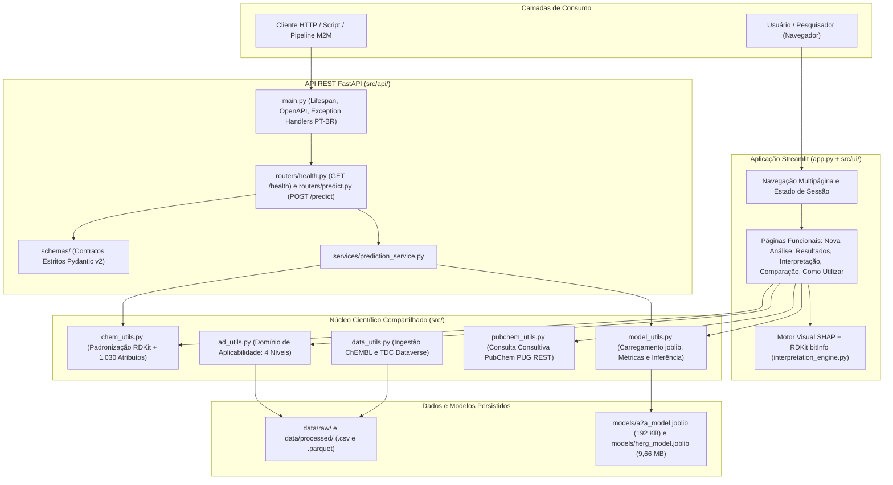

# MultiTarget BioPredict

## Plataforma de Triagem Virtual Multiobjetivo: Potência no Receptor de Adenosina A2A × Segurança Cardíaca hERG


---

## Sumário

1. [Apresentação do projeto](#1-apresentação-do-projeto)
2. [Fundamentação científica](#2-fundamentação-científica)
3. [Arquitetura e tecnologias](#3-arquitetura-e-tecnologias)
4. [Bases de dados e curadoria](#4-bases-de-dados-e-curadoria)
5. [Representação molecular e engenharia de atributos](#5-representação-molecular-e-engenharia-de-atributos)
6. [Desenvolvimento dos modelos](#6-desenvolvimento-dos-modelos)
7. [Desempenho e avaliação](#7-desempenho-e-avaliação)
8. [Interpretação multiobjetivo](#8-interpretação-multiobjetivo)
9. [Interpretabilidade química](#9-interpretabilidade-química)
10. [Aplicação Streamlit](#10-aplicação-streamlit)
11. [API REST FastAPI](#11-api-rest-fastapi)
12. [Como executar o projeto](#12-como-executar-o-projeto)
13. [Estrutura de diretórios](#13-estrutura-de-diretórios)
14. [Limitações e trabalhos futuros](#14-limitações-e-trabalhos-futuros)
15. [Considerações finais](#15-considerações-finais)
16. [Referências](#16-referências)

---

## 1. Apresentação do projeto

- **Título oficial:** **Plataforma de Triagem Virtual Multiobjetivo: Potência no Receptor de Adenosina A2A × Segurança Cardíaca hERG**
- **Nome do sistema:** **MultiTarget BioPredict**

### Descrição objetiva
O **MultiTarget BioPredict** é uma plataforma computacional de quimioinformática e aprendizado de máquina supervisionado (*Machine Learning*) desenvolvida em Python para triagem virtual (*in silico*) de pequenas moléculas orgânicas a partir de suas estruturas químicas bidimensionais (código SMILES ou desenho estrutural 2D).

### Objetivo geral
Estimar de forma simultânea, independente, reprodutível e interpretável dois vetores farmacológicos complementares para cada estrutura molecular submetida:
1. **Potência farmacológica no alvo terapêutico:** predição contínua de `pIC50` frente ao **Receptor de Adenosina A2A humano** (`ADORA2A`, ChEMBL `CHEMBL251`).
2. **Propensão ao bloqueio do antialvo cardíaco:** predição probabilística de classificação positiva frente ao **canal de potássio hERG** (`KCNH2` / Kv11.1).

### Contextualização do problema
Nas fases iniciais de descoberta e planejamento de fármacos (*drug discovery*), a síntese química e a validação biológica em bancada (*in vitro* e *in vivo*) exigem investimento financeiro elevado e longos ciclos experimentais. Historicamente, campanhas de otimização focadas apenas em maximizar a afinidade sobre o alvo terapêutico frequentemente selecionam candidatos lipofílicos ou estruturalmente propensos a interações indesejadas (*off-target*), resultando em reprovação pré-clínica tardia por toxicidade — especialmente cardiotoxicidade associada ao bloqueio do canal hERG.

### Proposta de solução
A plataforma integra curadoria rigorosa de bioatividades públicas, padronização estrutural determinística via RDKit, engenharia unificada de 1.030 atributos moleculares, dois modelos preditivos baseados em ensembles de árvores (XGBoost e Random Forest), análise de Domínio de Aplicabilidade (AD) e explicabilidade local via SHAP. O núcleo científico é disponibilizado por duas interfaces desacopladas e 100% locais:
- **Aplicação Web Analítica (Streamlit):** voltada à exploração visual, desenho molecular 2D, interpretação estrutural e comparação entre análogos.
- **API REST Programática (FastAPI):** voltada à integração automatizada máquina-a-máquina (M2M), com contratos estritos em Pydantic v2, carregamento único de modelos em memória (`lifespan`) e tratamento padronizado de erros HTTP em português brasileiro.

---

## 2. Fundamentação científica

### Receptor de adenosina A2A (`ADORA2A`)
O receptor de adenosina A2A humano é um receptor acoplado à proteína G (GPCR) da família purinérgica amplamente expresso nos gânglios da base (corpo estriado), no sistema cardiovascular e em células do sistema imune. Na química medicinal, antagonistas seletivos ou não seletivos de A2A possuem relevância consolidada em neurofarmacologia — incluindo o manejo motor adjuvante na Doença de Parkinson (exemplificado pela **Istradefilina**) e a modulação central de vigília (exemplificada pela **Cafeína**) —, além de investigações contemporâneas em imuno-oncologia para reversão da imunossupressão mediada por adenosina no microambiente tumoral.

### Canal de potássio hERG (Kv11.1 / `KCNH2`)
O gene *hERG* (*human Ether-à-go-go-Related Gene*, oficialmente `KCNH2`) codifica a subunidade formadora do poro do canal de potássio dependente de voltagem **Kv11.1**, responsável pela corrente retificadora tardia rápida de potássio ($I_{Kr}$) nos cardiomiócitos. Essa corrente é indispensável para a repolarização ventricular normal do potencial de ação cardíaco. A cavidade central do poro de Kv11.1 apresenta volume relativamente amplo e resíduos aromáticos hidrofóbicos (como Tyr652 e Phe656), o que favorece a ligação promíscua de diversas pequenas moléculas farmacologicamente ativas. O bloqueio farmacológico desse canal pode retardar a repolarização ventricular, prolongar o intervalo QT no eletrocardiograma e elevar o risco de taquiarritmias ventriculares graves como *Torsades de Pointes* (TdP) — razão histórica da retirada pós-comercialização de fármacos como a **Terfenadina**.

### Relação entre potência farmacológica e segurança cardíaca e avaliação simultânea
Modificações químicas introduzidas durante a otimização *hit-to-lead* (como o aumento de massa molecular, aromaticidade ou lipofilicidade para ganhar afinidade hidrofóbica na cavidade ortostérica de um receptor) podem elevar concomitantemente a afinidade pelo poro do canal hERG. Avaliar **A2A e hERG simultaneamente** desde a concepção da estrutura 2D permite identificar precocemente esse *trade-off* eficácia × segurança, priorizando séries químicas que preservem potência estimada elevada sem migrar para zonas de alta propensão ao bloqueio de Kv11.1.

### Diferença entre atividade experimental, predição computacional e risco clínico
Para uma interpretação cientificamente correta da plataforma, três níveis distintos não devem ser confundidos:
1. **Atividade experimental (*in vitro*):** grandeza empírica obtida em ensaios laboratoriais controlados (como ensaios de ligação radioligante, ensaios funcionais de cAMP ou eletrofisiologia *patch-clamp*), sujeita às condições do protocolo experimental.
2. **Predição computacional (*in silico*):** estimativa matemática emitida por modelos estatísticos supervisionados (QSAR 2D) a partir de padrões topológicos e físico-químicos aprendidos sobre bases históricas curadas.
3. **Risco clínico em humanos:** desfecho fisiopatológico complexo dependente de farmacocinética (concentração plasmática livre $C_{\max,\text{unbound}}$), ligação a proteínas plasmáticas, metabolismo hepático, distribuição tecidual, interação com outros canais iônicos cardíacos e suscetibilidade individual do paciente.

> **Esclarecimento metodológico essencial:** a variável `P_hERG` (`p_herg_positive` na API) produzida pelo modelo Random Forest representa exclusivamente a **probabilidade estimada de classificação positiva pelo classificador computacional** (`predict_proba` para a classe `1` definida no dataset de treinamento), e **não** uma probabilidade clínica direta de cardiotoxicidade, prolongamento de QT ou ocorrência de arritmia em pacientes.

---

## 3. Arquitetura e tecnologias

### Tecnologias utilizadas e respectivas funções

| Tecnologia | Versão Fixada | Função Efetiva no Projeto |
|---|---|---|
| **Python** | `3.12` (`3.12.10`) | Linguagem base de execução dos pipelines científicos, interface web, API REST e suíte de testes. |
| **RDKit** | `2026.9.1` | Sanitização química, remoção de sais, neutralização de cargas, canonicalização de SMILES, cálculo de descritores 2D, geração de fingerprints Morgan/ECFP4 e renderização 2D de estruturas e subambientes (`bitInfo`). |
| **Pandas, NumPy e SciPy** | `2.3.3` / `2.4.4` / `1.18.1` | Manipulação tabular, álgebra vetorial com tipagem compacta (`numpy.uint8`), persistência colunar Apache Parquet (via `pyarrow`) e testes estatísticos não paramétricos nos notebooks exploratórios. |
| **Scikit-learn** | `1.9.1` | Treinamento e inferência do classificador Random Forest (hERG), algoritmos de *benchmark*, validação cruzada estratificada e métricas estatísticas. |
| **XGBoost** | `3.4.1` | Treinamento e inferência do regressor campeão `XGBRegressor` (`tree_method="hist"`) para predição contínua de `pIC50` (A2A). |
| **SHAP** | `0.53.0` | Explicabilidade aditiva local exata para modelos de árvore (`shap.TreeExplainer`) na aplicação analítica e no caderno integrador. |
| **Streamlit** | `1.65.0` | Interface web analítica multipágina (`app.py` e `src/ui/`), integrada ao editor molecular bidimensional `streamlit-ketcher`. |
| **FastAPI** | `0.162.0` | Framework ASGI da API REST (`src/api/`), geração automática do contrato OpenAPI 3.1 e interfaces Swagger UI e ReDoc. |
| **Pydantic** | `2.14.2` | Modelagem e validação estrita em tempo de execução dos contratos JSON de entrada e saída (`src/api/schemas/`). |
| **Uvicorn** | `0.54.0` | Servidor ASGI de execução local da API FastAPI. |

### Arquitetura em camadas e separação de responsabilidades



O repositório mantém isolamento estrito entre sete domínios:
- **Núcleo científico compartilhado (`src/*.py`):** concentra toda a lógica determinística de padronização molecular, featurização de 1.030 atributos, diagnóstico de Domínio de Aplicabilidade, persistência e avaliação de modelos. Não importa módulos de interface web nem de roteamento HTTP.
- **Aplicação Streamlit (`app.py` e `src/ui/`):** consome o núcleo científico para oferecer análise visual interativa, explicabilidade SHAP, histórico de sessão e comparação multimolecular.
- **API FastAPI (`src/api/`):** consome o mesmo núcleo científico (`chem_utils` e `model_utils`) sem importar nenhum módulo do Streamlit, garantindo paridade matemática entre predições via web e via HTTP.
- **Dados (`data/`):** separa dados brutos originais (`data/raw/`) das bases curadas e matrizes featurizadas em Parquet (`data/processed/`).
- **Modelos (`models/`):** armazena os binários serializados (`.joblib`) e seus metadados auditáveis (`.json`).
- **Testes (`tests/`):** suíte automatizada em `pytest` cobrindo regressão de featurização, geometria gráfica, fronteiras de decisão, Domínio de Aplicabilidade, fluxos de UI e contratos/endpoints da API REST.
- **Documentação (`README.md`, `DEVELOPMENT.md`, `DEVELOPMENT-API.md`, `context/PRD.md`, `reports/`):** registro técnico, arquitetural, científico e histórico de auditorias do sistema.

---

## 4. Bases de dados e curadoria

Os pipelines de aquisição e curadoria foram executados de forma independente nos cadernos [`notebooks/01_a2a_curation.ipynb`](notebooks/01_a2a_curation.ipynb) e [`notebooks/02_herg_curation.ipynb`](notebooks/02_herg_curation.ipynb), apoiados por [`src/data_utils.py`](src/data_utils.py) e [`src/chem_utils.py`](src/chem_utils.py).

### 4.1 Receptor de Adenosina A2A (ChEMBL)
- **Fonte primária:** base pública **ChEMBL** (EMBL-EBI), consultada via API REST oficial.
- **Alvo biológico:** `CHEMBL251` (*Adenosine A2a receptor*, *Homo sapiens*).
- **Critérios quantitativos de filtragem:**
  - Tipo de bioatividade: `standard_type == "IC50"`.
  - Unidade padronizada: `standard_units == "nM"`.
  - Relação exata de igualdade: `standard_relation == "="` e `standard_value > 0` (eliminando registros censurados com relações `>` ou `<`).
  - Essa etapa reduziu os **3.050 registros brutos** (`data/raw/chembl_a2a_raw.csv`) para **1.753 medições quantitativas exatas**.
- **Padronização estrutural e conversão para `pIC50`:**
  - Todas as 1.753 estruturas foram padronizadas e convertidas em SMILES canônicos pelo RDKit (100% de conversão válida), resultando em **1.391 estruturas canônicas únicas**.
  - A concentração molar em nanomolar ($\text{IC}_{50,\text{nM}}$) foi convertida para escala logarítmica negativa:

$$\text{pIC}_{50} = -\log_{10}\left(\text{IC}_{50,\text{nM}} \times 10^{-9}\right) = 9 - \log_{10}\left(\text{IC}_{50,\text{nM}}\right)$$

- **Tratamento de duplicatas e discordância experimental:**
  - Para estruturas avaliadas em múltiplos ensaios independentes, consolidou-se a potência pela **mediana** de `pIC50` e calculou-se o desvio-padrão amostral (`pIC50_std`).
  - Estruturas com divergência inter-ensaio superior a uma unidade logarítmica (`pIC50_std > 1.0`, equivalente a variação maior que 10 vezes em $\text{IC}_{50}$) foram descartadas (**27 compostos conflitantes removidos**).
- **Dataset curado final (`data/processed/a2a_curated.csv`):** **1.364 compostos únicos**, com `pIC50` variando de `4,130` a `11,721` (média `7,295 ± 1,141`; mediana `7,125`).

### 4.2 Canal de Potássio hERG (Therapeutics Data Commons — `herg_karim`)
- **Fonte primária:** repositório **Therapeutics Data Commons (TDC)**, dataset **`herg_karim`** (compilação integrada de referência descrita por Karim et al., obtida programaticamente via Harvard Dataverse em `src/data_utils.py`).
- **Volume bruto (`data/raw/tdc_herg_karim.csv`):** **13.445 registros** contendo estrutura molecular SMILES e rótulo binário (`Y = 1` para bloqueador hERG; `Y = 0` para não-bloqueador).
- **Padronização e resolução de estruturas duplicadas e conflitantes:**
  - A padronização estrutural via RDKit converteu 100% dos 13.445 registros, identificando **13.152 estruturas canônicas únicas**.
  - Para estruturas repetidas, avaliou-se a média dos rótulos ($\bar{Y}$): duplicatas concordantes ($\bar{Y} = 0$ ou $\bar{Y} = 1$) foram unificadas, enquanto **16 estruturas com anotações conflitantes entre fontes** ($0 < \bar{Y} < 1$, simultaneamente reportadas como bloqueadoras e não-bloqueadoras) foram **integralmente removidas** para evitar introdução de ruído de rótulo no classificador.
- **Dataset curado final (`data/processed/herg_curated.csv`):** **13.136 compostos únicos**, apresentando balanceamento natural praticamente exato:
  - **Classe positiva (`hERG_label = 1`, bloqueador):** `6.570` compostos (`50,02%`).
  - **Classe negativa (`hERG_label = 0`, não-bloqueador):** `6.566` compostos (`49,98%`).

---

## 5. Representação molecular e engenharia de atributos

Toda a transformação química reside em [`src/chem_utils.py`](src/chem_utils.py) e é compartilhada de maneira idêntica entre os notebooks de modelagem, a interface Streamlit e a API FastAPI.

### Padronização e canonicalização de SMILES no RDKit
Antes da extração de qualquer atributo, a entrada molecular passa por cinco etapas determinísticas (`standardize_mol` e `canonicalize_smiles`):
1. **Sanitização e normalização (`rdMolStandardize.Cleanup`):** higienização de valências, normalização de grupos funcionais e estados de ligação.
2. **Isolamento do fragmento principal (`LargestFragmentChooser(preferOrganic=True)`):** remoção automática de contraíons salinos, metais acompanhantes e moléculas de solvente.
3. **Neutralização de cargas (`Uncharger`):** neutralização consistente de ácidos e bases ionizados reversíveis, preservando centros zwitteriônicos obrigatórios.
4. **Ressanitização (`Chem.SanitizeMol`):** verificação final da integridade aromática e kekulização consistente.
5. **Geração de SMILES canônico (`Chem.MolToSmiles(..., canonical=True, isomericSmiles=True)`):** produção de identificador textual único, garantindo que representações Kekulé ou aromáticas equivalentes da mesma molécula produzam exatamente o mesmo vetor numérico.

### Diferença entre descritores físico-químicos e fingerprints moleculares
O projeto representa cada molécula em duas escalas complementares:
- **Descritores físico-químicos 2D (propriedades macroscópicas globais):** são grandezas numéricas contínuas ou inteiras calculadas sobre a molécula inteira, resumindo tamanho, hidrofobicidade, polaridade e capacidade de formar ligações de hidrogênio ou rotacionar conformacionalmente.
- **Fingerprints moleculares circulares (subestruturas topológicas locais):** são vetores binários de alta dimensionalidade em que cada posição (*bit*) codifica a presença (`1`) ou ausência (`0`) de vizinhanças atômicas circulares específicas em torno de cada átomo pesado da molécula, capturando fragmentos farmacofóricos locais que descritores globais isolados não distinguem.

### Composição final dos 1.030 atributos (`FEATURE_NAMES`)
Cada composto padronizado é convertido em um vetor ordenado de **1.030 atributos**:
1. **6 descritores físico-químicos 2D do RDKit** (colunas `0` a `5`):
   - `MolWt`: massa molecular (g/mol).
   - `MolLogP`: coeficiente de partição octanol/água estimado pelo método de Wildman-Crippen.
   - `TPSA`: área de superfície polar topológica ($\text{\AA}^2$).
   - `NumHDonors`: número de doadores de ligação de hidrogênio.
   - `NumHAcceptors`: número de aceptores de ligação de hidrogênio.
   - `NumRotatableBonds`: número de ligações simples rotacionáveis não terminais.
2. **1.024 bits de fingerprints circulares Morgan / ECFP4** (colunas `fp_0` a `fp_1023`):
   - Gerados com **`radius = 2`** (vizinhança circular de até 2 ligações a partir do átomo central, equivalente ao diâmetro 4 do padrão **ECFP4**) e tamanho **`1024` bits**.
   - Armazenados estritamente em `numpy.uint8` (1 byte por bit) e persistidos em formato colunar Apache Parquet (`a2a_featurized.parquet` com `0,64 MB` e `herg_featurized.parquet` com `1,79 MB`), reduzindo o consumo de memória em 87,5% em relação a matrizes `float64`.

---

## 6. Desenvolvimento dos modelos

O desenvolvimento experimental está documentado em [`notebooks/05_a2a_modeling.ipynb`](notebooks/05_a2a_modeling.ipynb), [`notebooks/06_herg_modeling.ipynb`](notebooks/06_herg_modeling.ipynb), [`models/a2a_model_metadata.json`](models/a2a_model_metadata.json) e [`models/herg_model_metadata.json`](models/herg_model_metadata.json).

### Variáveis-alvo e algoritmos selecionados

| Dimensão | Variável-Alvo | Modelo Campeão Selecionado | Hiperparâmetros Principais | Artefato Serializado |
|---|---|---|---|---|
| **Potência A2A** (Regressão) | `pIC50` contínuo | **XGBoost Regressor** (`XGBRegressor`) | `n_estimators=250`, `learning_rate=0.08`, `max_depth=6`, `subsample=0.8`, `colsample_bytree=0.8`, `tree_method="hist"`, `random_state=42`, `n_jobs=2` | [`models/a2a_model.joblib`](models/a2a_model.joblib) (`192 KB`, `compress=3`) |
| **Segurança hERG** (Classificação) | `hERG_label` binário (`0` ou `1`) + escore `predict_proba` da classe `1` | **Random Forest Classifier** (`RandomForestClassifier`) | `n_estimators=150`, `min_samples_split=4`, `random_state=42`, `n_jobs=2` | [`models/herg_model.joblib`](models/herg_model.joblib) (`9,66 MB`, `compress=3`) |

### Fluxo de treinamento, validação e persistência
1. **Particionamento *Holdout* 80/20:** separação inicial com `random_state=42` em conjunto de treino (80%) e conjunto de teste cego *holdout* (20%: `n = 273` moléculas em A2A; `n = 2.628` moléculas em hERG, com estratificação de classe).
2. **Benchmark comparativo e Validação Cruzada (5-Fold):** no conjunto de desenvolvimento, múltiplos algoritmos foram comparados sob validação cruzada de 5 folds (`KFold` para A2A; `StratifiedKFold` para hERG, com `n_jobs=2` para respeitar o orçamento de 8 GB de RAM):
   - Em **A2A**, avaliaram-se Dummy Regressor, Ridge Regression, Random Forest Regressor, XGBoost Regressor e MLP Regressor, selecionando-se o **XGBoost Regressor**.
   - Em **hERG**, avaliaram-se Logistic Regression, Random Forest Classifier, XGBoost Classifier e MLP Classifier, selecionando-se o **Random Forest Classifier** pelo melhor desempenho global discriminativo e menor Brier Score no teste.
3. **Avaliação independente no *Holdout* 20%:** aferição definitiva das métricas de generalização sobre os dados retidos fora da seleção de modelos.
4. **Reajuste final (*Refit* em 100% da base curada):** após a validação no *holdout*, o estimador campeão de cada alvo foi reajustado sobre a totalidade da respectiva coleção curada (`1.364` compostos em A2A e `13.136` compostos em hERG) para maximizar a cobertura estrutural em produção e persistido via `joblib.dump(..., compress=3)`. As métricas reportadas a seguir pertencem exclusivamente à avaliação *holdout* e à validação cruzada anteriores ao *refit*.

---

## 7. Desempenho e avaliação

### 7.1 Modelo de Regressão A2A (XGBoost Regressor)

| Protocolo de Avaliação | R² | RMSE (`pIC50`) | MAE (`pIC50`) |
|---|---|---|---|
| **Holdout (20%, `n = 273`)** | **0,723** | **0,578** | **0,422** |
| **Validação Cruzada (5-Fold)** | **0,645 ± 0,050** | **0,682 ± 0,063** | **0,486 ± 0,033** |

### 7.2 Modelo de Classificação hERG (Random Forest Classifier)

| Protocolo de Avaliação | ROC-AUC | PR-AUC | F1-Score | Brier Score | MCC |
|---|---|---|---|---|---|
| **Holdout (20%, `n = 2.628`)** | **0,930** | **0,936** | **0,853** | **0,112** | **0,709** |
| **Validação Cruzada (5-Fold Estratificada)** | **0,917 ± 0,005** | **0,921 ± 0,005** | **0,839 ± 0,005** | — | — |

### Significado estatístico resumido das métricas
- **R² (Coeficiente de Determinação):** proporção da variância dos valores experimentais de `pIC50` explicada pelo regressor no conjunto avaliado (quanto mais próximo de `1,0`, maior o ajuste).
- **RMSE e MAE (Erro Quadrático Médio da Raiz e Erro Absoluto Médio):** quantificam o desvio das predições na própria unidade logarítmica de `pIC50`; o RMSE penaliza erros grandes com maior intensidade, enquanto o MAE expressa o erro absoluto médio por molécula.
- **ROC-AUC e PR-AUC:** medem a capacidade do classificador de ordenar corretamente compostos da classe positiva acima dos da classe negativa ao longo de todos os pontos de corte possíveis (sob a curva ROC e sob a curva Precisão-Revocação, respectivamente).
- **F1-Score e MCC (Coeficiente de Correlação de Matthews):** avaliam a qualidade da classificação discreta no limiar binário padrão; o F1 equilibra precisão e sensibilidade, enquanto o MCC (de `-1` a `+1`) sintetiza as quatro células da matriz de confusão.
- **Brier Score:** erro quadrático médio entre as probabilidades estimadas `P_hERG` e os rótulos observados (`0` ou `1`); valores mais baixos indicam escores probabilísticos mais bem alinhados às frequências empíricas do conjunto de teste.

> **Nota de escopo estatístico:** essas métricas descrevem unicamente a acurácia preditiva matemática dos modelos nos subconjuntos de avaliação *in silico* sob divisão aleatória; elas não constituem indicadores de eficácia terapêutica clínica nem de segurança cardiológica em seres humanos.

---

## 8. Interpretação multiobjetivo

### Avaliação conjunta sem mascaramento de risco
Em projetos de triagem virtual, agregar eficácia e toxicidade em uma média ponderada única (*desirability score*) pode permitir que uma potência prevista muito alta mascare um sinal severo de bloqueio hERG. Por essa razão, o **MultiTarget BioPredict** avalia os dois modelos por **semáforos independentes** e projeta cada molécula em uma **Matriz Cartesiana Multiobjetivo 2D**:
- **Eixo Horizontal (`X`):** potência estimada no receptor A2A (`pIC50`).
- **Eixo Vertical (`Y`):** índice complementar derivado `1 - P`, em que `P` corresponde à probabilidade estimada `P_hERG` da classe positiva pelo modelo hERG (quanto maior `1 - P`, menor a propensão estimada ao bloqueio).

### Tabela oficial das faixas operacionais de interpretação

| Dimensão | Classificação | Critério |
|---|---|---|
| A2A | Alta potência | pIC50 ≥ 6,5 |
| A2A | Potência moderada | 5,0 ≤ pIC50 < 6,5 |
| A2A | Baixa potência/inativa | pIC50 < 5,0 |
| hERG | Baixo risco | P < 0,30 |
| hERG | Risco moderado | 0,30 ≤ P ≤ 0,70 |
| hERG | Alto risco | P > 0,70 |

- **Regra explícita de fronteira:** em toda a plataforma, a faixa moderada de hERG inclui ambos os limites (`0,30 ≤ P ≤ 0,70`). Portanto, o valor exato **`P = 0,70`** (`1 - P = 0,30`) pertence à classificação de **Risco moderado**, sendo classificados como **Alto risco** apenas valores estritamente superiores (`P > 0,70`, equivalentes a `1 - P < 0,30`).
- **Natureza operacional dos critérios:** os pontos de corte `pIC50 = 5,0` (equivalente a $\text{IC}_{50} = 10\ \mu\text{M}$), `pIC50 = 6,5` ($\text{IC}_{50} \approx 316\ \text{nM}$), `P = 0,30` e `P = 0,70` são **faixas operacionais internas de triagem do projeto**, concebidas para organizar visualmente a priorização de candidatos na matriz multiobjetivo:
  - **Quadrante 1 (Zona Ideal):** `pIC50 ≥ 6,5` e `P < 0,30` (`1 - P > 0,70`) — alta potência estimada em A2A combinada a baixo risco estimado em hERG.
  - **Quadrante 2 (Baixo Interesse Terapêutico):** `pIC50 < 5,0` e `P < 0,30` — baixa potência estimada, apesar do baixo escore hERG.
  - **Quadrante 3 (Descarte Prioritário):** `pIC50 < 5,0` e `P > 0,70` — baixa potência aliada a alto escore de propensão ao bloqueio hERG.
  - **Quadrante 4 (Alerta Crítico):** `pIC50 ≥ 6,5` e `P > 0,70` — alta potência estimada em A2A acompanhada de alto risco estimado em hERG, demandando redesenho estrutural ou confirmação experimental cautelosa.
  - **Zona de Otimização / Transição (*Hit-to-Lead*):** compostos situados nas faixas intermediárias (`5,0 ≤ pIC50 < 6,5` e/ou `0,30 ≤ P ≤ 0,70`).
  Esses critérios **não representam limites clínicos ou regulatórios universais** (como margens regulatórias ICH S7B).

### Contextualização pelo Domínio de Aplicabilidade (`src/ad_utils.py`)
Na aplicação Streamlit, toda predição multiobjetivo é acompanhada por um diagnóstico de cobertura estrutural frente às bases completas de treinamento (`1.364` compostos de A2A e `13.136` de hERG), classificado em quatro níveis hierárquicos:
1. **Nível 1 (Correspondência exata de estrutura):** SMILES canônico idêntico a um registro do conjunto de treinamento (predição *in-sample*).
2. **Nível 2 (Correspondência exata de atributos 1.030-D):** vetor completo de 1.030 features idêntico ($\Delta X = 0$), mesmo com diferença estereoquímica no SMILES isomérico.
3. **Nível 3 (Correspondência exata de fingerprint 1.024-b):** similaridade Tanimoto `S = 1,0000` nos bits ECFP4, mas com divergência nos descritores físico-químicos 2D (preservando o composto como vizinho de referência sem auto-exclusão indevida).
4. **Nível 4 (Sem correspondência exata — inferência genuinamente *out-of-sample*):** apresentação contínua da similaridade máxima de Tanimoto ($S_{\max}$) ao vizinho mais próximo do treino e verificação do envelope empírico dos 6 descritores 2D.

---

## 9. Interpretabilidade química

### Finalidade do SHAP no projeto
Modelos baseados em centenas de árvores de decisão oferecem elevado poder preditivo em espaços de atributos esparsos (1.030 colunas), mas não expõem diretamente o peso de cada fragmento em uma predição individual. Para tornar a análise transparente na aplicação Streamlit e nos estudos do [`notebooks/07_multitarget_shap_evaluation.ipynb`](notebooks/07_multitarget_shap_evaluation.ipynb), o projeto emprega **SHAP** (*SHapley Additive exPlanations*) por meio do algoritmo exato `shap.TreeExplainer`.

### Como a interpretabilidade auxilia a análise molecular
Para cada molécula avaliada na interface analítica, a predição individual $f(x)$ é decomposta aditivamente a partir do valor esperado de base do modelo ($\phi_0$):

$$f(x) = \phi_0 + \sum_{i=1}^{1030} \phi_i$$

- **Seleção das Top 10 contribuições locais:** a plataforma ordena os atributos pelo módulo $|\phi_i|$ e destaca os **10 atributos de maior impacto absoluto** para A2A (em unidades de `pIC50`) e para hERG (na escala de probabilidade da classe positiva).
- **Mapeamento estrutural 2D com RDKit (`bitInfo`):** quando um atributo relevante é um bit de fingerprint Morgan (`fp_0` a `fp_1023`) presente na molécula (`valor = 1`), o motor [`src/ui/interpretation_engine.py`](src/ui/interpretation_engine.py) extrai o átomo central e o raio topológico real da ocorrência, renderiza o microambiente químico 2D em modo escuro e distingue automaticamente entre **ocorrência única**, **múltiplas ocorrências equivalentes** na mesma molécula e **colisão de hashing** (quando subambientes distintos colidem no mesmo índice módulo 1024). Quando um bit relevante está ausente (`valor = 0`), a interface explicita que a contribuição SHAP decorre da ausência daquele padrão estrutural na molécula analisada.

> **Limite epistemológico obrigatório:** os valores SHAP medem estritamente a **contribuição matemática e estatística local** de cada atributo para a saída numérica do modelo treinado. Eles **não demonstram causalidade físico-química**, não substituem simulações de ancoragem tridimensional (*molecular docking* / dinâmica molecular) e **não comprovam mecanismos farmacológicos ou toxicológicos** reais nos receptores biológicos.

---

## 10. Aplicação Streamlit

A interface gráfica multipágina é orquestrada em [`app.py`](app.py) e modularizada em [`src/ui/`](src/ui/), operando integralmente em tema escuro (*Dark Mode* configurado em [`.streamlit/config.toml`](.streamlit/config.toml)).

### Fluxo operacional nas páginas funcionais implementadas
1. **Nova Análise ([`src/ui/pages/p2_nova_analise.py`](src/ui/pages/p2_nova_analise.py)):** ponto de entrada para submissão e execução do pipeline completo. Oferece três formas de entrada molecular:
   - **Moléculas de referência de acesso rápido:** atalhos pré-configurados para controles farmacológicos documentados (**Cafeína**, **Istradefilina**, **Terfenadina**, **Taurina** e **L-Teanina**).
   - **Entrada textual por código SMILES:** campo validado com higienização automática e tratamento seguro de erros de sintaxe química.
   - **Editor molecular 2D interativo (Ketcher):** desenho ou modificação estrutural direta no navegador (submetido ao pressionar `Apply` no editor e acionar a análise).
   Ao executar a análise, a aplicação padroniza a estrutura no RDKit, consulta opcionalmente metadados públicos no **PubChem PUG REST** ([`src/pubchem_utils.py`](src/pubchem_utils.py), com degradação graciosa *offline*), calcula as predições A2A e hERG, avalia o Domínio de Aplicabilidade, computa as explicações SHAP e armazena o registro em um histórico de sessão não destrutivo (fila FIFO de até 10 moléculas gerenciada por [`src/ui/history_manager.py`](src/ui/history_manager.py)).
2. **Resultados ([`src/ui/pages/p3_resultados.py`](src/ui/pages/p3_resultados.py)):** exibe o painel consolidado da molécula ativa, contendo renderização 2D, identificação e proveniência (*in-sample* vs. *out-of-sample*), cartões independentes dos semáforos A2A (`pIC50` e `IC50` molar estimado) e hERG (`P_hERG` e `1 - P`), Matriz Cartesiana Multiobjetivo, avaliação da Regra dos Cinco de Lipinski e diagnóstico completo dos 4 níveis do Domínio de Aplicabilidade.
3. **Interpretação ([`src/ui/pages/p4_interpretacao.py`](src/ui/pages/p4_interpretacao.py)):** apresenta os gráficos de decomposição SHAP (Top 10 atributos para A2A e para hERG) e os cartões detalhados de subambientes Morgan 2D e descritores físico-químicos, com alertas explícitos sobre bits ausentes e eventuais colisões de hashing.
4. **Comparação ([`src/ui/pages/p5_comparacao.py`](src/ui/pages/p5_comparacao.py)):** permite selecionar de **2 a 5 moléculas** analisadas no histórico da sessão, definir uma molécula de referência e inspecionar lado a lado a projeção multiobjetivo comparativa, a matriz simétrica de similaridade de Tanimoto (ECFP4) e os deltas relativos ($\Delta \text{pIC}_{50}$, razão de $\text{IC}_{50}$, $\Delta P_{\text{hERG}}$ e variações nos 6 descritores 2D).
5. **Como Utilizar ([`src/ui/pages/p6_como_utilizar.py`](src/ui/pages/p6_como_utilizar.py)):** guia didático interativo integrado à interface explicando o fluxo operacional, a leitura das faixas de decisão, o significado do Domínio de Aplicabilidade e os cuidados na interpretação do SHAP.

### Nota transparente sobre páginas institucionais provisórias
A barra de navegação lateral registra também quatro rotas institucionais complementares — **`Visão Geral`**, **`Fundamentos Científicos`**, **`Modelos e Governança`** e **`Sobre o Projeto`** — que atualmente exibem cartões estruturais provisórios (`render_provisional_page`), tendo sido deliberadamente mantidas como melhorias futuras de interface para priorizar a estabilização científica, analítica e programática (API REST) do sistema.

---

## 11. API REST FastAPI

Para permitir integração programática direta com scripts Python, fluxos automatizados de triagem virtual e ferramentas externas sem depender da interface gráfica, o projeto implementa uma API REST modular em [`src/api/`](src/api/) (documentada em detalhe em [`DEVELOPMENT-API.md`](DEVELOPMENT-API.md)).

### Arquitetura, Lifespan e reutilização do núcleo científico
- **Separação em camadas (`src/api/`):**
  - [`src/api/main.py`](src/api/main.py): instanciação do objeto `FastAPI`, metadados OpenAPI com a identidade oficial do projeto, registro de rotas e gerenciador de ciclo de vida `lifespan`.
  - [`src/api/schemas/`](src/api/schemas/): contratos estritos em Pydantic v2 (`health.py` e `prediction.py`).
  - [`src/api/services/prediction_service.py`](src/api/services/prediction_service.py): orquestração da inferência reutilizando diretamente `canonicalize_smiles`, `featurize_dataframe` e `FEATURE_NAMES` de [`src/chem_utils.py`](src/chem_utils.py).
  - [`src/api/routers/`](src/api/routers/): controladores HTTP para `GET /health` e `POST /predict`.
  - [`src/api/exception_handlers.py`](src/api/exception_handlers.py): tradução integral para português brasileiro e higienização de erros HTTP 422.
- **Carregamento único por `lifespan`:** na inicialização do servidor ASGI, o `@asynccontextmanager async def lifespan(app: FastAPI)` valida a presença física dos artefatos `models/a2a_model.joblib` e `models/herg_model.joblib` (com suporte a sobrescrita por variáveis de ambiente `BIOPREDICTA_MODELS_DIR`, `A2A_MODEL_PATH` e `HERG_MODEL_PATH`), carrega ambos os modelos uma única vez em `app.state.a2a_model` e `app.state.herg_model` via `load_model` ([`src/model_utils.py`](src/model_utils.py)) e limpa as referências de memória no encerramento (*shutdown*).
- **Predição multiobjetivo em requisição única:** uma única chamada `POST /predict` padroniza o SMILES submetido, extrai o vetor de 1.030 atributos e executa simultaneamente a regressão A2A (`p_ic50`) e a classificação probabilística hERG (`p_herg_positive`), retornando ambos os valores numéricos (`float`) arredondados para duas casas decimais na construção da resposta HTTP.

### Schemas Pydantic v2
- **`PredictionRequest`:** exige `smiles: str` (`min_length=1`, `max_length=1000`), com `ConfigDict(extra="forbid", str_strip_whitespace=True, strict=True)` — remove espaços periféricos, rejeita tipos não textuais, bloqueia campos extras não previstos no contrato e limita o tamanho do payload.
- **`PredictionResponse`:** retorna `smiles: str` (SMILES canônico padronizado pelo RDKit), `p_ic50: float` e `p_herg_positive: float` (`0.0 <= p_herg_positive <= 1.0`), com `ConfigDict(extra="forbid", strict=True, allow_inf_nan=False)` (proibindo `NaN` ou `Infinity`).
- **`HealthResponse` e `ModelsLoadedStatus`:** reportam `status` (`"ok"` ou `"degraded"`), `service` (`"MultiTarget BioPredict API"`), `models_loaded` (`{"a2a": bool, "herg": bool}`) e `ready_for_inference` (`bool`).

### Endpoints implementados e tratamento de erros HTTP

| Método | Rota | Códigos HTTP | Comportamento |
|---|---|---|---|
| `GET` | `/health` | `200 OK` | Verifica a saúde do serviço e confirma se os modelos A2A e hERG estão carregados em `app.state` e prontos para inferência. |
| `POST` | `/predict` | `200 OK`, `400`, `422`, `500` | Executa a predição multiobjetivo A2A + hERG para uma estrutura SMILES. |

Semântica padronizada de erros em português brasileiro:
- **`400 Bad Request`:** sintaxe JSON válida, porém o código SMILES é quimicamente inválido ou não interpretável pelo RDKit.
- **`422 Unprocessable Content`:** violação contratual do schema Pydantic (campo obrigatório ausente, string vazia/apenas espaços, tipo inválido, comprimento `> 1000` caracteres, campo adicional proibido) ou payload JSON sintaticamente malformado (`type: "json_invalid"`). Tanto a resposta HTTP quanto os logs do servidor são higienizados para não refletir nem gravar conteúdo molecular bruto (`input`) em eventos de erro.
- **`500 Internal Server Error`:** indisponibilidade dos modelos em memória ou erro interno inesperado, retornando mensagem segura sem expor *stack traces*.

### Exemplos reais e verificados de requisição e resposta

#### 1. Monitoramento de saúde (`GET /health`)
Requisição:
```bash
curl -X GET "http://127.0.0.1:8000/health" -H "Accept: application/json"
```
Resposta (`HTTP 200 OK`):
```json
{
  "status": "ok",
  "service": "MultiTarget BioPredict API",
  "models_loaded": {
    "a2a": true,
    "herg": true
  },
  "ready_for_inference": true
}
```

#### 2. Predição multiobjetivo — Cafeína (`POST /predict`)
Requisição:
```bash
curl -X POST "http://127.0.0.1:8000/predict" \
     -H "Content-Type: application/json" \
     -d '{"smiles": "Cn1c(=O)c2c(ncn2C)n(C)c1=O"}'
```
Resposta (`HTTP 200 OK` — nota: em JSON numérico, `0.10` é representado como `0.1`):
```json
{
  "smiles": "Cn1c(=O)c2c(ncn2C)n(C)c1=O",
  "p_ic50": 4.95,
  "p_herg_positive": 0.1
}
```

#### 3. Predição multiobjetivo — Istradefilina via Python (`httpx`)
```python
import httpx

payload = {"smiles": "CCn1c(=O)c2c(nc(/C=C/c3ccc(OC)c(OC)c3)n2C)n(CC)c1=O"}
with httpx.Client(base_url="http://127.0.0.1:8000") as client:
    resp = client.post("/predict", json=payload)
    print(resp.status_code, resp.json())
```
Resposta (`HTTP 200 OK`):
```json
{
  "smiles": "CCn1c(=O)c2c(nc(/C=C/c3ccc(OC)c(OC)c3)n2C)n(CC)c1=O",
  "p_ic50": 5.51,
  "p_herg_positive": 0.46
}
```

#### 4. Tratamento de erro químico (`HTTP 400 Bad Request`) e validação (`HTTP 422`)
Para `{"smiles": "SMILES_INVALIDO_123"}` (`HTTP 400 Bad Request`):
```json
{
  "detail": "O código SMILES fornecido é quimicamente inválido ou não pôde ser interpretado pelo RDKit."
}
```
Para `{"smiles": "   "}` (`HTTP 422 Unprocessable Content`):
```json
{
  "detail": [
    {
      "loc": ["body", "smiles"],
      "msg": "O campo 'smiles' não pode ser vazio ou conter apenas espaços.",
      "type": "string_too_short"
    }
  ]
}
```

---

## 12. Como executar o projeto

### Pré-requisitos
- **Python 3.12** (validado em `Python 3.12.10`).
- **Git**.
- Máquina local com **8 GB de RAM** (execução integral em CPU; não requer GPU nem serviços externos em nuvem).

### 1. Clonar o repositório e criar o ambiente virtual

No **Windows (PowerShell)**:
```powershell
git clone https://github.com/raphaelpiresdev-ai/BioPredicta.git
cd BioPredicta

python -m venv .venv
.\.venv\Scripts\Activate.ps1
```

No **Linux / macOS (Bash)**:
```bash
git clone https://github.com/raphaelpiresdev-ai/BioPredicta.git
cd BioPredicta

python3 -m venv .venv
source .venv/bin/activate
```

### 2. Instalar as dependências
```powershell
python -m pip install --upgrade pip
pip install -r requirements.txt
```

### 3. Executar a aplicação web analítica (Streamlit)
```powershell
streamlit run app.py
```
- Acesse no navegador: `http://localhost:8501`

### 4. Executar a API REST (FastAPI + Uvicorn)
```powershell
uvicorn src.api.main:app --host 127.0.0.1 --port 8000 --reload
```
Com o servidor Uvicorn ativo, acesse a documentação interativa e a especificação OpenAPI em:
- **Swagger UI:** `http://127.0.0.1:8000/docs`
- **ReDoc:** `http://127.0.0.1:8000/redoc`
- **OpenAPI JSON:** `http://127.0.0.1:8000/openapi.json`

### 5. Executar os testes automatizados (`pytest`)
```powershell
# Testes dedicados da API FastAPI
python -m pytest tests/test_api_structure.py tests/test_api_lifespan.py tests/test_api_schemas.py tests/test_api_endpoints.py -v

# Suíte global de testes do projeto (excluindo o teste isolado de benchmark de memória/latência)
python -m pytest tests -m "not benchmark" -q
```

---

## 13. Estrutura de diretórios

A árvore abaixo reflete fielmente os diretórios e arquivos implementados no repositório, destacando o desacoplamento entre **núcleo científico**, **Streamlit** e **FastAPI**:

```text
BioPredicta/
├── .streamlit/
│   └── config.toml                              # Tema escuro (Dark Mode) da aplicação Streamlit
├── context/
│   └── PRD.md                                   # Documento de Requisitos do Produto (PRD)
├── data/
│   ├── raw/
│   │   ├── chembl_a2a_raw.csv                   # 3.050 registros brutos extraídos do ChEMBL (CHEMBL251)
│   │   └── tdc_herg_karim.csv                   # 13.445 registros brutos do dataset TDC herg_karim
│   └── processed/
│       ├── a2a_curated.csv                      # 1.364 compostos únicos curados (A2A)
│       ├── a2a_featurized.csv                   # Matriz featurizada A2A em CSV
│       ├── a2a_featurized.parquet               # Matriz featurizada A2A em Parquet (1.030 atributos, uint8)
│       ├── herg_curated.csv                     # 13.136 compostos únicos curados (hERG)
│       └── herg_featurized.parquet              # Matriz featurizada hERG em Parquet (1.030 atributos, uint8)
├── models/
│   ├── a2a_model.joblib                         # XGBoost Regressor serializado (192 KB)
│   ├── a2a_model_metadata.json                  # Metadados, hiperparâmetros e métricas homologadas (A2A)
│   ├── herg_model.joblib                        # Random Forest Classifier serializado (9,66 MB)
│   └── herg_model_metadata.json                 # Metadados, hiperparâmetros e métricas homologadas (hERG)
├── notebooks/
│   ├── 01_a2a_curation.ipynb                    # Aquisição e curadoria quantitativa A2A
│   ├── 02_herg_curation.ipynb                   # Aquisição e curadoria binária hERG
│   ├── 03_a2a_featurization_eda.ipynb           # Featurização e análise exploratória A2A
│   ├── 04_herg_featurization_eda.ipynb          # Featurização e análise exploratória hERG
│   ├── 05_a2a_modeling.ipynb                    # Benchmark, CV 5-fold, holdout e persistência A2A
│   ├── 06_herg_modeling.ipynb                   # Benchmark, CV 5-fold, holdout e persistência hERG
│   └── 07_multitarget_shap_evaluation.ipynb     # Avaliação multiobjetivo integrada e explicabilidade SHAP
├── reports/
│   └── AUDITORIA.md                             # Relatórios técnicos e registros históricos de auditoria
├── src/
│   ├── __init__.py
│   ├── chem_utils.py                            # [Núcleo Científico] Padronização RDKit e featurização 1.030-D
│   ├── model_utils.py                           # [Núcleo Científico] Carregamento joblib, métricas e CV
│   ├── data_utils.py                            # [Núcleo Científico] Download/curadoria ChEMBL e TDC Dataverse
│   ├── ad_utils.py                              # [Núcleo Científico] Motor de Domínio de Aplicabilidade (4 níveis)
│   ├── pubchem_utils.py                         # [Núcleo Científico] Consulta consultiva PubChem PUG REST
│   ├── api/                                     # [API REST FastAPI] Camada programática independente de UI
│   │   ├── __init__.py
│   │   ├── main.py                              # Instância FastAPI, metadados OpenAPI e ciclo de vida lifespan
│   │   ├── exception_handlers.py                # Tradução PT-BR e higienização de erros HTTP 422
│   │   ├── routers/
│   │   │   ├── health.py                        # Endpoint GET /health
│   │   │   └── predict.py                       # Endpoint POST /predict
│   │   ├── schemas/
│   │   │   ├── health.py                        # Schemas HealthResponse e ModelsLoadedStatus
│   │   │   └── prediction.py                    # Schemas estritos PredictionRequest e PredictionResponse
│   │   └── services/
│   │       └── prediction_service.py            # Pipeline unificado de inferência A2A + hERG
│   └── ui/                                      # [Aplicação Streamlit] Componentes visuais e páginas analíticas
│       ├── theme.py                             # Design System e estilos CSS Dark Mode
│       ├── catalogs.py                          # Catálogos descritivos de descritores e subestruturas
│       ├── components.py                        # Gráficos multiobjetivo, matriz Tanimoto e cálculo de deltas
│       ├── history_manager.py                   # Histórico de sessão FIFO (até 10 moléculas)
│       ├── interpretation_engine.py             # Decomposição SHAP + renderização RDKit bitInfo 2D
│       └── pages/
│           ├── p2_nova_analise.py               # Entrada por presets, SMILES e editor Ketcher 2D
│           ├── p3_resultados.py                 # Semáforos, matriz cartesiana, Lipinski e Domínio AD
│           ├── p4_interpretacao.py              # Visualização SHAP Top 10 e cartões estruturais
│           ├── p5_comparacao.py                 # Comparação multimolecular (2 a 5 compostos)
│           └── p6_como_utilizar.py              # Guia didático interativo de utilização
├── tests/                                       # Suíte automatizada de testes unitários e de integração (pytest)
├── app.py                                       # Ponto de entrada da aplicação multipágina Streamlit
├── DEVELOPMENT.md                               # Relatório de Desenvolvimento Técnico (Núcleo Científico & UI)
├── DEVELOPMENT-API.md                           # Relatório de Desenvolvimento Técnico da API REST FastAPI
├── pytest.ini                                   # Configuração do pytest e marcadores de teste
├── requirements.txt                             # Dependências fixadas do ambiente principal
├── requirements-tdc.txt                         # Dependências opcionais para ambiente isolado do pacote PyTDC
└── README.md                                    # Documentação principal, científica e operacional do projeto
```

---

## 14. Limitações e trabalhos futuros

### Limitações metodológicas e arquiteturais atuais
1. **Particionamento aleatório sem *scaffold split*:** tanto a validação cruzada de 5 folds quanto o teste *holdout* 80/20 utilizaram divisão aleatória (`random_state=42`, estratificada no caso de hERG), sem agrupamento por arcabouços de Bemis-Murcko (*scaffold split*). Em bibliotecas quimioinformáticas com séries congêneres, o *split* aleatório pode produzir métricas otimistas frente a quimiotipos inéditos distantes das famílias estruturais de treino.
2. **Invariância estereoquímica da representação 2D:** embora `canonicalize_smiles` preserve marcações isoméricas no texto (`isomericSmiles=True`), os 6 descritores 2D e os fingerprints Morgan ECFP4 são gerados sem diferenciação quiral (`useChirality=False` padrão). Consequentemente, enantiômeros e diastereoisômeros que diferem apenas na configuração espacial 3D produzem o mesmo vetor de 1.030 atributos ($\Delta X = 0$) e recebem predições idênticas — comportamento sinalizado explicitamente pelo Nível 2 do Domínio de Aplicabilidade.
3. **Ausência de calibração probabilística pós-hoc formal:** o modelo hERG apresenta Brier Score baixo no *holdout* (`0,112`), porém as probabilidades `P_hERG` provêm diretamente da proporção de votos das árvores do Random Forest (`predict_proba`), sem etapa adicional de calibração pós-hoc paramétrica (Platt *scaling*) ou não paramétrica (regressão isotônica).
4. **Restrições de generalização fora do Domínio de Aplicabilidade e efeito de *refit*:** moléculas estruturalmente distantes das coleções ChEMBL/TDC (baixa similaridade de Tanimoto $S_{\max}$ ou massa molecular fora da faixa observada no treino, como aminoácidos muito pequenos, peptídeos grandes, macrociclos complexos ou compostos organometálicos) operam em regime de extrapolação matemática. Inversamente, como os binários finais em `models/` sofreram *refit* sobre 100% da base curada, consultas sobre moléculas presentes no treinamento (como Cafeína e Istradefilina em A2A) refletem ajuste *in-sample* e não devem ser interpretadas como teste cego externo.
5. **Funcionalidades institucionais e de infraestrutura fora do escopo atual:** na aplicação Streamlit, as quatro páginas institucionais (`Visão Geral`, `Fundamentos Científicos`, `Modelos e Governança` e `Sobre o Projeto`) permanecem como módulos provisórios (*placeholders*); na API FastAPI, o escopo atual contempla inferência unitária local (`GET /health` e `POST /predict`), sem endpoint de predição em lote, autenticação ou controle de taxa (*rate limiting*).

### Trabalhos futuros planejados
- Implementar protocolo complementar de validação por *scaffold split* de Bemis-Murcko para quantificar a capacidade de extrapolação inter-séries químicas.
- Avaliar calibração probabilística pós-hoc (`CalibratedClassifierCV` isotônico/sigmoidal) sobre o classificador hERG e intervalos de predição conformais para a regressão A2A.
- Investigar fingerprints quirais (`includeChirality=True`) e descritores conformacionais 3D para discriminação de estereoisômeros farmacologicamente distintos.
- Concluir o conteúdo editorial das quatro páginas institucionais da interface Streamlit.
- Expandir a API FastAPI em etapas futuras com rota opcional de triagem em lote (*batch screening*) e inclusão opcional de resumo do Domínio de Aplicabilidade.

---

## 15. Considerações finais

O **MultiTarget BioPredict** demonstra como princípios de engenharia de software modular, curadoria quimioinformática reprodutível e aprendizado de máquina interpretável podem ser articulados em uma **Plataforma de Triagem Virtual Multiobjetivo: Potência no Receptor de Adenosina A2A × Segurança Cardíaca hERG** capaz de operar integralmente em hardware local modesto, servindo tanto à exploração visual interativa (Streamlit) quanto ao consumo programático padronizado (FastAPI).

> **Declaração obrigatória de uso em pesquisa:** esta plataforma é estritamente uma **ferramenta computacional de apoio à pesquisa acadêmica e triagem virtual preliminar (*in silico*)**. Seus resultados, faixas operacionais e explicações SHAP **não substituem** ensaios bioquímicos e eletrofisiológicos *in vitro*, estudos toxicológicos pré-clínicos regulatórios (*in vivo* / BPL) nem avaliação farmacológica ou decisão clínica profissional.

- **Autoria:** desenvolvido por **Raphael Pires**.
- **Documentação complementar no repositório:**
  - [`DEVELOPMENT.md`](DEVELOPMENT.md): Relatório de Desenvolvimento Técnico do núcleo científico, modelagem e interface Streamlit.
  - [`DEVELOPMENT-API.md`](DEVELOPMENT-API.md): Relatório de Desenvolvimento Técnico detalhado da API REST FastAPI.
  - [`context/PRD.md`](context/PRD.md): Documento de Requisitos do Produto.
  - [`reports/AUDITORIA.md`](reports/AUDITORIA.md): Registros técnicos históricos de auditoria e verificação científica.
- **Licenciamento:** este repositório não inclui um arquivo formal de licença (`LICENSE`) na versão atual; os termos de licenciamento e redistribuição dependem de definição explícita do autor.

---

## 16. Referências

1. **ChEMBL Database (EMBL-EBI)** — Base pública de moléculas bioativas com propriedades *drug-like* e bioatividades curadas da literatura científica (alvo Receptor de Adenosina A2A humano: `CHEMBL251`). Disponível em: https://www.ebi.ac.uk/chembl/
2. **Therapeutics Data Commons (TDC) & Dataset `herg_karim`** — Huang, K. et al. *Therapeutics Data Commons: Machine Learning Datasets and Tasks for Drug Discovery and Development*; compilação de bloqueio hERG derivada de Karim, A. et al., distribuída via Harvard Dataverse. Disponível em: https://tdcommons.ai/
3. **PubChem PUG REST (NCBI)** — Kim, S. et al. Interface programática pública para consulta de identificadores químicos (`CID`), nomenclatura IUPAC e sinônimos moleculares. Disponível em: https://pubchem.ncbi.nlm.nih.gov/
4. **RDKit: Open-Source Cheminformatics Software** — Biblioteca de referência para padronização estrutural, descritores moleculares 2D, fingerprints circulares e renderização química. Disponível em: https://www.rdkit.org/
5. **Fingerprints Circulares Morgan / ECFP** — Rogers, D.; Hahn, M. *Extended-Connectivity Fingerprints*. Journal of Chemical Information and Modeling, 2010.
6. **Critérios Físico-Químicos de Biodisponibilidade Oral (Regra dos Cinco)** — Lipinski, C. A.; Lombardo, F.; Dominy, B. W.; Feeney, P. J. *Experimental and computational approaches to estimate solubility and permeability in drug discovery and development settings*. Advanced Drug Delivery Reviews, 1997.
7. **Scikit-learn** — Pedregosa, F. et al. *Scikit-learn: Machine Learning in Python*. Journal of Machine Learning Research, 2011. Disponível em: https://scikit-learn.org/
8. **XGBoost** — Chen, T.; Guestrin, C. *XGBoost: A Scalable Tree Boosting System*. Proceedings of the 22nd ACM SIGKDD International Conference on Knowledge Discovery and Data Mining, 2016. Disponível em: https://xgboost.readthedocs.io/
9. **SHAP (SHapley Additive exPlanations & TreeExplainer)** — Lundberg, S. M.; Lee, S.-I. *A Unified Approach to Interpreting Model Predictions* (Advances in Neural Information Processing Systems, 2017); Lundberg, S. M. et al. *From local explanations to global understanding with explainable AI for trees* (Nature Machine Intelligence, 2020). Disponível em: https://shap.readthedocs.io/
10. **FastAPI, Pydantic e Streamlit** — Documentações oficiais dos frameworks utilizados nas camadas de serviço HTTP, validação de esquemas e interface analítica: https://fastapi.tiangolo.com/ | https://docs.pydantic.dev/ | https://docs.streamlit.io/
