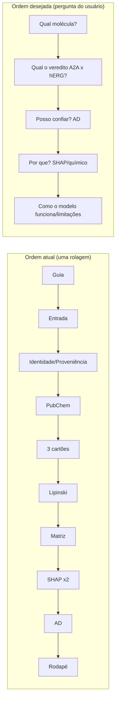
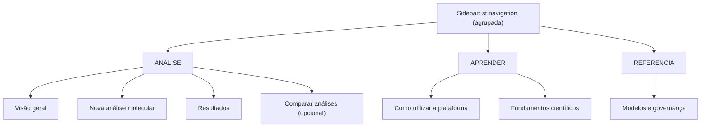

# AUDITORIA_UX_UI_FASE_0 — Diagnóstico de UX/UI do MultiTarget BioPredict

> **Fase 0 — somente diagnóstico.** Nenhum arquivo do projeto foi alterado (código, CSS, modelos, dados, notebooks, dependências). Este relatório é o único arquivo criado. Nenhum commit foi feito.

## 0. Base de evidências e limitações

| Fonte | Uso |
|---|---|
| Leitura integral do fluxo de [`app.py`](file:///c:/Users/Raphael/Documents/BioPredicta/app.py) (2.581 linhas), do CSS embutido, de [`src/ad_utils.py`](file:///c:/Users/Raphael/Documents/BioPredicta/src/ad_utils.py) (cartões de AD) e [`src/pubchem_utils.py`](file:///c:/Users/Raphael/Documents/BioPredicta/src/pubchem_utils.py) | Inventário, redundâncias, consistência |
| Captura de tela enviada por você (Ketcher + erro de SMILES do pireno) | Fluxo de erro de entrada |
| Medições estáticas no código (contagens abaixo) | Poluição visual / dívida de estilo |
| Análise somente leitura dos bits ECFP4 rotulados contra os CSVs curados (3.864 moléculas: 1.364 A2A + 2.500 hERG amostradas, seed 0; nada foi gravado) | Validade dos rótulos químicos dos cartões SHAP |
| Verificação das APIs do Streamlit 1.65.0 instalado | Viabilidade da arquitetura proposta |

**Limitação declarada:** não executei a aplicação em um navegador nesta fase. Os achados de renderização (truncamento, alturas, responsividade) são **inferidos do código/CSS** e marcados como *"verificar visualmente"*. Recomendo uma rodada de capturas (desktop 1440 px, 1024 px, 390 px) como primeiro passo da Fase 1, antes de qualquer edição.

Medições estáticas de [`app.py`](file:///c:/Users/Raphael/Documents/BioPredicta/app.py):

| Métrica | Valor |
|---|---|
| Linhas totais / bloco CSS embutido | 2.581 / ~400 (L63–L467) |
| Chamadas `render_html` / ocorrências de `metric-card` | 12 / 12 |
| Atributos `style=` inline | 87 |
| Literais hexadecimais de cor / cores únicas | 150 / 20 (as variáveis `:root` do tema existem, mas quase não são usadas nos inline) |
| `@media` queries | **0** |
| `st.expander` / `st.tabs` / `st.columns` / `st.pyplot` | 3 / 1 / 7 / 3 |
| Páginas / navegação | 1 página, 0 `st.navigation` |
| Seções empilhadas na mesma rolagem | 17 comentadas (≈ 14 blocos visuais por análise) |

---

## 1. Diagnóstico geral da experiência atual

**O que funciona bem (preservar):**

- Fluxo científico coerente: entrada → padronização RDKit → dois modelos → semáforos → matriz → SHAP → AD.
- Identidade escura consistente com `.streamlit/config.toml` (`base = "dark"`, primário `#00D2BE`).
- Divulgação progressiva já iniciada (expanders de Lipinski, guia rápido, metadados).
- Governança científica madura (avisos de in-sample, escore não calibrado, AD, proveniência).
- Falhas externas (PubChem) degradam sem derrubar a aplicação.

**Problema central:** a aplicação é um *único script linear* que despeja, para **cada molécula**, ~14 blocos de nível de abstração diferente (identidade, proveniência, KPIs, físico-química, matriz, SHAP ×2 abas, 10 cartões ×2, AD ×2, notas metodológicas) em uma rolagem contínua. O usuário iniciante não sabe *o que olhar primeiro*; o pesquisador não encontra *onde está o detalhe técnico*. A sidebar mistura **navegação** (modo de entrada), **conteúdo educacional** (classes operacionais), **governança** (metadados) e **identidade** (rodapé), sem ser navegação de fato.

**Veredito:** a base científica está sólida; a camada de apresentação sofre de **sobrecarga cognitiva por empilhamento**, **repetição de números**, **mistura de níveis de explicação** e **dívida de estilo** (HTML/CSS inline espalhado em 3 módulos).

---

## 2. Inventário das funcionalidades e componentes

| # | Componente | Localização (aprox.) | Tipo | Observação |
|---|---|---|---|---|
| 1 | Config de página (`layout="wide"`, sidebar expandida) | `app.py` L46 | Streamlit | OK |
| 2 | Tema CSS global + `@import` Google Fonts | `app.py` L63–L467 | HTML/CSS | Dependência externa (ver P1-9) |
| 3 | Catálogos químicos (`PHARMACOPHORE_BIT_CATALOG`, `BIT_TRANSLATION_MAP`, `DESCRIPTOR_INFO_CATALOG`) | L471–L930 | Dados estáticos no `app.py` | ~460 linhas de conteúdo dentro da camada de UI |
| 4 | Helpers RDKit de renderização (`render_molecule_dark_base64`, `render_morgan_bit_base64`, `resolve_pharmacophore_details`, `build_pharmacophore_card_html`) | L984–L1250 | Funções | Misturam conteúdo químico e markup |
| 5 | Recursos em cache (`load_models_and_explainers`, `load_ad_reference_cached`) | L1254, L1273 | `@st.cache_resource` | OK |
| 6 | Controles de referência, proveniência (`REFERENCE_CONTROLS`, `resolve_compound_provenance`, `build_control_provenance_html`) | L1289–L1603 | Dados + HTML | |
| 7 | **Sidebar**: título, radio de modo, 2 cartões de modelos, expander de metadados, classes operacionais (LaTeX), caption | L1609–L1668 | `st.sidebar` | Ver §4 |
| 8 | Cabeçalho (`hero-banner`) + expander "Guia Rápido" | L1670–L1722 | HTML + expander | |
| 9 | Submissão: 5 botões de controle / SMILES + atalhos / Ketcher | L1727–L1813 | Widgets | Ver §4-D |
| 10 | Padronização + PubChem + featurização | L1817–L1855 | Lógica | PubChem síncrono, sem spinner |
| 11 | Inferência e classes operacionais (`classify_herg_operational_risk`) | L1859–L1930 | Lógica | Preservar |
| 12 | Cartão de proveniência ("Identidade Verificada & Proveniência") | L1932 | HTML | |
| 13 | Cartão PubChem | L1935 (`pubchem_utils`) | HTML | |
| 14 | Painel de decisão (estrutura 2D + KPI A2A + KPI hERG) | L1943–L2053 | 3 colunas | |
| 15 | Expander Lipinski/físico-química | L2073 | Expander | |
| 16 | Matriz multiobjetivo (`build_multiobjective_figure`, `classify_multiobjective_quadrant`) + cartão diagnóstico | L2120–L2378 | matplotlib + HTML | |
| 17 | Seção XAI: banner Top 10 + 2 abas (A2A/hERG), cada uma com gráfico de barras SHAP + 10 cartões em grade 2×5 | L2380–L2540 | tabs + HTML | Todo o conteúdo das 2 abas é computado a cada execução |
| 18 | Domínio de Aplicabilidade (2 cartões + nota) | L2544 (`ad_utils.build_ad_section_html`) | HTML (módulo separado) | Estilo próprio |
| 19 | Rodapé | L2573 | `st.columns` + caption | |

**Funcionalidades que não existem hoje:** navegação entre seções, botão explícito "Analisar", histórico/comparação, exportação de resultados, glossário, página de metodologia/governança dedicada.

---

## 3. Mapeamento dos principais problemas de UX/UI

### 3.1 Redundância de informação (evidência quantitativa)

| Dado | Aparece em | Vezes |
|---|---|---|
| **pIC50 predito** | cartão de proveniência (L1578), KPI A2A (L1996), cartão diagnóstico da matriz (L2366), título do gráfico SHAP A2A, eixo do gráfico, rótulo no scatter | ≥ 6 |
| **P(hERG) / 1 − P** | cartão de proveniência (L1589), KPI hERG, cartão diagnóstico da matriz, título do SHAP hERG, sidebar (limiares), scatter | ≥ 6 |
| **Limiares 5,0 / 6,5 / 0,30 / 0,70** | sidebar, guia, rótulos dos semáforos, texto do cartão diagnóstico, legenda do scatter | 5 locais |
| **Status in-sample/out-of-sample** | cartão de proveniência (2 badges), cada KPI (2 badges), aviso em amarelo, **e** "Nível 1–4" do cartão de AD | 4 formas de dizer "isto está/não está no treino" |
| **Banner "Auditoria Local de Atributos (Top 10)"** | banner HTML global (L2388) **+** `st.info` na aba A2A (L2417) **+** `st.info` na aba hERG (L2486) | **3× o mesmo aviso** |
| **Metadados do modelo (holdout, refit)** | sidebar (expander), cartão de proveniência, texto dos semáforos, rodapé de AD | 4 |

### 3.2 Hierarquia visual e poluição

1. **Empilhamento de cartões:** `metric-card` + `kpi-box` + `ad-card` + `pharmacophore-card` + badges (`insample`, `semaphore-*`, `shap-tag-*`, `present`, `absent`, `descriptor-val`) → pelo menos **10 estilos de "caixa com borda"** distintos. Borda lateral ciano (hero, proveniência), borda superior colorida (cartões SHAP), borda total (demais): três gramáticas de borda.
2. **Raios/espaçamentos incoerentes:** `metric-card` 12 px; `ad-card` 10 px com padding 18 px e cores literais; `kpi-box` e blocos de AD com `#252A37` literal; cartão PubChem com estilo próprio. Estilos de [`ad_utils.py`](file:///c:/Users/Raphael/Documents/BioPredicta/src/ad_utils.py) e [`pubchem_utils.py`](file:///c:/Users/Raphael/Documents/BioPredicta/src/pubchem_utils.py) **não** usam as classes do `app.py`.
3. **Cor como único canal em pontos-chave:** gráficos SHAP (ciano/vermelho) e algumas badges; o sentido "bom/ruim" **inverte** entre abas (A2A: ciano = aumenta afinidade; hERG: vermelho = aumenta risco). Há legenda no eixo X, mas pequena.
4. **Excesso de emojis decorativos:** 11 cabeçalhos com emoji + 🟢🟡🔴 *e* texto colorido *e* 📌🔬 para o mesmo estado. Competem com o semáforo, que é o sinal principal.
5. **Tipografia pequena:** `0.68–0.78 rem` (11–12 px) em legendas de bits, sub-rótulos de KPI e notas de AD; texto longo em 0.80–0.84 rem em cartões densos.
6. **Hierarquia de títulos inconsistente:** `st.subheader` (h3), `st.markdown("####")` e `div.card-header-title` (não semântico) misturados; títulos longos com parênteses técnicos ("Matriz de Decisão Multiobjetivo (Potência Predita A2A × Margem 1 − P_hERG)").
7. **Ordem invertida da informação:** a primeira coisa após a entrada é a "Identidade Verificada & Proveniência" (texto + 3 KPI + avisos), e só depois o veredito (semáforos). O **resultado-chave está abaixo da dobra** em telas comuns.

### 3.3 Termos científicos — regressões que eu mesmo introduzi na Fase 5.1

> [!IMPORTANT]
> Ao revisar o app com olhar de produto encontrei **retrocessos de governança** nas edições da Fase 5.1 (camada de apresentação). Registro aqui por transparência; a correção só será proposta/feita com sua aprovação.

| Local | Texto atual | Problema | Texto anterior/regra vigente |
|---|---|---|---|
| `app.py` L2036 (tooltip KPI hERG) | "Probabilidade de bloqueio ℹ️" | Chama de *probabilidade* um escore **não calibrado**; removi o aviso visível "Escore do modelo (não calibrado)" | Fases 3C/4B: "escore estimado", "não calibrado" |
| L2041, L2368, L2335 | "**Margem de segurança**" | "Segurança" sugere garantia; a regra do projeto é "índice complementar derivado (1 − P_hERG)", não probabilidade de segurança | "Índice Complementar" |
| L1699 (guia) | "indicam **perfil seguro** (baixo risco)" | Contradiz a governança (classe operacional baixa ≠ segurança clínica) | "classe operacional baixa" |
| L2025, sidebar | "Triagem de **Segurança** hERG", "antitóxica" | Mesma conotação; "antitóxica" é impreciso | "Triagem hERG (Canal Kv11.1)" |
| Guia (L1686+) | "Eficácia Terapêutica" para pIC50 predito | pIC50 predito é **potência in vitro**, não eficácia terapêutica | "Potência predita no receptor A2A" |

### 3.4 Validade dos rótulos químicos dos cartões SHAP (achado de integridade)

Os cartões usam rótulos fixos por bit (`BIT_TRANSLATION_MAP`, `PHARMACOPHORE_BIT_CATALOG`). Como o fingerprint é **dobrado em 1.024 bits**, vários ambientes atômicos diferentes colidem no mesmo bit. Medi, nos CSVs curados, a **fração das ocorrências de cada bit rotulado que corresponde ao ambiente químico dominante**:

| Faixa | Nº de bits rotulados (de 34) | Exemplos (dominância → rótulo atual) |
|---|---|---|
| ≥ 80 % | 16 | fp_904 99 % (F) · fp_726 99 % (anel aromático) · fp_650 98 % (O) · fp_893 97 % (C=O) · fp_831 92 % (n aromático) |
| < 80 % | **18** | fp_234 **16 %** "Núcleo Imídico/Xantínico N-Metilado" · fp_825 17 % · fp_338 21 % "Metileno benzílico/Carbinol arílico" (ambiente dominante é cadeia alifática–N) · fp_312 38 % "Anel Furano/Oxazol" (ambiente dominante é **aminopirimidina**) · fp_517 26 % "Aceptor carbonílico purínico" · fp_807 68 % "Hidroxila/Éter" (68 % são **átomos de carbono**) |
| **Rótulo incorreto** | 1 | **fp_926** "Sistema Aromático Condensado Substituído": 99 % das ocorrências são **um carbono alifático (raio 0)** |

Agravantes:

- Os rótulos de `fp_484`, `fp_825` e `fp_926` **foram adicionados por mim na Fase 5.1 sem validação por dados** — é a origem do rótulo incorreto de `fp_926`.
- O título do cartão vem do dicionário estático, mas a imagem 2D mostra o ambiente **real** da molécula (`bitInfo`). Logo, **título e imagem podem se contradizer na mesma tela**.
- Os textos `role_a2a`/`role_herg` afirmam interações mecanísticas (Asn253, Glu169, Phe168, Phe656/Tyr652) como fato para cada bit; ECFP + SHAP **não** estabelece mecanismo. Deveriam ser apresentados como *hipótese/contexto da literatura*.

### 3.5 Submissão molecular (D)

| Aspecto | Controles | SMILES | Ketcher |
|---|---|---|---|
| Local do seletor de modo | Sidebar (radio) | Sidebar | Sidebar — **controle na sidebar, entrada no corpo**: ações em dois lugares |
| Instrução | Sem texto de orientação | Placeholder longo (cadeia de Istradefilina) | "clique em Apply" (fácil de perder; botão no canto inferior do editor) |
| Validação | — | `st.error` genérico + `st.stop()` | Mesmo `st.error`; **mostra o SMILES bruto ilegível** |
| Estado de carregamento | Nenhum | Nenhum | Nenhum; `st_ketcher` sem `key` (desenho se perde ao trocar de modo/rerun) |
| Rótulo dos botões | 5 colunas com rótulos de ~30 caracteres (`"💊 Istradefilina (CHEMBL431770)"`) → *verificar visualmente truncamento/quebra* | Atalhos duplicam os mesmos 5 controles | — |
| Ação | Reativa (clique roda tudo) | Reativa em `on_change` | Reativa após Apply |

**Caso real (sua captura):** o desenho do pireno usou quatro anéis-modelo cujas duplas de Kekulé colidiram (carbonos de junção sublinhados em vermelho pelo Ketcher). O Ketcher exportou `c1c=cc2c=cc3c=cc=c4c=cc=1=c=2c=3=4`, o RDKit recusou, e a aplicação mostrou "Estrutura Química Inválida… Verifique a valência". A mensagem **não diz *qual* é o problema, não aponta a causa mais provável (valência no editor), não oferece ação** (limpar, abrir SMILES, exemplo) e o restante da página fica indisponível por `st.stop()`.

Outros pontos:

- **Duplicação semântica:** modo "Controles" e "atalhos rápidos" do modo SMILES oferecem os mesmos 5 compostos.
- **Ausência de botão "Analisar"** torna o ciclo de uso implícito; o iniciante não sabe quando a análise "acontece".
- `identify_compound_pubchem` (L1834) é **síncrona**, com dois pedidos de 3,5 s de timeout, **sem spinner** — offline, a página pode ficar até ~7 s sem retorno visual antes de exibir qualquer resultado.

### 3.6 Painel de resultados (E) — avaliação por componente

| Componente | Avaliação | Problema |
|---|---|---|
| Estrutura 2D | Boa; PNG escuro | Altura fixa de 180 px; imagem pequena frente ao espaço; mistura "N bits ativos" (jargão ECFP) no cabeçalho do cartão |
| Potência A2A | Semáforo claro | Repete o pIC50 em ≥ 6 lugares; "(Regressão)/XGBoost ℹ️" ainda é jargão no cabeçalho; `title=` não é acessível |
| Risco hERG | Semáforo claro | Ver §3.3; "Probabilidade de bloqueio" |
| Classes operacionais | Corretas | Dispersas (sidebar, guia, rótulos) — sem fonte única |
| Matriz multiobjetivo | Agora em largura total | Legenda com 4 linhas + 4 áreas sombreadas com rótulos longos (*verificar visualmente sobreposição*); imagem rasterizada (não responsiva ao tema/tela); texto do diagnóstico abaixo repete eixo/valores |
| Diagnóstico farmacológico | Útil | É a **conclusão** e está *depois* do gráfico e fora do "primeiro olhar" |
| Físico-química (Lipinski) | Em expander | Boa decisão; título muito longo; mistura "drogabilidade oral" com A2A/hERG |
| SHAP (barras) | Eixo Y limpo (`fp_X`) | Código sem tradução no gráfico → o leitor precisa descer aos cartões para entender; o aviso Top 10 repete 3× |
| Grade de farmacóforos | Rico | 10 cartões × 2 abas = 20 cartões densos; altura variável (imagem presente/ausente); ver §3.4 |
| Similaridade | Dentro do cartão de AD | Termos `S_max`, `LOO`, "Nível 1–4" sem glossário no ponto de uso |
| Domínio de aplicabilidade | Conteúdo excelente | Aparece **no fim da página**, embora condicione a confiança de **tudo** acima |
| Identificação/PubChem | Útil | Duas "caixas de identidade" (proveniência + PubChem) mais o cartão da estrutura: três lugares para "quem é esta molécula" |

### 3.7 Consistência e qualidade técnica (G)

| Item | Evidência | Gravidade |
|---|---|---|
| `use_container_width` descontinuado | Streamlit 1.65 imprime: *"Please replace `use_container_width` with `width`… will be removed after 2025-12-31"* (3 `st.pyplot` + 1 botão = 4 usos) | Alta (risco de quebra) |
| Fonte externa | `@import url('https://fonts.googleapis.com/…')` (L66) | Média — conflita com o rodapé "Sem dependência de nuvem"; sem rede, cai em fonte padrão e o layout muda |
| Texto contraditório | Rodapé: "Ambiente 100 % Local… Sem dependência de nuvem" × consulta PubChem opcional | Média (precisão de comunicação) |
| Sem `@media` | 0 regras responsivas; grades usam `auto-fit/minmax` (parcialmente resiliente), mas colunas do Streamlit (`st.columns` de 5 botões, 3 KPIs, 2 cartões SHAP) colapsam por regra do framework, não por design | Média — *verificar visualmente em ≤ 1024 px* |
| Computação eager | `st.tabs` executa as duas abas: 2 × `TreeExplainer` + 20 renderizações RDKit por *rerun*, mesmo se o usuário nunca abrir a aba hERG | Média (latência) |
| Aninhamento na sidebar | `st.expander` com LaTeX dentro da sidebar estreita | Baixa |
| Emoji em `st.radio`/`st.button` como chave de lógica | `input_mode == "🧪 Controles de Referência (1-Clique)"` compara a string completa com emoji | Baixa (fragilidade) |
| Acoplamento testes ↔ UI | Os testes lêem `app.py` por AST e **por substring** (ex.: `"Holdout 80/20 prévio"` falhou na 5.1) | Risco de processo (ver §12) |

---

## 4. Análise da arquitetura de informação

**Sidebar atual (6 blocos):** título → *Modo de entrada* (navegação/ação) → *Modelos preditivos locais* (2 cartões) → *Metadados e governança* (expander) → *Classes operacionais* (LaTeX) → caption de hardware.

Classificação por natureza:

| Bloco | Natureza real | Onde deveria estar |
|---|---|---|
| Modo de entrada | Ação/entrada | Área "Nova análise" (corpo), não sidebar |
| Cartões dos modelos | Informação de referência | Página "Modelos e governança"; na sidebar só um *status* de 1 linha |
| Metadados (holdout/refit) | Governança | Página "Modelos e governança" |
| Classes operacionais | Educação + regra de decisão | Guia + legenda única reutilizável (fonte única) |
| Caption de hardware | Rodapé | Rodapé / "Sobre" |

**Funcionalidades agrupadas incorretamente:** entrada molecular na sidebar *e* no corpo; identidade/proveniência/PubChem/estrutura espalhados em 3 blocos; AD (que condiciona a confiança) depois de SHAP; guia de leitura em expander acima dos resultados.

**Informações repetidas/desnecessárias:** ver §3.1 (6 famílias de repetição).

**Fluxo mental do usuário vs. ordem atual**

---

## 5. Separação entre conteúdo químico, farmacológico e computacional

Hoje os cinco níveis pedidos competem na mesma área visual:

| Nível | Onde aparece hoje | Mistura observada |
|---|---|---|
| 1. Uso | Expander de guia + `st.info` + placeholders | Guia mistura uso + farmacologia + SHAP |
| 2. Farmacológico | Semáforos, matriz, diagnóstico | Cartões de semáforo contêm "XGBoost", "predict_proba", "Random Forest" (computacional) |
| 3. Químico | Estrutura, Lipinski, cartões de farmacóforos | Rótulos químicos e imagens misturados com SHAP numérico no mesmo cartão |
| 4. Computacional | Títulos dos gráficos SHAP, banner Top 10, "bits ativos", tooltips | Jargão (ECFP4, bitInfo, SHAP, LOO) dentro de áreas de decisão |
| 5. Governança | Proveniência, avisos in-sample, AD, metadados (sidebar), rodapé | Espalhada em 4 lugares, com 2 taxonomias de "pertence ao treino" |

**Proposta de fronteiras** (cada nível com **um lar** e *links* entre eles):

| Nível | Lar | Aparece no Resultado como |
|---|---|---|
| Uso | Página "Guia" | 1 linha + link "Como ler isto" |
| Farmacológico | Aba/seção "Veredito" | Conteúdo principal |
| Químico | Aba "Estrutura e química" | Sob demanda |
| Computacional | Página "Fundamentos" + `help=` | Ícone de ajuda discreto |
| Governança | Página "Modelos e governança" + selo de confiança no Veredito | 1 selo + link |

---

## 6. Necessidade e estrutura do guia "Como utilizar a plataforma"

**Necessidade: alta.** O guia atual (um expander de 2 colunas) cobre só alvos e SHAP; faltam fluxo de uso, interpretação da matriz, fingerprints/descritores, similaridade/AD e limitações — e vive acima do resultado, competindo com ele.

**Estrutura proposta (página própria, 2 camadas por tópico):**

| Seção | Camada "Essencial" (iniciante) | Camada "Detalhe" (pesquisador, expander) |
|---|---|---|
| 1. Objetivo e fluxo em 4 passos | Escolha → analise → leia o veredito → verifique confiança | Arquitetura do pipeline |
| 2. Como inserir/desenhar | 3 métodos, quando usar cada um, dicas do Ketcher (valência) | Padronização RDKit (sais, cargas, estereoquímica) |
| 3. pIC50 e IC50 | "Quanto maior pIC50, mais potente"; tabela de conversão | `pIC50 = 9 − log10(IC50 nM)`, filtros ChEMBL |
| 4. P(hERG) e 1 − P | "Escore do modelo, não risco clínico" | Random Forest, `predict_proba` não calibrado, Brier |
| 5. Classes operacionais | Tabela única de limiares (**fonte única**) | Origem dos cortes, notação `[0,30; 0,70)` |
| 6. Matriz multiobjetivo | Quadrantes em linguagem simples | Construção do eixo Y derivado |
| 7. SHAP | "Quais fragmentos empurraram a predição" | Valores de Shapley em árvores, base value, colisão de bits |
| 8. Fingerprints e descritores | ECFP4 como "impressão digital" | 1.024 bits + 6 descritores = 1.030 features |
| 9. Similaridade e AD | Como ler `S_max` e os 4 casos de proveniência | Tanimoto, LOO, `Smax_excluding_match` |
| 10. Limitações | Lista curta de "não usar para…" | Escopo de dados, in-sample, extrapolação |
| 11. Glossário | Busca/lista dos termos | — |

Reutilização: o mesmo texto "Essencial" pode alimentar os `help=` e *popovers* no Resultado (fonte única, sem duplicação).

---

## 7. Proposta de nova arquitetura de navegação

**Viabilidade técnica (verificada em Streamlit 1.65.0):** `st.navigation`, `st.Page`, `st.fragment`, `st.dialog`, `st.popover`, `st.segmented_control`, `st.pills`, `st.status`, `st.toast`, `st.html`, `st.badge` estão **disponíveis**. Não é necessário adicionar dependências.

| Página | Conteúdo | Observações de viabilidade |
|---|---|---|
| **Visão geral** | Propósito em 3 frases, fluxo em 4 passos, botão "Iniciar análise", estado dos modelos (1 linha), aviso de uso responsável | Nova; baixo risco |
| **Nova análise molecular** | `st.segmented_control` dos 3 métodos, entrada, **botão "Analisar"**, validação com mensagens acionáveis, pré-visualização 2D antes de rodar | Move o radio da sidebar para o corpo; botão explícito é **mudança funcional** (ver §11-F) |
| **Resultados** | Cabeçalho da molécula (nome/CID/SMILES) → **Veredito** (2 semáforos + selo de confiança AD) → matriz + diagnóstico → abas: *Estrutura e química · Por que (SHAP A2A/hERG) · Confiança (AD/similaridade) · Proveniência* | Estado em `st.session_state["analysis"]`; sem resultado → CTA para "Nova análise" |
| **Comparar análises** | Tabela de snapshots da sessão (SMILES, pIC50, P(hERG), classe, AD) + matriz com vários pontos | Viável com `session_state` (sem persistência, local); **funcionalidade nova** — opcional, P2 |
| **Como utilizar** | §6 | Conteúdo estático |
| **Fundamentos** | Química (ECFP, descritores), computação (XGBoost/RF/SHAP), validação | Reaproveita textos hoje espalhados |
| **Modelos e governança** | Metadados, holdout/refit, datasets, limitações, AD, procedência, versões | Hoje na sidebar/rodapé/AD |

**Sidebar futura (enxuta):** logo/nome, **navegação**, selo de status "Modelos carregados ✓", e rodapé curto. Nada de limiares/LaTeX/cartões.

**Fluxo recomendado do usuário:** Visão geral → Nova análise → (Analisar) → Resultados (Veredito → Confiança → Por quê). O guia fica a 1 clique, nunca no meio do resultado.

> **Ressalva de viabilidade:** `st.stop()` hoje encerra o script inteiro; em multipágina ele encerra só a página corrente — comportamento compatível, mas a lógica de "stop por entrada inválida" deve virar estados explícitos (ver §12).

---

## 8. Hierarquia visual e identidade dos componentes

**Princípio:** *um sinal dominante por tela*. Nos Resultados: o **Veredito** (2 semáforos) domina; tudo mais é secundário/terciário.

### 8.1 Níveis de superfície (substituir ~10 estilos por 4)

| Nível | Uso | Estilo |
|---|---|---|
| N0 | Fundo | `#0E1117` |
| N1 | Superfície de conteúdo (seções) | `#1E222D`, raio 12 px, sem borda colorida |
| N2 | Cartão de dado (KPI, AD, SHAP) | `#252A37`, raio 10 px, borda 1 px `--border-subtle` |
| N3 | Estado/alerta | Fundo translúcido + ícone + texto (nunca só cor) |

Borda colorida **somente** para estado semântico (verde/âmbar/vermelho do semáforo; âmbar do aviso in-sample). Remover borda lateral decorativa do hero e do cartão de proveniência.

### 8.2 Tokens (fonte única)

- Cores: usar **apenas** variáveis `--*` (hoje 20 hex únicos com 150 ocorrências); adicionar tokens semânticos: `--state-good/warn/bad/info`, `--surface-1/2`.
- Tipografia: mínimo **0,85 rem (≈ 14 px)** para texto corrido; 0,75 rem apenas para rótulos em maiúsculas curtas. Escala: título de página 1,8 / seção 1,3 / cartão 1,05 / corpo 0,95 / rótulo 0,8.
- Espaçamento: grade de 8 px (0,5 / 1 / 1,5 rem).
- Iconografia: no máximo **1 ícone por título de seção**; remover emojis dos corpos de cartão; manter 🟢🟡🔴 *apenas* no semáforo (e sempre acompanhados de texto).
- Centralização: mover CSS e *builders* de HTML para um módulo de UI (`src/ui/theme.py`, `components.py`), usado também por `ad_utils`/`pubchem_utils` (hoje cada um tem estilo próprio).

### 8.3 Padrão de componente "KPI de decisão"

`[rótulo curto]` → `[valor grande]` → `[classe operacional com ícone+texto]` → `[1 linha de leitura]` → `[ⓘ ajuda (popover)]`. Sem jargão computacional no corpo; "XGBoost/RF" vão para o popover/Fundamentos.

---

## 9. Recomendações para gráficos, cartões, indicadores e resultados

**Veredito (topo de Resultados):** dois KPIs lado a lado, mesma altura, e à direita um **selo de confiança** derivado do AD ("Nível de proveniência 4 · S_max 0,42 → extrapolação") — traz o AD para o primeiro olhar sem alterar o cálculo.

**Matriz multiobjetivo**

- Reduzir a legenda: 4 linhas de limiar viram **marcas nos eixos**; rótulos longos de quadrante → 4 rótulos curtos (já existentes) e legenda externa de 1 linha.
- Manter matplotlib (sem nova dependência); trocar `use_container_width=True` por `width="stretch"`.
- Diagnóstico textual em **1 frase + chip do quadrante**, sem repetir pIC50/P (já estão no Veredito).

**SHAP**

- Um único aviso Top 10 (remover 2 das 3 ocorrências), preferencialmente como *caption* do gráfico.
- Eixo Y: manter o código (`fp_831`) **e** exibir o nome curto traduzido apenas quando o rótulo for confiável (§3.4); caso contrário, "ambiente mais frequente" ou só o código.
- Computar a aba hERG sob demanda (`st.fragment`/seleção por `st.segmented_control` em vez de `st.tabs`) para reduzir latência.
- Legenda explícita do sentido da cor **dentro** de cada gráfico (A2A e hERG têm polaridade oposta).

**Cartões de farmacóforo**

- Altura uniforme (área de imagem fixa; ❌ com mesmo tamanho), título = **código + nome** *com selo "ilustrativo"* quando a dominância do ambiente < 80 %; descrição mecanística rotulada como **"contexto da literatura (hipótese)"**.
- Mostrar 3–4 cartões por padrão e "Ver todos os 10" em expander.

**Indicadores e classes:** uma função/tabela única de limiares alimentando sidebar (removida), guia, rótulos e legenda — elimina a divergência por cópia.

**Identificação da molécula:** fundir proveniência + PubChem + estrutura em **um** cabeçalho "Molécula analisada" (nome, CID, fórmula, SMILES, selo in-sample); detalhes de proveniência numa aba.

**Estados de interface (novos):** `st.status`/spinner para PubChem; skeleton/`st.empty` para SHAP; mensagens de erro de entrada acionáveis (§10); *toast* de "Análise concluída".

---

## 10. Experiência para iniciantes e pesquisadores

| Elemento | Iniciante (padrão) | Pesquisador (sob demanda) |
|---|---|---|
| Veredito | Linguagem simples + semáforo + 1 frase | Valores exatos, IC50, `P(hERG)` com 3 casas |
| Ajuda | `ⓘ` com 2 linhas (popover) | Link "Detalhes técnicos" → Fundamentos |
| SHAP | "Fragmentos que mais pesaram", 3 cartões | 10 atributos, valores SHAP, base value |
| Confiança | Selo (alta/média/baixa) com explicação curta | S_max, LOO, níveis 1–4, vizinho mais próximo |
| Modelos | Resumo de 2 linhas | Hiperparâmetros, métricas holdout, refit, datasets |
| Alternância | `st.segmented_control` global "Modo: Essencial / Técnico" persistido em `session_state` | — |

O **modo Essencial/Técnico** é um *filtro de apresentação* (nenhum cálculo muda): em "Técnico" os expanders abrem e as colunas técnicas aparecem; em "Essencial" ficam recolhidos.

**Mensagens de erro de entrada (modelo):**

> ❌ **Não foi possível interpretar a estrutura.** O RDKit recusou o SMILES enviado pelo Ketcher (provável **erro de valência**: carbono com mais de 4 ligações — no editor, átomos sublinhados em vermelho). **O que fazer:** corrija as ligações duplas dos átomos marcados ou cole um SMILES no método "Inserir SMILES". [Limpar] [Ver exemplo (pireno)]

---

## 11. Lista priorizada de melhorias

Classificação: **[U]** = apenas apresentação · **[F]** = envolve alteração funcional/de conteúdo científico (justificada ao final).

### P0 — críticos

| ID | Item | Onde | Tipo |
|---|---|---|---|
| P0-1 | **Revisar rótulos químicos dos bits** (18/34 mapeiam < 80 % do ambiente dominante; `fp_926` incorreto) — marcar como ilustrativos, ou derivar do ambiente real, ou remover os não validados; rotular mecanismos como hipótese | `BIT_TRANSLATION_MAP`, `PHARMACOPHORE_BIT_CATALOG`, `build_pharmacophore_card_html` | **[F]** (conteúdo científico) |
| P0-2 | **Corrigir regressões terminológicas da 5.1** ("Probabilidade de bloqueio", "Margem de segurança", "perfil seguro", "Triagem de Segurança", "Eficácia terapêutica"; restaurar "escore não calibrado" visível) | L2025, L2036, L2041, L2335, L2368, L1686–L1699 | [U] (texto) |
| P0-3 | **Estrutura de navegação** (`st.navigation` + páginas), tirando 17 seções de uma só rolagem | `app.py` inteiro | [U] |
| P0-4 | **Erro de entrada acionável** (Ketcher/SMILES) sem `st.stop()` que oculte a página; preservar desenho com `key` | L1802–L1829 | [U] (+ pequena alteração de fluxo) |
| P0-5 | **Substituir `use_container_width`** por `width="stretch"/"content"` (descontinuado) | 3 `st.pyplot`, 1 `st.button` | [U] |

### P1 — alta prioridade

| ID | Item | Onde | Tipo |
|---|---|---|---|
| P1-1 | Veredito em primeiro (acima de proveniência/PubChem) + selo de confiança do AD | L1932–L2053 | [U] |
| P1-2 | Eliminar redundâncias (pIC50/P(hERG) ≥ 6×; Top 10 3×; limiares 5×) com **fonte única** | vários | [U] |
| P1-3 | Página "Como utilizar a plataforma" + glossário (§6) | nova | [U] |
| P1-4 | Páginas "Fundamentos" e "Modelos e governança"; sidebar enxuta | L1609–L1668 | [U] |
| P1-5 | Unificar taxonomias de proveniência (in-sample × níveis 1–4) em um bloco único com legenda | `build_control_provenance_html`, `ad_utils.build_ad_card_html` | [U] |
| P1-6 | Módulo de tema/componentes (tokens, 4 níveis de superfície) e uso por `ad_utils`/`pubchem_utils` | CSS L63–L467 + 3 módulos | [U] |
| P1-7 | Estados de carregamento (PubChem com spinner/timeout visível; SHAP sob demanda) | L1834, L2380–L2540 | [U] (+ `st.fragment`) |
| P1-8 | Cartões SHAP: altura uniforme, 3–4 por padrão, "ver todos" | `build_pharmacophore_card_html` | [U] |
| P1-9 | Remover `@import` externo (fontes locais/fallback) e corrigir texto "sem dependência de nuvem" | L66, L2580 | [U] (+ texto) |
| P1-10 | Tooltips acessíveis (`help=`/popover) no lugar de `title=` | KPIs | [U] |
| P1-11 | Modo "Essencial/Técnico" | global | [U] |
| P1-12 | Botão explícito "Analisar" e pré-visualização 2D antes de rodar | Nova análise | **[F]** (fluxo) |

### P2 — refinamento

| ID | Item | Tipo |
|---|---|---|
| P2-1 | Escala tipográfica mínima 0,85 rem; revisar contraste de `#94A3B8` em fundos N2 | [U] |
| P2-2 | Reduzir emojis; um ícone por seção; semântica de títulos (h1–h3) | [U] |
| P2-3 | Matriz: legenda externa, rótulos curtos, marcas nos eixos | [U] |
| P2-4 | Comparação de análises na sessão (tabela + matriz multi-ponto) | **[F]** (nova função) |
| P2-5 | Exportar resultado (CSV/JSON da sessão) | **[F]** |
| P2-6 | Regras `@media` para ≤ 1024 px / ≤ 640 px (e verificação em 390 px) | [U] |
| P2-7 | Botões de controle com rótulo curto + legenda (nome / ID ChEMBL em segunda linha) | [U] |
| P2-8 | Padronizar idioma (glossário PT-BR para `In-Sample`, `S_max`, `LOO`) | [U] |

**Justificativa das mudanças [F]:** P0-1 corrige *conteúdo* científico exibido (risco de interpretação química incorreta); P1-12 altera o gatilho da análise (reativo → explícito) para dar controle e permitir pré-visualização; P2-4/P2-5 são funcionalidades novas, opcionais. Nenhuma altera modelos, dados, limiares, cálculos ou classificações.

---

## 12. Riscos técnicos e dependências

| Risco | Detalhe | Mitigação |
|---|---|---|
| **Testes acoplados ao `app.py`** | `tests/test_controls_and_interpretation.py` e `tests/test_multiobjective_plot.py` extraem funções por **AST** de `app.py` e verificam **substrings** de texto da UI | Antes de mover funções para módulos, migrar os testes para importar de `src/ui/...` e trocar asserções de copy por asserções de constantes; manter os testes de limiares intactos |
| Reestruturação grande (2,5 mil linhas) | Risco de regressão silenciosa | Fatiar em PRs: (1) extrair catálogos/CSS sem mudar saída; (2) páginas; (3) tema; comparar *HTML gerado* antes/depois |
| `st.stop()` e multipágina | Fluxo de erro hoje depende de `st.stop()` global | Estado explícito (`session_state["analysis"]`, `status`) e `st.error` local |
| `session_state` entre páginas | Resultado precisa sobreviver à troca de página | Guardar *snapshot* serializável (SMILES canônico, predições, AD), recalcular sob demanda com cache |
| Ketcher (`streamlit-ketcher==0.0.1`) | Componente iframe; estado se perde sem `key`; comportamento em multipágina a validar | Atribuir `key`; teste manual de troca de página |
| PubChem | Rede opcional, bloqueante | Spinner + timeout curto + cache em `st.cache_data` |
| Determinismo científico | Qualquer mudança de apresentação não pode alterar números | Testes de regressão numérica (pIC50/P/SHAP dos 5 controles) e hashes de modelos/dados antes e depois (já praticado nas fases anteriores) |
| `use_container_width` | Já descontinuado | P0-5 |
| Sem navegador de teste automatizado | Visual não coberto por pytest | Capturas de tela padronizadas (desktop/tablet/mobile) como parte dos critérios |
| Dependências | Nada novo é necessário (Streamlit 1.65 cobre navegação, fragments, popover, segmented control) | Proibir novas libs na Fase 1 |

---

## 13. Critérios de aceitação para as próximas fases

**Integridade (todas as fases)**
- [ ] SHA-256 de `models/*.joblib` e `data/processed/*` idênticos antes/depois.
- [ ] Predições dos 5 controles (pIC50, P(hERG), valores SHAP) numericamente idênticas.
- [ ] Limiares 5,0 / 6,5 / 0,30 / 0,70 e notação `P < 0,30 | 0,30 ≤ P < 0,70 | P ≥ 0,70` preservados.
- [ ] Suíte `pytest -m "not benchmark"` verde, sem avisos novos; nenhum commit sem autorização.

**Arquitetura e navegação**
- [ ] Navegação lateral com ≥ 6 páginas agrupadas; nenhuma página com mais de **~5 blocos primários**.
- [ ] Sidebar sem conteúdo de referência (limiares, LaTeX, metadados).
- [ ] Resultados exibem o **Veredito e o selo de confiança sem rolagem** em 1440×900.
- [ ] Cada número-chave (pIC50, P(hERG)) aparece **no máximo 2×** no Resultado (Veredito + detalhe).

**Conteúdo e governança**
- [ ] Nenhum rótulo químico de bit apresentado como definitivo sem validação (dominância ≥ 80 % **ou** selo "ilustrativo"); nenhum caso de título contradizendo a imagem do cartão.
- [ ] Terminologia: "escore estimado não calibrado", "índice complementar derivado", "potência predita"; ausência de "perfil seguro", "probabilidade de bloqueio", "margem de segurança".
- [ ] Os 5 níveis de conteúdo (uso, farmacológico, químico, computacional, governança) têm lar único; links entre eles.
- [ ] Guia com as 11 seções do §6, em duas camadas (Essencial/Detalhe).

**Qualidade visual e técnica**
- [ ] ≤ 4 níveis de superfície; 100 % das cores via tokens; 0 `@import` externo.
- [ ] Texto corrido ≥ 0,85 rem; contraste ≥ 4,5:1 (WCAG AA) nos textos secundários.
- [ ] Sem `use_container_width` descontinuado; sem *warnings* de depreciação no log.
- [ ] Estados de carregamento visíveis para PubChem e SHAP; erro de entrada com ação sugerida; entrada inválida **não** oculta o restante da navegação.
- [ ] Capturas aprovadas em 1440 / 1024 / 390 px sem texto cortado ou sobreposto; alturas de cartões uniformes na mesma linha.
- [ ] Alternância Essencial/Técnico funcional e persistente na sessão.

---

## Resumo executivo

**Principais problemas**
1. Página única com ~14 blocos empilhados por análise; sidebar mistura navegação, educação e governança; sem navegação real.
2. Repetição massiva (pIC50 e P(hERG) ≥ 6×, aviso Top 10 3×, limiares 5×, 4 formas de dizer "in-sample") e ordem invertida (identidade antes do veredito; AD no fim).
3. **Integridade de conteúdo:** 18 dos 34 rótulos químicos de bits cobrem < 80 % das ocorrências do ambiente que dizem representar (`fp_926` é incorreto); mecanismos apresentados como fato.
4. **Regressões terminológicas da Fase 5.1 (minhas):** "probabilidade de bloqueio", "margem de segurança", "perfil seguro" contradizem a governança do escore não calibrado.
5. Fluxo de erro de entrada pouco acionável (caso do pireno), sem estados de carregamento, e `use_container_width` descontinuado.
6. Dívida de estilo: ~10 estilos de caixa, 87 `style=` inline, 150 literais de cor, 0 `@media`, fonte externa vs. promessa "100 % local".

**O que deve mudar na experiência:** Veredito primeiro e selo de confiança no topo; detalhes técnicos sob demanda (modo Essencial/Técnico); guia e fundamentos em páginas próprias; mensagens de erro que dizem *o que fazer*; menos ícones, mais hierarquia.

**O que deve permanecer intacto:** modelos, dados, limiares e classificações, cálculos, SHAP, AD, PubChem resiliente, identidade escura, testes de regressão científica, aviso de in-sample.

**Arquitetura recomendada:** `st.navigation` agrupada — *Análise* (Visão geral · Nova análise · Resultados · [Comparar]) / *Aprender* (Como utilizar · Fundamentos) / *Referência* (Modelos e governança); sidebar enxuta; Resultados em *Veredito → Confiança → Por quê → Química → Proveniência*.

**Sequência sugerida (cada etapa com aprovação)**
1. **Fase 1a — Correções P0 de conteúdo e texto** (P0-1, P0-2, P0-5) + capturas de linha de base.
2. **Fase 1b — Infraestrutura:** extrair CSS/catálogos/componentes para módulos, migrar testes acoplados ao `app.py`, tokens de tema.
3. **Fase 2 — Navegação e páginas:** `st.navigation`, "Nova análise" (P0-4), "Resultados" com Veredito primeiro.
4. **Fase 3 — Conteúdo didático:** Guia, Fundamentos, Modelos e governança, modo Essencial/Técnico.
5. **Fase 4 — Refinamento:** gráficos, cartões SHAP, responsividade, acessibilidade; opcionais P2 (comparação, exportação).

**Decisões que preciso de você antes da Fase 1:** (a) tratamento dos rótulos de bits — *selo "ilustrativo"*, *derivar do ambiente real* ou *remover os não validados*; (b) aprovar o botão explícito "Analisar" (P1-12); (c) se o histórico/comparação (P2-4) entra no escopo.

*Fase 0 encerrada. Aguardando sua avaliação e aprovação explícita antes de qualquer implementação.*

