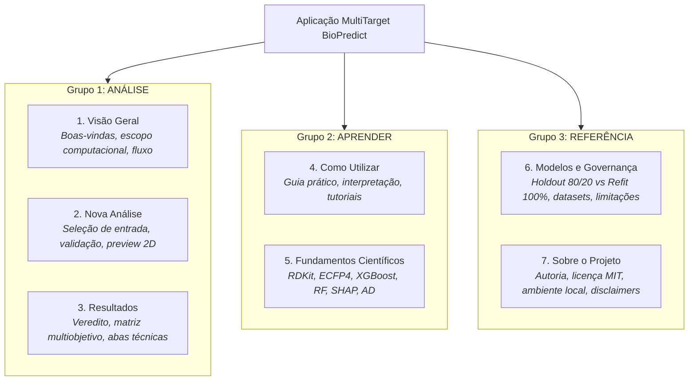
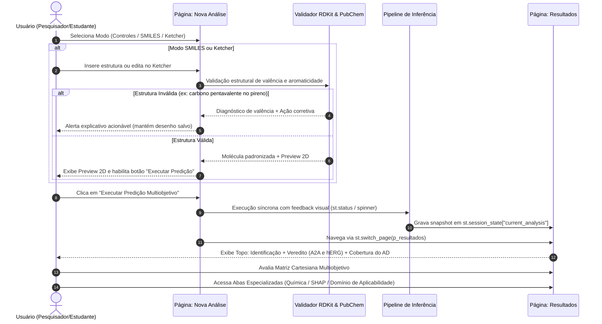

# PLANEJAMENTO_UX_UI_FASE_1 — Planejamento Técnico da Reformulação UX/UI
## Projeto MultiTarget BioPredict

> **Status:** Documento de Planejamento Técnico e Arquitetural (Fase 1 — Revisão Complementar).  
> **Natureza da Tarefa:** Estritamente documental e analítica.  
> **Execução de Código:** Bloqueada nesta etapa. Nenhum arquivo funcional (`.py`, `.joblib`, `.csv`, `.parquet`, `.json`, `.toml`) foi alterado. Nenhum commit realizado.  
> **Base de Decisões Aprovadas:** Abordagem Ilustrativa para SHAP/ECFP4; Abordagem Híbrida (Apresentação Essencial padrão + Detalhamento Técnico independente por seção); Adiamento de Histórico/Comparação de Moléculas.

---

## 1. Diagnóstico Resumido e Matriz de Prioridades

Com base nos achados quantitativos e qualitativos da [`AUDITORIA_UX_UI_FASE_0.md`](file:///c:/Users/Raphael/Documents/BioPredicta/AUDITORIA_UX_UI_FASE_0.md), a interface atual do MultiTarget BioPredict repousa sobre uma base científica sólida (modelos treinados supervisionados, featurização robusta via RDKit, cálculo de Domínio de Aplicabilidade e interpretabilidade via SHAP TreeExplainer), porém sofre de severa **sobrecarga cognitiva por empilhamento linear** em um único script de 2.581 linhas ([`app.py`](file:///c:/Users/Raphael/Documents/BioPredicta/app.py)).

### 1.1 Síntese do Diagnóstico
1. **Sobrecarga e Ausência de Hierarquia:** Cerca de 14 blocos visuais e 17 seções comentadas são executados em rolagem vertical contínua para cada molécula submetida. O veredito executivo e o selo de cobertura do Domínio de Aplicabilidade (AD) competem com metadados brutos e cartões explicativos densos.
2. **Redundância Numérica Excessiva:** O valor de $pIC_{50}$ e o escore estimado $P(\text{hERG})$ repetem-se $\ge 6$ vezes ao longo da página; os limiares operacionais aparecem em 5 locais diferentes; e avisos conceituais (como o banner "Top 10") duplicam-se em 3 locais distintos.
3. **Integridade de Conteúdo Químico e Protocolo SHAP (Achado P0):** A auditoria dos 34 bits Morgan rotulados revelou que 18 cobrem menos de 80% do subambiente dominante e o bit `fp_926` foi rotulado erroneamente como sistema aromático condensado (quando 99% das ocorrências representam carbono alifático de raio 0). Além disso, notas mecanísticas apontavam interações pontuais de resíduos de aminoácidos como certezas biofísicas, extrapolando a capacidade explicativa de representações 2D bidimensionais dobradas.
4. **Regressões Terminológicas da Camada Visual:** A introdução prévia de termos como "Probabilidade de bloqueio", "Margem de segurança" e "Perfil seguro" distorce a natureza não calibrada do classificador Random Forest de hERG e a interpretação puramente in vitro do $pIC_{50}$.
5. **Dívida Técnica de Apresentação:** Coexistência de 87 atributos `style=` inline, 150 literais hexadecimais, ausência de media queries responsivas, dependência externa de Google Fonts via `@import` e uso do parâmetro descontinuado `use_container_width` do Streamlit.

### 1.2 Matriz de Prioridades (P0, P1, P2)

```mermaid
quadrantChart
    title Matriz de Prioridades de Implementação
    x-axis Baixo Impacto Visual/Científico --> Alto Impacto Visual/Científico
    y-axis Alta Complexidade Técnica --> Baixa Complexidade Técnica
    quadrant-1 Ações Rápidas de Alto Valor (P0/P1)
    quadrant-2 Grandes Reformulações Estruturais (P0/P1)
    quadrant-3 Melhorias Secundárias (P2)
    quadrant-4 Otimizações Pontuais (P1/P2)
    "P0-2 Correção Terminológica": [0.85, 0.90]
    "P0-5 Depreciação use_container_width": [0.70, 0.85]
    "P0-1 Protocolo Ilustrativo SHAP": [0.90, 0.70]
    "P0-4 Validação Reativa sem st.stop": [0.80, 0.65]
    "P0-3 Arquitetura de Navegação": [0.95, 0.35]
    "P1-1 Veredito e Selo AD no Topo": [0.85, 0.75]
    "P1-6 Design System e Tokens": [0.75, 0.45]
    "P1-3 Central de Ajuda e Glossário": [0.65, 0.60]
    "P1-7 Estados de Carregamento/Spinner": [0.60, 0.70]
    "P2-1 Tipografia e Acessibilidade": [0.45, 0.80]
    "P2-3 Otimização da Matriz Multiobjetivo": [0.55, 0.50]
```

* **P0 — Críticos (Bloqueadores de Integridade e Arquitetura):**
  * `P0-1`: Implementar o protocolo de apresentação estritamente ilustrativa dos cartões SHAP/ECFP4, corrigindo a definição de `fp_926`, diferenciando descrição observacional de hipóteses da literatura, e esclarecendo que o critério empírico de dominância não é prova de identidade universal nem causalidade biológica.
  * `P0-2`: Sanear as regressões terminológicas e fixar a convenção canônica de limiares hERG: $P < 0.30$ (Baixo), $0.30 \le P \le 0.70$ (Moderado, incluindo exatamente 0.70) e $P > 0.70$ (Alto).
  * `P0-3`: Estruturar a navegação modular (7 páginas lógicas com `st.navigation`), decompondo o monólito em fluxos especializados.
  * `P0-4`: Implementar ciclo de entrada molecular resiliente e acionável (sem `st.stop()` cego; Ketcher com preservação de estado via `key`).
  * `P0-5`: Substituir as chamadas descontinuadas `use_container_width` por `width="stretch"` / `width="content"`.

* **P1 — Alta Prioridade (Experiência do Usuário e Clareza Científica):**
  * `P1-1`: Painel de Resultados com Veredito Executivo em primeiro plano e Selo de Cobertura do Domínio de Aplicabilidade integrado.
  * `P1-2`: Eliminação de redundâncias numéricas mediante centralização em fonte única de verdade.
  * `P1-3`: Criação das páginas didáticas e metodológicas ("Como utilizar", "Fundamentos científicos", "Modelos e governança").
  * `P1-6`: Implementação do Design System unificado em módulo próprio (`src/ui/theme.py`), padronizando superfícies e eliminando dependências externas (`@import`).
  * `P1-7`: Feedback visual explícito durante a execução síncrona (PubChem e pipeline de inferência) via `st.status` / `st.spinner`.

* **P2 — Refinamento e Polimento (Design e Acessibilidade):**
  * `P2-1`: Ajuste da escala tipográfica (mínimo 0.85 rem / 14 px) e contraste WCAG AA.
  * `P2-2`: Racionalização semântica de ícones e eliminação de emojis decorativos concorrentes.
  * `P2-3`: Refinamento da Matriz Multiobjetivo (legendas compactas, sem sobreposição aos quadrantes).
  * `P2-6`: Implementação de regras `@media` para viewports tablet ($\le 1024\text{ px}$) e mobile ($\le 640\text{ px}$).

---

## 2. Arquitetura de Informação Proposta

A aplicação será reestruturada em **7 páginas lógicas**, organizadas na barra lateral em três agrupamentos semânticos claros: **ANÁLISE**, **APRENDER** e **REFERÊNCIA**. Essa separação garante que a avaliação computacional não seja obscurecida pela documentação metodológica, mantendo esta última disponível sob demanda a um clique.



---

## 3. Mapa de Navegação e Responsabilidades de Cada Página

### 3.1 Estratégia de Navegação no Streamlit 1.65.0

A navegação será implementada utilizando exclusivamente a API nativa de multipage do Streamlit 1.65:
- **`st.navigation` associada a `st.Page` com referências a funções executáveis (*callables*):**  
  As páginas não serão arquivos soltos na pasta `pages/` (padrão legado descontinuado para projetos estruturados), mas sim funções de renderização importadas de submódulos do novo pacote `src/ui/pages/`.
- **Transição Programática Compatível:**  
  A transição da tela de análise para a tela de resultados será realizada passando o próprio objeto de página ou seu `url_path`:
  ```python
  # Definição das páginas no orquestrador principal (app.py)
  p_analise = st.Page(render_nova_analise, title="Nova Análise", url_path="nova-analise", icon="🧪")
  p_resultados = st.Page(render_resultados, title="Resultados", url_path="resultados", icon="📊")

  # Transição compatível após a inferência
  st.switch_page(p_resultados)  # utiliza a instância de st.Page, sem caminhos de arquivos legados
  ```

### 3.2 Persistência do Estado da Análise em `st.session_state`

Para garantir que o resultado sobreviva à navegação entre as páginas sem perda de dados e sem reprocessamentos custosos, estabelece-se o seguinte protocolo de sessão:

1. **Chave Canônica:** `st.session_state["current_analysis"]` armazena um dicionário com o snapshot completo da última molécula avaliada:
   - `canonical_smiles`: String do SMILES padronizado via RDKit.
   - `mol_obj`: Objeto molecular `rdkit.Chem.Mol` (em cache de memória).
   - `descriptors_2d`: Dicionário com descritores físico-químicos (MolWt, LogP, TPSA, HBD, HBA, RotBonds).
   - `pubchem_info`: Metadados recuperados via PubChem (IUPAC, sinônimos, CID, nomes comerciais).
   - `provenance`: Metadados de proveniência (status in-sample nos conjuntos de treino A2A e hERG, valores de ensaio ChEMBL para controles de referência).
   - `predictions`: Valores determinísticos do modelo (`pred_pIC50`, `pred_IC50_nM`, `prob_herg`, `safety_index_complementary`).
   - `classifications`: Classes operacionais atribuídas ($A_{2A}$, $\text{hERG}$, quadrante da matriz).
   - `ad_results`: Diagnóstico de cobertura estrutural do AD (níveis 1 a 4, $S_{\max}$ e vizinhos de referência).
   - `shap_data`: Matriz de valores SHAP locais e mapeamento de bits ativos via `bitInfo`.
2. **Resiliência a Acessos Diretos:** Caso o usuário acesse `/resultados` sem uma análise prévia em `session_state`, a página renderizará um estado vazio amigável com botão direcionando para `p_analise`.

### 3.3 Responsabilidades por Página

```
┌──────────────────────────────────────────────────────────────────────────────────┐
│                                 MAPA DE PÁGINAS                                 │
├───────────────────────┬──────────────────────────┬───────────────────────────────┤
│ Página (Rota)         │ Responsabilidade Central │ Componentes Primários         │
├───────────────────────┼──────────────────────────┼───────────────────────────────┤
│ 1. Visão Geral        │ Contextualização rápida  │ • Banner explicativo do escopo│
│    (/)                │ e ponto de partida.      │ • Pipeline em 4 etapas (cards)│
│                       │                          │ • Verificação de modelos (.job│
│                       │                          │ • Botão "Iniciar Nova Análise"│
├───────────────────────┼──────────────────────────┼───────────────────────────────┤
│ 2. Nova Análise       │ Entrada, edição e        │ • Segmented Control (3 modos) │
│    (/nova-analise)    │ pré-validação molecular. │ • Grid de 5 Controles         │
│                       │                          │ • Editor Ketcher (key fixa)   │
│                       │                          │ • Preview 2D pré-execução     │
│                       │                          │ • Botão "Executar Predição"   │
├───────────────────────┼──────────────────────────┼───────────────────────────────┤
│ 3. Resultados         │ Avaliação computacional  │ • Identificação unificada     │
│    (/resultados)      │ multiobjetivo e análise  │ • Veredito (Potência e hERG)  │
│                       │ aprofundada dos alvos.   │ • Selo de Cobertura do AD     │
│                       │                          │ • Matriz Cartesiana Ajustada  │
│                       │                          │ • 3 Abas Técnicas Especializ. │
├───────────────────────┼──────────────────────────┼───────────────────────────────┤
│ 4. Como Utilizar      │ Onboarding e guia        │ • Guia prático em 2 níveis    │
│    (/como-utilizar)   │ didático de operação.    │ • Tabela única de limiares    │
│                       │                          │ • Leitura dos Quadrantes      │
│                       │                          │ • Glossário Químico-Farmacol. │
├───────────────────────┼──────────────────────────┼───────────────────────────────┤
│ 5. Fundamentos        │ Rigor metodológico e     │ • Featurização RDKit/ECFP4    │
│    (/fundamentos)     │ embasamento teórico.     │ • Algoritmos XGBoost e RF     │
│                       │                          │ • Formulação SHAP TreeExplain.│
│                       │                          │ • Métricas Tanimoto e AD      │
├───────────────────────┼──────────────────────────┼───────────────────────────────┤
│ 6. Modelos e          │ Transparência, métricas  │ • Holdout 80/20 vs Refit 100% │
│    Governança         │ e limitações operacion.  │ • Datasets ChEMBL e TDC       │
│    (/governanca)      │                          │ • Aviso de escore não calib.  │
│                       │                          │ • Indicação de extrapolação   │
├───────────────────────┼──────────────────────────┼───────────────────────────────┤
│ 7. Sobre o Projeto    │ Metadados acadêmicos e   │ • Autoria institucional       │
│    (/sobre)           │ conformidade técnica.    │ • Licença MIT e Repositório   │
│                       │                          │ • Requisitos de Hardware Local│
│                       │                          │ • Termo de Uso em Pesquisa    │
└───────────────────────┴──────────────────────────┴───────────────────────────────┘
```

---

## 4. Jornada Completa do Usuário

O fluxo operacional foi desenhado para eliminar a confusão entre entrada de dados e visualização de resultados, garantindo um ciclo de feedback claro e determinístico:



### Detalhamento das Etapas:
1. **Seleção de Entrada:** Seleção intuitiva via `st.segmented_control` no corpo da tela.
2. **Pré-validação Reativa:** Ao digitar ou desenhar, a estrutura é validada pelo RDKit. Se válida, exibe preview 2D imediato. Se inválida, alerta com orientação clara, sem `st.stop()` que oculte a interface e sem apagar o desenho do Ketcher.
3. **Execução Explícita:** Disparo intencional via botão com feedback visual de etapas (`st.status`).
4. **Veredito em Primeiro Olhar:** Exibição imediata na tela de Resultados da resposta central: potência predita in vitro no alvo terapêutico ($A_{2A}$), escore predito no canal antitóxico ($\text{hERG}$) e a cobertura do Domínio de Aplicabilidade (AD).
5. **Exploração Técnica Opcional:** Consulta sob demanda às propriedades físico-químicas, aos subambientes dos cartões SHAP ilustrativos ou aos vizinhos estruturais do AD.

---

## 5. Proposta de Organização da Tela "Nova Análise"

A tela de submissão resolve o problema de fragmentação entre a barra lateral e o corpo principal:

```
┌──────────────────────────────────────────────────────────────────────────────────┐
│  🧪 NOVA ANÁLISE MOLECULAR                                                      │
│  Selecione a forma de entrada da molécula para avaliação multiobjetivo           │
├──────────────────────────────────────────────────────────────────────────────────┤
│                                                                                  │
│   [ 💊 Controles de Referência ]  [ ✏️ Inserir SMILES ]  [ 🔬 Desenhar Estrutura ]│
│                                                                                  │
├──────────────────────────────────────────────────────────────────────────────────┤
│  CASO 1: Controles de Referência Selecionado                                     │
│  ┌────────────────┐ ┌────────────────┐ ┌────────────────┐ ┌────────────────┐    │
│  │ Istradefilina  │ │ Cafeína        │ │ Preladenant    │ │ Terfenadina    │ ...│
│  │ CHEMBL431770   │ │ CHEMBL113      │ │ CHEMBL1201585  │ │ CHEMBL22       │    │
│  │ Treino A2A     │ │ Treino A2A     │ │ Out-of-Sample  │ │ Treino hERG    │    │
│  │ [ Selecionar ] │ │ [ Selecionar ] │ │ [ Selecionar ] │ │ [ Selecionar ] │    │
│  └────────────────┘ └────────────────┘ └────────────────┘ └────────────────┘    │
├──────────────────────────────────────────────────────────────────────────────────┤
│  CASO 2: Desenho no Ketcher Selecionado                                          │
│  ┌─────────────────────────────────────────────────────────┐ ┌────────────────┐ │
│  │ [Editor Ketcher Embutido - key='ketcher_canvas']        │ │ Pré-visualiz.  │ │
│  │                                                         │ │ Estrutural 2D  │ │
│  │                                                         │ │   [Imagem]     │ │
│  │                                                         │ │ C20H12         │ │
│  │                                                         │ │ Estrutura OK ✓ │ │
│  └─────────────────────────────────────────────────────────┘ └────────────────┘ │
├──────────────────────────────────────────────────────────────────────────────────┤
│  [ ▶️ Executar Predição Multiobjetivo ]                                          │
└──────────────────────────────────────────────────────────────────────────────────┘
```

### Regras de Implementação da Tela "Nova Análise":
- **Seletor de Modo no Corpo:** `st.segmented_control` no contêiner principal, liberando a sidebar exclusivamente para navegação global.
- **Controles em Grade Limpa:** Apresentados em cartões compactos, indicando claramente o nome, identificador ChEMBL e status no conjunto de treino.
- **Isolamento de Estado do Ketcher:** Parâmetro `key="ketcher_canvas"`. O SMILES extraído é persistido na sessão para evitar perda de edições durante a navegação.
- **Preview 2D Pré-Análise:** Pré-visualização da estrutura padronizada antes da execução da inferência.
- **Botão de Ação Explícito:** `st.button("Executar Predição Multiobjetivo", type="primary")`. A inferência não roda a cada tecla ou traço, economizando processamento local.

---

## 6. Proposta de Organização da Tela "Resultados"

A tela de Resultados prioriza o veredito computacional no topo e organiza as análises investigativas em abas dedicadas:

```
┌──────────────────────────────────────────────────────────────────────────────────┐
│  MOLÉCULA AVALIADA: Istradefilina (KW-6002)                                      │
│  PubChem CID: 5311027 | Fórmula: C20H24N4O4 | Massa Molar: 384.43 g/mol          │
│  Proveniência: Amostra do Treino A2A (In-Sample) | Out-of-Sample hERG            │
├──────────────────────────────────────────────────────────────────────────────────┤
│ 🎯 VEREDITO MULTIOBJETIVO                                                        │
│ ┌───────────────────────────┐ ┌───────────────────────────┐ ┌──────────────────┐ │
│ │ POTÊNCIA RECEPTOR A2A     │ │ ESCORE CANAL hERG         │ │ COBERTURA DO AD  │ │
│ │  pIC50 predito = 7.84     │ │  Escore: 0.12 (Não calib) │ │  Nível 1 (A2A)   │ │
│ │  [🟢 Alta Potência Pred.] │ │  [🟢 Baixa Probabilidade] │ │  Nível 4 (hERG)  │ │
│ │  IC50 estimado: 14.5 nM   │ │  Info Compl. (1-P): 0.88  │ │  S_max = 0.42    │ │
│ └───────────────────────────┘ └───────────────────────────┘ └──────────────────┘ │
├──────────────────────────────────────────────────────────────────────────────────┤
│ 📊 MATRIZ MULTIOBJETIVO (Potência A2A x Escore hERG)                             │
│ ┌──────────────────────────────────────────────────────────────────────────────┐ │
│ │  [Gráfico Cartesiano Matplotlib - width='stretch']                           │ │
│ │  Classificação: "Perfil computacional favorável nos alvos avaliados"         │ │
│ └──────────────────────────────────────────────────────────────────────────────┘ │
├──────────────────────────────────────────────────────────────────────────────────┤
│  [ ABA 1: Estrutura Química ] [ ABA 2: Atributos SHAP ] [ ABA 3: Domínio AD ]  │
│ ┌──────────────────────────────────────────────────────────────────────────────┐ │
│ │ Conteúdo contextual da aba selecionada                                       │ │
│ └──────────────────────────────────────────────────────────────────────────────┘ │
└──────────────────────────────────────────────────────────────────────────────────┘
```

### Destaques da Estruturação:
1. **Identificação Unificada:** Consolidação das fontes de identificação (PubChem e controles) em um cabeçalho único, eliminando redundâncias visuais.
2. **Veredito em Três Colunas Proporcionais:**
   - **Coluna 1 — Potência no Alvo Terapêutico $A_{2A}$:** $pIC_{50}$ predito, semáforo operacional ($\ge 6.5$ Alta Potência Predita; $5.0 \le pIC_{50} < 6.5$ Potência Moderada; $< 5.0$ Baixa Potência / Inativo) e conversão equivalente em nanomolar.
   - **Coluna 2 — Escore no Canal hERG (Kv11.1):** Escore predito do modelo com indicação obrigatória `(Não calibrado)` e semáforo estritamente alinhado à convenção canônica:
     - **Baixo:** $P(\text{hERG}) < 0.30$
     - **Moderado:** $0.30 \le P(\text{hERG}) \le 0.70$ *(o valor exatamente igual a 0.70 pertence à classe moderada)*
     - **Alto:** $P(\text{hERG}) > 0.70$
     - *Informação Matemática Complementar:* Exibição de $1 - P(\text{hERG})$ estritamente como dado derivado auxiliar, sem apresentá-lo como "margem de segurança" ou KPI principal.
   - **Coluna 3 — Cobertura do Domínio de Aplicabilidade (AD):** Apresenta o nível de aplicabilidade estrutural (Níveis 1 a 4) e a similaridade máxima com o conjunto de treino ($S_{\max}$), indicando se a predição opera em território de interpolação estrutural ou possível extrapolação, **sem alegar garantia de precisão ou confiança estatística**.
3. **Matriz Multiobjetivo:** Dispersão cartesiana em largura responsiva (`width="stretch"`), com linhas de corte marcadas nos eixos e legenda exteriorizada. O quadrante superior direito é rotulado tecnicamente como *"Perfil computacional favorável nos alvos avaliados"*, evitando o termo comercial/clínico "Candidato promissor".
4. **Abas Técnicas Especializadas:**
   - **Aba 1 (Estrutura Química):** Imagem 2D ampliada (240 px) e tabela de **avaliação segundo a regra de Lipinski** (descritores físico-químicos).
   - **Aba 2 (Explicabilidade — SHAP):** Visualização dos gráficos de importância de atributos locais e cartões ilustrativos no novo padrão documental.
   - **Aba 3 (Domínio de Aplicabilidade e Proveniência):** Detalhamento dos vizinhos de referência Tanimoto e proveniência bibliográfica dos dados de treino.

---

## 7. Comportamento do Modo Essencial e do Detalhamento Técnico

Em consonância com a decisão de **Abordagem Híbrida**:
- **Modo Essencial como Apresentação Padrão:** A interface inicial apresenta os resultados de maneira direta, sintética e compreensível para estudantes e pesquisadores, sem exigir conhecimento prévio de detalhes internos de algoritmos de Machine Learning.
- **Detalhamento Técnico Independente por Seção:** Não haverá chave seletora global que recarregue a aplicação inteira. O aprofundamento ocorre pontualmente em cada seção:
  - **Popovers Nacionais (`st.popover`):** Ícones discretos `ⓘ Detalhes Técnicos` exibem parâmetros numéricos concretos já disponíveis no código (ex.: identificador ChEMBL do ensaio experimental de bancada para controles de referência, valor numérico exato de $S_{\max}$ ou distância Tanimoto ao vizinho mais próximo).
  - **Expanders Contextuais (`st.expander`):** Blocos retráteis mantêm recolhidos dados extensos (ex.: lista completa dos descritores 2D ou notas metodológicas da literatura).
  - **Diferenciação Rigorosa de Recursos:** Fica expressamente vedada a menção a funcionalidades hipotéticas não implementadas (como intervalos de confiança estatísticos ou desvio-padrão de Monte Carlo, uma vez que os modelos treinados são estimadores pontuais determinísticos).

---

## 8. Protocolo Visual dos Cartões SHAP Ilustrativos

Em atendimento à decisão sobre o **caráter estritamente ilustrativo do SHAP**:

```
┌─────────────────────────────────────────────────────────────┐
│ [ ILUSTRATIVO ]                        Impacto no Modelo    │
│ Bit Morgan: fp_831                     +0.42 pIC50          │
├──────────────────────────────┬──────────────────────────────┤
│                              │ DESCRIÇÃO QUÍMICA OBSERVAC.: │
│       [ Imagem 2D do         │ Presença de átomo de N em    │
│         Subambiente          │ anel aromático heterocíclico │
│         gerada via           ├──────────────────────────────┤
│         bitInfo RDKit ]      │ HIPÓTESE DA LITERATURA:      │
│                              │ Estrutura compatível com     │
│                              │ aceptores de ligação de      │
│                              │ hidrogênio descritos na      │
│                              │ literatura de antagonistas.  │
└──────────────────────────────┴──────────────────────────────┘
```

### Especificação dos 5 Campos Obrigatórios do Cartão SHAP:
1. **Identificador do Bit Morgan:** Código canônico do vetor dobrado de 1.024 bits (`fp_831`, `fp_726`, etc.).
2. **Contribuição SHAP:** Valor numérico aditivo ($\phi_i$) indicando o peso matemático daquele atributo para a saída do ensemble de árvores.
3. **Subambiente Estrutural Ilustrado:** Imagem 2D do subambiente atômico real presente na molécula avaliada, gerada a partir do `bitInfo` do RDKit. Caso o bit esteja ausente na molécula (ausência impactando o modelo), exibe-se a indicação neutra *"Atributo Ausente na Estrutura"*.
4. **Descrição Química Observacional:** Caracterização neutra e objetiva do padrão químico visível no fragmento ilustrado.
5. **Hipótese da Literatura (Condicional):** Contextualização bibliográfica incluída **somente quando houver referência bibliográfica adequada registrada** no catálogo químico.

### Ressalvas Científicas Mandatórias do SHAP:
- O critério empírico de dominância (mesmo quando $\ge 80\%$ no conjunto de treino) reflete apenas a frequência estatística observada naquele conjunto amostral, **não constituindo prova universal da identidade química de um bit Morgan dobrado**.
- A contribuição SHAP reflete estritamente a importância do atributo na função de decisão matemática do modelo, **não devendo ser associada a causalidade farmacológica ou mecanismo biofísico comprovado**.
- **Correção mandatória do bit `fp_926`:** Remoção definitiva do rótulo "Sistema Aromático Condensado Substituído", descrevendo-o observacionalmente como "Carbono alifático (raio 0)".

---

## 9. Design System Proposto

### 9.1 Tokens Semânticos de Cor (Paleta Dark Consolidada)
Eliminam-se os 150 literais hexadecimais dispersos, consolidando a folha de estilos nas seguintes variáveis CSS:

```css
:root {
  /* Superfícies Hierárquicas */
  --bg-app: #0E1117;          /* N0: Fundo Geral da Aplicação */
  --surface-n1: #1E222D;      /* N1: Blocos de Seção e Contêineres */
  --surface-n2: #252A37;      /* N2: Cartões de Dados, KPIs e Diálogos */
  --surface-n3: #2E3445;      /* N3: Elementos Interativos / Hover */
  
  /* Bordas e Divisores */
  --border-subtle: #333B4D;   /* Divisores discretos */
  --border-card: #3E4759;     /* Borda padrão de cards N2 */
  
  /* Tipografia */
  --text-primary: #F8FAFC;    /* Texto principal (Contraste 13.8:1) */
  --text-secondary: #CBD5E1;  /* Texto de apoio (Contraste 10.2:1) */
  --text-muted: #94A3B8;      /* Rótulos e metadados (Contraste 5.8:1 - WCAG AA) */
  
  /* Cores de Identidade */
  --brand-cyan: #00D2BE;      /* Primário / Ações Principais / A2A Alto */
  --brand-cyan-glow: rgba(0, 210, 190, 0.15);
  
  /* Semáforos Semânticos (Classes Operacionais) */
  --status-good: #00D2BE;     /* Ciano/Verde: Alta Potência A2A / Baixo Escore hERG */
  --status-warn: #F59E0B;     /* Âmbar: Potência Moderada A2A / Escore Moderado hERG */
  --status-bad: #FF4B4B;      /* Vermelho: Baixa Potência A2A / Alto Escore hERG */
  --status-info: #38BDF8;     /* Azul Informativo: Metadados e Badges */
}
```

### 9.2 Validação Matemática de Contraste (WCAG 2.1 Nível AA)
Todos os pares de cor foram validados para o tema escuro (`#1E222D` e `#252A37`):
- `--text-primary` (`#F8FAFC`) sobre N2: **13.8:1** (Excede 4.5:1 exigido).
- `--text-secondary` (`#CBD5E1`) sobre N2: **10.2:1** (Excede 4.5:1 exigido).
- `--text-muted` (`#94A3B8`) sobre N2: **5.84:1** (Aprovado em WCAG AA para textos $\ge 14\text{ px}$).
- `--brand-cyan` (`#00D2BE`) sobre N2: **8.12:1** (Aprovado).
- `--status-warn` (`#F59E0B`) sobre N2: **6.35:1** (Aprovado).
- `--status-bad` (`#FF4B4B`) sobre N2: **4.68:1** (Aprovado).

### 9.3 Tipografia, Espaçamento e Remoção de Dependência Externa
- **Eliminação de `@import`:** Remoção definitiva da importação de Google Fonts externas. Utilização exclusiva da pilha de fontes de sistema:  
  `font-family: -apple-system, BlinkMacSystemFont, "Segoe UI", Roboto, Helvetica, Arial, sans-serif;`
- **Tamanho Mínimo de Fonte:** Piso de **0.85 rem (13.6 px)** para qualquer texto contínuo e 0.75 rem (12 px) exclusivamente para siglas/badges curtas em caixa alta.
- **Grid de Espaçamento Base 8px:** `--space-xs` (4px), `--space-sm` (8px), `--space-md` (16px), `--space-lg` (24px), `--space-xl` (32px).
- **Responsividade:** Regras `@media` para transição fluida em visualizações desktop ($\ge 1200\text{ px}$), tablet ($\le 1024\text{ px}$) e mobile ($\le 640\text{ px}$).

---

## 10. Inventário dos Componentes Reutilizáveis

A camada de interface será modularizada no futuro pacote `src/ui/components.py`:

| Componente | Função Principal | Estrutura Visual |
|---|---|---|
| **`HeaderMolecula`** | Exibe nome, CID PubChem, fórmula, peso molecular e proveniência. | Card N1 unificado com tipografia semântica e badges de metadados. |
| **`KPIDecisao`** | Apresenta o indicador de potência predita ($A_{2A}$) ou escore estimado ($\text{hERG}$). | Card N2 com borda de semáforo, valor numérico em destaque (2.2rem), classe operacional e popover técnico. |
| **`SeloCoberturaAD`** | Apresenta o diagnóstico de cobertura do Domínio de Aplicabilidade. | Card N2 compacto com nível estrutural (1 a 4), índice $S_{\max}$ e indicação de interpolação vs. possível extrapolação (sem garantia de precisão). |
| **`MatrizMultiobjetivoPlot`** | Renderiza a dispersão cartesiana das predições multialvo. | Matplotlib dark mode otimizado, sem sobreposição de textos, utilizando `st.pyplot(..., width="stretch")`. |
| **`CardFarmacoforoSHAP`** | Apresenta o fragmento ilustrativo com peso preditivo. | Card N2 com badge "ILUSTRATIVO", viewport de imagem 2D com fundo dark, impacto numérico SHAP, descrição observacional e hipótese bibliográfica. |
| **`TabelaLipinski`** | Avaliação segundo a regra de Lipinski. | Tabela padronizada com ícones discretos de conformidade e descritores físico-químicos 2D. |
| **`BannerStatus`** | Mensagens de alerta, validação e carregamento. | Superfície N3 com ícone semântico e orientações corretivas acionáveis. |

---

## 11. Tratamento dos Estados de Interface

A nova arquitetura introduz um gerenciamento rigoroso de estados visuais, eliminando telas travadas ou paradas abruptas (`st.stop`):

1. **Estado Vazio (Sem Molécula Selecionada):**
   - Ao acessar `/resultados` sem predição na sessão, o usuário encontra uma mensagem informativa amigável (*"Nenhuma análise realizada nesta sessão"*) com botão direto para `p_analise`.
2. **Estado de Entrada Inválida (Validação Reativa Sem `st.stop`):**
   - Se o Ketcher ou a entrada manual apresentar erro químico (ex.: carbono com valência incorreta no pireno), o validador intercepta a inconsistência e renderiza um alerta explicativo:
     > ⚠️ **Inconsistência Química na Estrutura:** O RDKit identificou erro de valência no anel aromático.  
     > **Ação recomendada:** Ajuste as ligações duplas nos átomos indicados no Ketcher ou insira o SMILES aromático canônico `c1cc2cccc3cccc4cccc1c2c34`.
   - A página **não quebra** e o desenho no editor é **preservado**.
3. **Estado de Carregamento (Feedback Visual Síncrono):**
   - Como a execução no Streamlit ocorre no ciclo de rerun da página, o processamento será acompanhado por `st.status("Executando pipeline de predição...")` indicando as etapas concluídas (padronização química, consulta PubChem, featurização ECFP4, inferência dos modelos e Domínio de Aplicabilidade).
4. **Estado de Sucesso:**
   - Feedback pontual via `st.toast("Predição concluída com sucesso!")` com exibição imediata do painel de resultados.

---

## 12. Padronização da Terminologia Científica e Farmacológica

Para assegurar conformidade com o rigor acadêmico do projeto, adota-se o seguinte dicionário de terminologias canônicas:

| Termo Incorreto / Proibido | Termo Canônico Obrigatório | Justificativa Científica |
|---|---|---|
| "Probabilidade de bloqueio" | **Escore estimado $P(\text{hERG})$ (Não calibrado)** | O modelo Random Forest não passou por calibração de probabilidades; o escore reflete a proporção de votos das árvores, não probabilidade clínica calibrada. |
| "Margem de segurança" | **Informação matemática complementar ($1 - P_{\text{hERG}}$)** | "Segurança" sugere garantia clínica inexistente em predição in silico; trata-se apenas do inverso aritmético do escore. |
| "Perfil seguro" | **Classe Operacional Baixa** | Baixo escore in silico não atesta segurança toxicológica ou clínica do composto. |
| "Eficácia terapêutica" / "Alta afinidade" | **Alta potência predita in vitro no receptor $A_{2A}$** | O modelo estima $pIC_{50}$ de ensaios in vitro de bancada, não eficácia terapêutica in vivo. |
| "Candidato promissor" | **Perfil computacional favorável nos alvos avaliados** | Delimita a conclusão estritamente aos critérios in silico analisados na ferramenta. |
| "Confiabilidade do AD" / "Garantia de precisão" | **Cobertura do Domínio de Aplicabilidade / Similaridade com o conjunto de referência** | O AD avalia proximidade estrutural; interpolação não garante exatidão preditiva absoluta. |
| "Conformidade de Lipinski" | **Avaliação segundo a regra de Lipinski** | Trata-se de uma heurística físico-química de biodisponibilidade oral, não de uma norma de conformidade mandatória. |
| "Mecanismo comprovado do bit" | **Hipótese da literatura / Contexto ilustrativo** | Fingerprints ECFP 2D dobrados não provam interações de sítio tridimensional. |
| Limiares inconsistentes | **Convenção Canônica Homologada:**<br>• $A_{2A}$: $< 5.0$ (Baixa Potência/Inativo), $5.0 \le pIC_{50} < 6.5$ (Moderada), $\ge 6.5$ (Alta Potência Predita)<br>• $\text{hERG}$: $P < 0.30$ (Baixo), $0.30 \le P \le 0.70$ (Moderado — com $0.70$ pertencendo à classe moderada), $P > 0.70$ (Alto) | Preservação estrita das fronteiras estabelecidas no projeto. |

---

## 13. Proposta de Estrutura de Arquivos e Módulos

### 13.1 Acoplamento de Testes via AST em `app.py`
A suíte de testes existente ([`tests/test_controls_and_interpretation.py`](file:///c:/Users/Raphael/Documents/BioPredicta/tests/test_controls_and_interpretation.py) e [`tests/test_multiobjective_plot.py`](file:///c:/Users/Raphael/Documents/BioPredicta/tests/test_multiobjective_plot.py)) realiza análise sintática estática (`ast.parse`) no código-fonte de `app.py` para extrair funções:
- `classify_herg_operational_risk`
- `classify_herg_safety_axis`
- `classify_multiobjective_quadrant`
- Dicionário `REFERENCE_CONTROLS`

### 13.2 Estratégia de Transição por Fachada Pública (Façade)
Para desacoplar a interface sem provocar quebras na suíte de testes:
1. `app.py` manterá na sua raiz as declarações das funções canônicas de classificação e do dicionário de controles, atuando como fachada pública para os testes.
2. A nova lógica de visualização e navegação será modularizada no pacote `src/ui/`:

```
BioPredicta/
├── app.py                         # Orquestrador st.navigation e Fachada Pública de Compatibilidade
├── src/
│   ├── ad_utils.py                # Domínio de Aplicabilidade (existente)
│   ├── chem_utils.py              # Processamento molecular e featurização RDKit (existente)
│   ├── pubchem_utils.py           # Consulta PubChem resiliente (existente)
│   └── ui/                        # [NOVO PACOTE DE INTERFACE]
│       ├── __init__.py
│       ├── theme.py               # Tokens CSS, classes N0-N3, remoção de @import
│       ├── components.py          # Cards de KPI, Selo AD, cabeçalhos, tabela Lipinski
│       ├── catalogs.py            # BIT_TRANSLATION_MAP e PHARMACOPHORE_BIT_CATALOG saneados
│       └── pages/                 # Funções de renderização invocadas via st.Page
│           ├── __init__.py
│           ├── p1_visao_geral.py
│           ├── p2_nova_analise.py
│           ├── p3_resultados.py
│           ├── p4_como_utilizar.py
│           ├── p5_fundamentos.py
│           ├── p6_governanca.py
│           └── p7_sobre.py
```

---

## 14. Organização do Roteiro de Implementação

Diferenciação clara entre o trabalho de planejamento e as etapas de implementação futura:

- **Fase 1 — Planejamento UX/UI (Concluída nesta entrega documental):**  
  Diagnóstico, mapeamento de riscos, design system, protocolo SHAP e arquitetura de navegação.

- **Etapa de Implementação 1 — Design System e Estrutura de Navegação:**  
  Criação do pacote `src/ui/`, módulos `theme.py` e `catalogs.py`. Configuração de `st.navigation` no `app.py` preservando a fachada pública para os testes AST. Eliminação de `@import` e substituição de `use_container_width`.

- **Etapa de Implementação 2 — Nova Experiência de Análise:**  
  Construção de `p2_nova_analise.py`. Ketcher com `key="ketcher_canvas"`, validação reativa com mensagens explicativas sem `st.stop()`, preview 2D prévio e botão explícito de execução.

- **Etapa de Implementação 3 — Redesenho do Painel de Resultados:**  
  Construção de `p3_resultados.py`. Veredito Executivo no topo com Selo de Cobertura do AD, Matriz Cartesiana sem colisão de legendas e eliminação das redundâncias numéricas.

- **Etapa de Implementação 4 — Separação das Interpretações:**  
  Implementação das abas especializadas no Painel de Resultados. Aplicação do protocolo visual dos cartões SHAP ilustrativos (5 campos) e saneamento conceitual do bit `fp_926`.

- **Etapa de Implementação 5 — Central de Ajuda e Governança:**  
  Construção das páginas `p1_visao_geral.py`, `p4_como_utilizar.py`, `p5_fundamentos.py`, `p6_governanca.py` e `p7_sobre.py`. Glossário e tabela unificada de limiares.

- **Etapa de Implementação 6 — Auditoria Final e Verificação de Invariância:**  
  Checagem de hashes criptográficos de modelos e dados, validação de determinismo dos 5 controles, testes de responsividade em 1440 px, 1024 px e 390 px, e execução completa da suíte `pytest`.

---

## 15. Matriz de Riscos Técnicos, Científicos e de Regressão

| Risco Mapeado | Gravidade | Probabilidade | Estratégia de Mitigação |
|---|---|---|---|
| **Quebra de Testes por AST (`app.py`)** | Alta | Alta | Manter funções de classificação e dicionários como casca/fachada exportada no próprio `app.py`. |
| **Perda de Desenho no Ketcher ao Navegar** | Média | Alta | Atribuir `key="ketcher_canvas"` e sincronizar o SMILES resultante imediatamente em `st.session_state`. |
| **Inconsistência Numérica em Predições** | Crítica | Baixa | Nenhuma linha de código em `chem_utils.py` ou nos modelos treinados será alterada. Validação estrita contra os valores conhecidos dos 5 controles. |
| **Custo Computacional em Renderização de Abas** | Média | Média | Avaliar renderização sob demanda nas abas de explicabilidade no Painel de Resultados, evitando renderizar gráficos SHAP quando a aba não estiver selecionada. |
| **Instabilidade ou Timeout na API PubChem** | Baixa | Média | Manter o fallback resiliente implementado em `pubchem_utils.py`, informando a indisponibilidade sem interromper a execução do aplicativo. |

---

## 16. Plano de Testes e Integridade dos Arquivos Reais

Antes de qualquer implementação, deve ser realizada a conferência física dos arquivos reais no repositório:

1. **Modelos Serializados e Metadados Existentes em `models/`:**
   - `models/a2a_model.joblib` (192.169 bytes)
   - `models/a2a_model_metadata.json` (16.708 bytes)
   - `models/herg_model.joblib` (9.667.505 bytes)
   - `models/herg_model_metadata.json` (16.852 bytes)
   *Garantia: O SHA-256 desses arquivos deve permanecer absolutamente inalterado antes e depois de cada etapa de implementação.*

2. **Datasets Processados Existentes em `data/processed/`:**
   - `data/processed/a2a_curated.csv` (112.919 bytes)
   - `data/processed/herg_curated.csv` (875.685 bytes)
   - `data/processed/a2a_featurized.parquet` (665.981 bytes)
   - `data/processed/herg_featurized.parquet` (1.881.275 bytes)
   *Garantia: Nenhum dado de treino ou featurização será reprocessado.*

3. **Arquivos de Teste Existentes em `tests/`:**
   - `tests/test_ad_performance.py`
   - `tests/test_applicability_domain.py`
   - `tests/test_controls_and_interpretation.py`
   - `tests/test_featurization_regression.py`
   - `tests/test_multiobjective_plot.py`
   - `tests/test_pubchem_identification.py`
   *Garantia: Todos os testes existentes deverão continuar passando verde.*

4. **Determinismo Numérico dos 5 Controles de Referência:**
   As inferências devem permanecer rigorosamente idênticas para:
   - *Istradefilina* (CHEMBL431770)
   - *Cafeína* (CHEMBL113)
   - *Preladenant* (CHEMBL1201585)
   - *Terfenadina* (CHEMBL22)
   - *Astemizol* (CHEMBL16142)

---

## 17. Critérios Objetivos de Aceitação para as Etapas de Implementação

### Critérios de Integridade Científica e Terminológica:
- [ ] Hashes SHA-256 de `models/*.joblib` e `data/processed/*` 100% idênticos aos originais.
- [ ] Predições dos 5 controles de referência matematicamente idênticas.
- [ ] Limiares operacionais rigorosamente verificados:
  - $A_{2A}$: $< 5.0$ (Baixa Potência/Inativo), $5.0 \le pIC_{50} < 6.5$ (Moderada), $\ge 6.5$ (Alta Potência Predita).
  - $\text{hERG}$: $P < 0.30$ (Baixo), $0.30 \le P \le 0.70$ (Moderado — com $0.70$ pertencendo à classe moderada), $P > 0.70$ (Alto).
- [ ] Ausência total das expressões "probabilidade de bloqueio", "margem de segurança", "perfil seguro", "candidato promissor", "risco cardiotóxico" e "confiabilidade do AD".
- [ ] O índice $1 - P(\text{hERG})$ apresentado estritamente como informação matemática complementar.

### Critérios de Usabilidade e Arquitetura:
- [ ] Barra lateral contendo apenas navegação via `st.navigation` com as 7 páginas especificadas, sem fórmulas LaTeX ou cartões de dados dispersos.
- [ ] O Veredito Executivo e o Selo de Cobertura do AD visíveis sem necessidade de rolagem em viewport padrão 1440×900.
- [ ] Erros de valência química exibidos com mensagens amigáveis e explicativas, sem travar a interface com `st.stop()` e preservando o desenho no Ketcher.
- [ ] Cartões SHAP contendo o badge `[ILUSTRATIVO]`, os 5 campos especificados separadamente, e o bit `fp_926` corrigido como carbono alifático.
- [ ] Folha de estilos sem `@import` externo e código sem chamadas ao parâmetro descontinuado `use_container_width`.
- [ ] Contraste visual de textos secundários atendendo à norma WCAG AA ($\ge 4.5:1$).

---

*Documento revisado e atualizado. Nenhuma alteração em código ou dados foi realizada. O projeto aguarda autorização formal do usuário para iniciar a Etapa de Implementação 1.*
