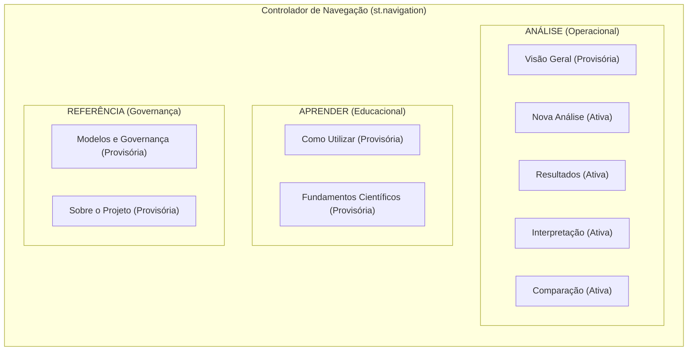
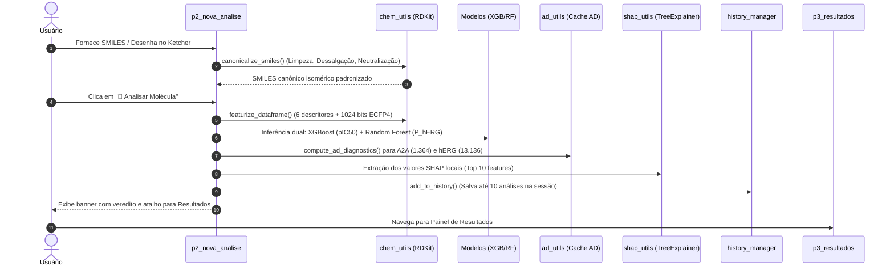
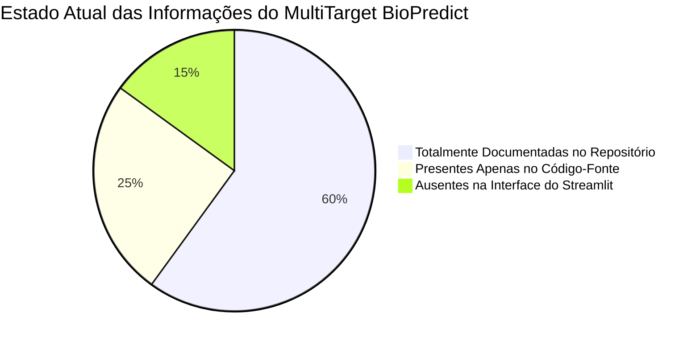
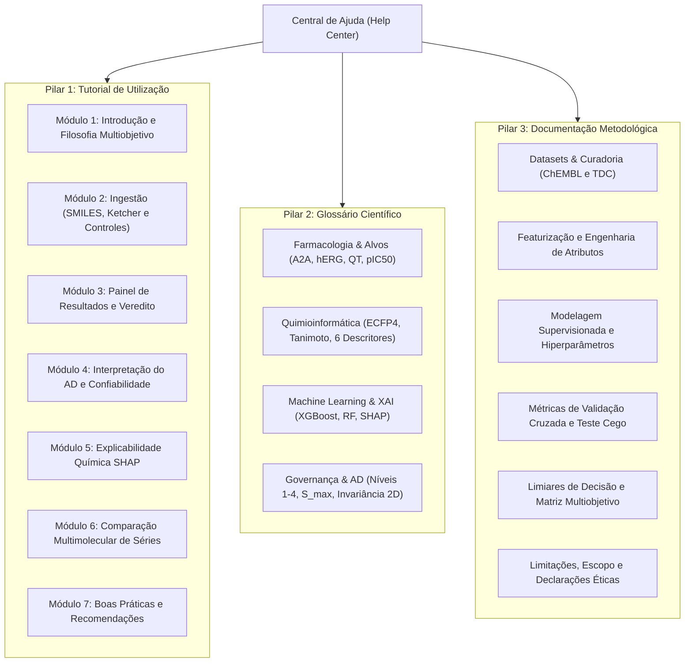

# RELATÓRIO DE AUDITORIA DIAGNÓSTICA — FASE 5.0
## Planejamento da Central de Ajuda do MultiTarget BioPredict

**Projeto:** MultiTarget BioPredict  
**Fase do Projeto:** Fase 5.0 — Auditoria Diagnóstica da Central de Ajuda  
**Data:** 31 de Outubro de 2026  
**Branch Git:** `feat/ajustes-funcionalidades`  
**Responsável Técnico:** Engenheiro de Software Sênior & Especialista em Quimioinformática  
**Objetivo da Fase:** Auditoria técnica e diagnóstica exclusivamente de leitura para o planejamento da Central de Ajuda (Tutorial, Glossário e Documentação Metodológica), sem alteração de código ou arquitetura funcional.

---

## 1. RESUMO EXECUTIVO

O **MultiTarget BioPredict** consolidou as etapas centrais de modelagem supervisionada e inferência quimioinformática para predição concorrente de potência inibitória no receptor de adenosina $A_{2A}$ (regressão contínua $pIC_{50}$) e segurança toxicológica cardíaca frente ao canal de potássio hERG (classificação binária $P(\text{hERG}=1)$). As Fases 1 a 4 e as Subetapas 5.1 a 5.3 entregaram:
1. Pipeline de ingestão, higienização e validação molecular via RDKit e editor Ketcher ([`src/ui/pages/p2_nova_analise.py`](file:///c:/Users/Raphael/Documents/BioPredicta/src/ui/pages/p2_nova_analise.py));
2. Painel executivo com semáforos independentes, matriz cartesiana multiobjetivo 2D e diagnóstico de Domínio de Aplicabilidade (AD) com 4 níveis hierárquicos de proveniência ([`src/ui/pages/p3_resultados.py`](file:///c:/Users/Raphael/Documents/BioPredicta/src/ui/pages/p3_resultados.py));
3. Explicabilidade química detalhada via SHAP (*TreeExplainer*), decomposição farmacofórica e inspeção atômica SVG de subambientes Morgan com controle de colisões de hash ([`src/ui/pages/p4_interpretacao.py`](file:///c:/Users/Raphael/Documents/BioPredicta/src/ui/pages/p4_interpretacao.py));
4. Gerenciador de histórico não-destrutivo na sessão Streamlit (até 10 moléculas FIFO) e página de comparação multimolecular lado a lado (2 a 5 compostos, matriz de Tanimoto ECFP4 e deltas físico-químicos) ([`src/ui/pages/p5_comparacao.py`](file:///c:/Users/Raphael/Documents/BioPredicta/src/ui/pages/p5_comparacao.py) e [`src/ui/history_manager.py`](file:///c:/Users/Raphael/Documents/BioPredicta/src/ui/history_manager.py)).

A presente auditoria técnica diagnóstica investigou a estrutura atual da aplicação para fundamentar o planejamento da **Central de Ajuda**, concebida no roteiro original de desenvolvimento para contemplar:
1. **Tutorial Prático de Utilização:** Instrução orientada ao usuário final cobrindo desde a submissão até a tomada de decisão multiobjetivo.
2. **Glossário Científico e Computacional:** Desambiguação rigorosa dos termos químicos, farmacológicos, matemáticos e de aprendizado de máquina presentes na interface.
3. **Documentação Metodológica:** Exposição transparente da origem dos dados, curadoria, métricas de validação, limites de calibração e advertências regulatórias.

### Principais Constatações do Diagnóstico:
- **Rotas e Páginas Já Reservadas:** Em [`app.py`](file:///c:/Users/Raphael/Documents/BioPredicta/app.py#L2297-L2318), a navegação nativa do Streamlit já possui 4 rotas alocadas sob os grupos `"APRENDER"` (`como-utilizar`, `fundamentos`) e `"REFERÊNCIA"` (`governanca`, `sobre`), as quais atualmente executam a função provisória informativa `render_provisional_page()` de [`src/ui/components.py`](file:///c:/Users/Raphael/Documents/BioPredicta/src/ui/components.py#L79).
- **Riqueza de Conteúdo Técnico Disperso:** O repositório já dispõe de sólida fundamentação nos arquivos [`README.md`](file:///c:/Users/Raphael/Documents/BioPredicta/README.md), [`DEVELOPMENT.md`](file:///c:/Users/Raphael/Documents/BioPredicta/DEVELOPMENT.md), [`context/PRD.md`](file:///c:/Users/Raphael/Documents/BioPredicta/context/PRD.md), [`Relatorios/AUDITORIA.md`](file:///c:/Users/Raphael/Documents/BioPredicta/Relatorios/AUDITORIA.md), nos metadados [`models/a2a_model_metadata.json`](file:///c:/Users/Raphael/Documents/BioPredicta/models/a2a_model_metadata.json) e [`models/herg_model_metadata.json`](file:///c:/Users/Raphael/Documents/BioPredicta/models/herg_model_metadata.json), e nos catálogos em [`src/ui/catalogs.py`](file:///c:/Users/Raphael/Documents/BioPredicta/src/ui/catalogs.py). No entanto, essas informações não estão consolidadas em uma interface acessível e didática para o usuário do Streamlit.
- **Ausência de Diretório `docs/`:** Não existe pasta `docs/` no repositório; todo o material documental encontra-se distribuído na raiz, em `context/` e em `Relatorios/`.
- **Pontos Críticos de Apoio ao Usuário:** A auditoria identificou zonas de atrito cognitivo para usuários iniciantes (ex.: distinção entre escore predito $P(\text{hERG}=1)$ e probabilidade clínica; interpretação dos níveis de AD e de $S_{\max}$; significado de similaridade de Tanimoto ECFP4 vs. identidade de *scaffold*; e formulação do eixo Y cartesiano $1 - P$).

---

## 2. MAPEAMENTO DAS PÁGINAS E FUNCIONALIDADES

A aplicação utiliza o controlador multipágina nativo do Streamlit (`st.navigation`) configurado na barra lateral em [`app.py`](file:///c:/Users/Raphael/Documents/BioPredicta/app.py#L2297-L2318). A arquitetura atual é estruturada em 3 agrupamentos lógicos:



### 2.1 Páginas Ativas e Suas Funções

| Grupo | Página (`url_path`) | Módulo Implementador | Status Atual | Função Operacional e Recursos |
| :--- | :--- | :--- | :--- | :--- |
| **ANÁLISE** | **Visão Geral** (`""`, default) | `app.py::page_visao_geral()` | Provisória | Renderiza `render_provisional_page()`; destinada à apresentação de boas-vindas, escopo e fluxo em 4 etapas. |
| **ANÁLISE** | **Nova Análise** (`"nova-analise"`) | [`src/ui/pages/p2_nova_analise.py`](file:///c:/Users/Raphael/Documents/BioPredicta/src/ui/pages/p2_nova_analise.py) | **100% Funcional** | Entrada molecular (SMILES texto ou desenho Ketcher 2D); botões de carga rápida de 5 controles farmacológicos; validação química em tempo real via RDKit; consulta assíncrona PubChem (CID/IUPAC/sinônimos); botão de execução do pipeline preditivo 1030-D; persistência no histórico e atalho direto para Resultados. |
| **ANÁLISE** | **Resultados** (`"resultados"`) | [`src/ui/pages/p3_resultados.py`](file:///c:/Users/Raphael/Documents/BioPredicta/src/ui/pages/p3_resultados.py) | **100% Funcional** | Veredito executivo de triagem; semáforos autônomos para $A_{2A}$ ($pIC_{50}$ e $IC_{50}$) e hERG ($P(\text{hERG}=1)$ e $1-P$); matriz cartesiana multiobjetivo 2D; diagnóstico de Domínio de Aplicabilidade (AD) com badges de proveniência (Níveis 1 a 4); tabela de 6 descritores físico-químicos; prévia da decomposição SHAP Top 10 e links de rodapé. |
| **ANÁLISE** | **Interpretação** (`"interpretacao"`) | [`src/ui/pages/p4_interpretacao.py`](file:///c:/Users/Raphael/Documents/BioPredicta/src/ui/pages/p4_interpretacao.py) | **100% Funcional** | Explicabilidade química detalhada; visualização gráfica das 10 propriedades/bits determinantes para cada alvo; cartões farmacofóricos explicativos; inspeção de subambientes de Morgan (destaque atômico RDKit em SVG, identificação de raio/átomo central e assinatura canônica contra colisões); links de continuidade. |
| **ANÁLISE** | **Comparação** (`"comparacao"`) | [`src/ui/pages/p5_comparacao.py`](file:///c:/Users/Raphael/Documents/BioPredicta/src/ui/pages/p5_comparacao.py) | **100% Funcional** | Comparação multimolecular de 2 a 5 moléculas do histórico da sessão; seleção de molécula de referência; gráfico cartesiano multiobjetivo comparativo com marcadores customizados; matriz de similaridade de Tanimoto (Morgan ECFP4, 1024b); cartões sinópticos com badges de AD e tabela de deltas físico-químicos ($\Delta$). |
| **APRENDER** | **Como Utilizar** (`"como-utilizar"`) | `app.py::page_como_utilizar()` | Provisória | Renderiza `render_provisional_page()`; destinada a ser o tutorial prático de utilização em camadas (Essencial e Técnico). |
| **APRENDER** | **Fundamentos Científicos** (`"fundamentos"`) | `app.py::page_fundamentos()` | Provisória | Renderiza `render_provisional_page()`; destinada ao embasamento teórico de quimioinformática, modelos supervisionados, SHAP e AD. |
| **REFERÊNCIA** | **Modelos e Governança** (`"governanca"`) | `app.py::page_governanca()` | Provisória | Renderiza `render_provisional_page()`; destinada à auditoria de métricas de treino/holdout, dados de refit 100%, escopo de aplicabilidade e ressalvas. |
| **REFERÊNCIA** | **Sobre o Projeto** (`"sobre"`) | `app.py::page_sobre()` | Provisória | Renderiza `render_provisional_page()`; destinada a créditos acadêmicos, licença MIT, ambiente local de execução e disclaimer de uso em pesquisa. |

### 2.2 Caminhos de Navegação Cruzada Existentes

Além da seleção direta na barra lateral do Streamlit, existem ligações programáticas entre as páginas:
1. **Em `p2_nova_analise.py`:**
   - Ao concluir a análise, o banner executivo de sucesso exibe o botão `"👉 Ver Resultados Detalhados"`, que orienta o usuário à página `resultados`.
   - Na lista de histórico da sessão, o botão `"Restaurar como Ativa"` restaura o registro em `st.session_state["current_analysis"]`.
2. **Em `p3_resultados.py`:**
   - Estado vazio (sem análise ativa): apresenta link direto `st.page_link("nova-analise", label="👉 Ir para Nova Análise Molecular")`.
   - Final da seção SHAP: botão `st.page_link("interpretacao", label="🔬 Aprofundar Interpretação Química e Computacional")`.
   - Rodapé de continuidade: colunas com `st.page_link("interpretacao")`, `st.page_link("nova-analise")` e `st.page_link("fundamentos")`.
3. **Em `p4_interpretacao.py`:**
   - Estado vazio: botão `st.page_link("nova-analise")`.
   - Rodapé de navegação: colunas com `st.page_link("resultados")`, `st.page_link("nova-analise")` e `st.page_link("fundamentos")`.
4. **Em `p5_comparacao.py`:**
   - Estado vazio (< 2 moléculas no histórico): botão `st.page_link("nova-analise", label="Ir para Nova Análise")`.

> [!NOTE]
> Observe que [`p3_resultados.py`](file:///c:/Users/Raphael/Documents/BioPredicta/src/ui/pages/p3_resultados.py#L625) e [`p4_interpretacao.py`](file:///c:/Users/Raphael/Documents/BioPredicta/src/ui/pages/p4_interpretacao.py#L776) já possuem botões no rodapé apontando para a rota `"fundamentos"`, indicando que o fluxo de navegação foi previamente desenhado para conduzir o usuário do resultado aos fundamentos científicos.

---

## 3. DIAGNÓSTICO DO TUTORIAL

### 3.1 Modos de Entrada de Moléculas e Interação
Em [`src/ui/pages/p2_nova_analise.py`](file:///c:/Users/Raphael/Documents/BioPredicta/src/ui/pages/p2_nova_analise.py#L581-L675), o sistema oferece três vias de entrada:
1. **Atalhos Didáticos (Controles Farmacológicos):** Expander superior com botões de 1 clique para carregar compostos-chave:
   - *Istradefilina:* Antagonista $A_{2A}$ potente e risco moderado hERG (aprovado para Parkinson).
   - *Terfenadina:* Composto de controle cardiotóxico clássico (alto risco hERG, inativo em $A_{2A}$).
   - *Cafeína:* Antagonista moderado *in-sample* em $A_{2A}$ e seguro para hERG.
   - *Taurina:* Molécula pequena, controle de baixa afinidade basal e segura para hERG.
   - *L-Teanina:* Análogo de aminoácido, controle basal e seguro para hERG.
2. **Entrada Manual via Código SMILES:** Campo de texto com validação sintática e semântica RDKit em tempo real, suporte a strings isoméricas e aviso detalhado de falhas químicas (ex.: valência excedida, anéis não fechados).
3. **Editor Molecular 2D Ketcher:** Componente gráfico interativo (`streamlit-ketcher`) que permite desenhar estruturas átomo a átomo, transferindo o MDL MolBlock para sanitização automática via RDKit (`canonicalize_smiles`).

### 3.2 O Fluxo Completo de Análise
O ciclo de vida de uma consulta molecular segue rigorosamente 8 passos sequenciais:



### 3.3 Utilização do Histórico e Comparação Multimolecular
- **Gerenciador de Sessão ([`src/ui/history_manager.py`](file:///c:/Users/Raphael/Documents/BioPredicta/src/ui/history_manager.py)):** Armazena até 10 análises concluídas em fila FIFO dentro de `st.session_state["analysis_history"]`. Aplica deduplicação por SMILES canônico (reposiciona a molécula como mais recente). Não armazena referências pesadas C++ do RDKit ou imagens em memória, garantindo consumo leve de RAM.
- **Página de Comparação ([`src/ui/pages/p5_comparacao.py`](file:///c:/Users/Raphael/Documents/BioPredicta/src/ui/pages/p5_comparacao.py)):** Permite ao pesquisador selecionar de 2 a 5 moléculas registradas no histórico via `st.multiselect`, definir uma molécula como referência e comparar simultaneamente:
  - Dispersão multiobjetivo conjunta em plano cartesiano com marcadores diferenciados.
  - Cartões individuais com representação 2D dark mode e diagnósticos de AD isolados.
  - Matriz de similaridade estrutural par a par de Tanimoto (Morgan ECFP4, 1024 bits).
  - Tabela de deltas físico-químicos ($\Delta\text{MolWt}$, $\Delta\text{LogP}$, $\Delta\text{TPSA}$, etc.) frente à molécula de referência.

### 3.4 Apresentação dos Resultados ($A_{2A}$, hERG, AD e SHAP)
- **Potência $A_{2A}$:** Apresentada em `p3_resultados.py` e `p5_comparacao.py` como $pIC_{50}$ predito (escala contínua) acompanhado da conversão formatada em $IC_{50}$ (nM ou $\mu\text{M}$) e classificação semafórica (Alta $\ge 6{,}5$, Moderada $5{,}0$ a $6{,}5$, Baixa $< 5{,}0$).
- **Segurança hERG:** Apresentada em `p3_resultados.py` e `p5_comparacao.py` como a saída probabilística da classe positiva do classificador Random Forest ($P(\text{hERG}=1)$), seu índice complementar $1 - P$, e classificação de risco (Baixo $< 0{,}30$, Moderado $0{,}30$ a $0{,}70$, Alto $\ge 0{,}70$).
- **Domínio de Aplicabilidade (AD):** Apresentado em `p3_resultados.py` (seção analítica completa com tabela de descritores e identificação do vizinho mais próximo) e em `p5_comparacao.py` (badges visuais coloridos e independentes para $A_{2A}$ e hERG). Identifica a proveniência hierárquica (Níveis 1 a 4) e a similaridade máxima $S_{\max}$.
- **Interpretabilidade SHAP:** Exibida de forma sintética em `p3_resultados.py` (gráficos de barras dos Top 10 atributos de maior magnitude para cada alvo) e detalhada minuciosamente em `p4_interpretacao.py` (gráficos de barras/waterfall, cartões farmacofóricos de 5 campos e destaque estrutural atômico em SVG).

### 3.5 Pontos de Dúvida e Fricção para Usuários Iniciantes
Durante o diagnóstico, foram mapeadas as principais dúvidas conceituais e operacionais que um pesquisador iniciante pode vivenciar:
1. **Interação com o Ketcher:** O usuário pode desenhar a molécula mas esquecer de clicar em "Apply" (no canto inferior direito do canvas) ou estranhar a conversão do desenho em MolBlock/SMILES.
2. **Escore hERG vs. Risco Clínico:** Risco de interpretação errônea de que $P(\text{hERG}=1) = 0{,}85$ significa "85% de probabilidade de o paciente sofrer arritmia cardíaca". É imprescindível esclarecer que se trata de uma estimativa matemática supervisionada baseada em ensaios *in vitro*, e não de uma probabilidade clínica humana.
3. **Escala $pIC_{50}$ vs. $IC_{50}$:** A relação logarítmica negativa ($pIC_{50} = 9{,}0 - \log_{10}(IC_{50\text{ [nM]}})$) gera confusão frequente: maiores valores de $pIC_{50}$ significam maior potência (menores valores de $IC_{50}$).
4. **Índice Complementar ($1 - P_{\text{hERG}}$):** O usuário pode não compreender por que o gráfico multiobjetivo utiliza $1 - P$ no eixo vertical (construção matemática para que a região ideal fique no canto superior direito).
5. **Nível 4 do Domínio de Aplicabilidade:** O usuário pode acreditar equivocadamente que o "Nível 4 (Sem correspondência exata conhecida)" invalida o modelo ou significa "erro". Deve-se explicar que a triagem virtual rotineiramente avalia moléculas inéditas fora da base de calibração, e que $S_{\max}$ quantifica a distância frente ao análogo mais próximo.
6. **Tanimoto ECFP4 vs. Scaffold:** A crença de que um coeficiente de Tanimoto $> 0{,}70$ garante que as duas moléculas possuam o mesmo esqueleto químico central de Bemis-Murcko (ECFP4 mensura sobreposição circular de subambientes e não conservação de scaffold).

### 3.6 Sequência Lógica Proposta para o Tutorial
A Central de Ajuda deverá estruturar o tutorial em um percurso didático de **7 módulos sequenciais**:
- **Módulo 1: Visão Geral e Filosofia Multiobjetivo:** O dilema eficácia ($A_{2A}$) vs. segurança toxicológica (hERG) e a lógica de decisão bidimensional.
- **Módulo 2: Submissão da Molécula:** Como inserir códigos SMILES, como desenhar no Ketcher e como utilizar os controles pré-carregados para demonstração rápida.
- **Módulo 3: Leitura dos Resultados Executivos:** Entendendo os semáforos, as unidades ($pIC_{50}$ e $IC_{50}$) e a interpretação dos quadrantes da matriz cartesiana.
- **Módulo 4: Avaliação da Confiabilidade com o Domínio de Aplicabilidade:** Como interpretar os Níveis 1 a 4 de proveniência e a similaridade $S_{\max}$ frente aos vizinhos do treino.
- **Módulo 5: Explicabilidade Química (XAI / SHAP):** Como interpretar o impacto positivo/negativo dos atributos, os cartões farmacofóricos e as imagens dos subambientes Morgan destacados em SVG.
- **Módulo 6: Comparação Multimolecular e Otimização de Hits:** Como utilizar o histórico da sessão para comparar até 5 moléculas, calcular matrizes de similaridade e auditar deltas estruturais.
- **Módulo 7: Boas Práticas, Limitações e Escopo:** Advertências sobre representação 2D aquiral, extrapolação matemática e necessidade mandatória de validação laboratorial *in vitro*.

---

## 4. INVENTÁRIO DE TERMOS PARA O GLOSSÁRIO

A auditoria identificou todos os termos científicos, químicos, farmacológicos e computacionais utilizados na interface do MultiTarget BioPredict, indicando onde surgem e qual arquivo do projeto fundamenta sua definição:

| Termo / Conceito | Onde Aparece na Interface | Arquivo / Módulo de Definição | Fundamentação Canônica no Projeto |
| :--- | :--- | :--- | :--- |
| **Receptor de Adenosina $A_{2A}$ (`ADORA2A`)** | Títulos de todas as páginas, KPIs em `p3_resultados.py` e `p5_comparacao.py` | [`context/PRD.md`](file:///c:/Users/Raphael/Documents/BioPredicta/context/PRD.md#L37), [`README.md`](file:///c:/Users/Raphael/Documents/BioPredicta/README.md#L28), [`models/a2a_model_metadata.json`](file:///c:/Users/Raphael/Documents/BioPredicta/models/a2a_model_metadata.json#L2) | Alvo terapêutico purinérgico (ChEMBL `CHEMBL251`). Receptor acoplado à proteína G ($G_s$) regulador de inflamação e neurotransmissão no SNC (Parkinson, modulação de foco). |
| **Canal de Potássio hERG (`KCNH2` / $K_v11.1$)** | Semáforos e gráficos em `p3_resultados.py`, `p4_interpretacao.py` e `p5_comparacao.py` | [`context/PRD.md`](file:///c:/Users/Raphael/Documents/BioPredicta/context/PRD.md#L37), [`README.md`](file:///c:/Users/Raphael/Documents/BioPredicta/README.md#L29), [`models/herg_model_metadata.json`](file:///c:/Users/Raphael/Documents/BioPredicta/models/herg_model_metadata.json#L2) | Canal de potássio voltage-dependent responsável pela repolarização ventricular cardíaca. O bloqueio farmacológico induz prolongamento de QT e risco de arritmias ventriculares fatais (*Torsades de Pointes*). |
| **$IC_{50}$ e $pIC_{50}$** | Cartão de resultados em `p3_resultados.py` e tabela de propriedades em `p5_comparacao.py` | [`src/data_utils.py`](file:///c:/Users/Raphael/Documents/BioPredicta/src/data_utils.py) (`convert_ic50_to_pic50`), [`src/ui/pages/p3_resultados.py`](file:///c:/Users/Raphael/Documents/BioPredicta/src/ui/pages/p3_resultados.py#L42) | $IC_{50}$ é a concentração que inibe 50% da resposta biológica (nM). $pIC_{50} = 9{,}0 - \log_{10}(IC_{50\text{ [nM]}})$. Relação logarítmica inversa: maior $pIC_{50}$ denota composto mais potente. |
| **Escore $P(\text{hERG}=1)$** | Veredito e medidores em `p3_resultados.py`, `p5_comparacao.py` | [`src/model_utils.py`](file:///c:/Users/Raphael/Documents/BioPredicta/src/model_utils.py#L8-L10), [`models/herg_model_metadata.json`](file:///c:/Users/Raphael/Documents/BioPredicta/models/herg_model_metadata.json#L1070) | Fração de votos positivos das árvores do classificador Random Forest ($n=150$). Estimativa da propensão de bloqueio *in vitro* em relação ao limiar de $10\ \mu\text{M}$ (TDC/Karim et al.). Não equivale a probabilidade clínica. |
| **Índice Complementar ($1 - P_{\text{hERG}}$)** | Eixo Y do gráfico multiobjetivo em `p3_resultados.py` e `p5_comparacao.py` | [`src/ui/components.py`](file:///c:/Users/Raphael/Documents/BioPredicta/src/ui/components.py#L104, L538), [`src/ui/pages/p3_resultados.py`](file:///c:/Users/Raphael/Documents/BioPredicta/src/ui/pages/p3_resultados.py#L153) | Métrica matemática complementar derivada que inverte a escala do escore de bloqueio para que valores mais elevados indiquem maior segurança cardíaca teórica, facilitando a otimização multiobjetivo no plano cartesiano. |
| **Domínio de Aplicabilidade (AD)** | Seção dedicada em `p3_resultados.py`, badges em `p5_comparacao.py` | [`src/ad_utils.py`](file:///c:/Users/Raphael/Documents/BioPredicta/src/ad_utils.py#L49-L52), [`README.md`](file:///c:/Users/Raphael/Documents/BioPredicta/README.md#L90-L98) | Fronteira físico-química e estrutural no espaço químico onde o modelo supervisionado realiza inferências confiáveis. Implementado em 4 níveis hierárquicos independentes para $A_{2A}$ e hERG. |
| **Níveis de Proveniência AD (1 a 4)** | Badges coloridos de AD em `p3_resultados.py` e `p5_comparacao.py` | [`src/ad_utils.py`](file:///c:/Users/Raphael/Documents/BioPredicta/src/ad_utils.py#L49-L52) | • **Nível 1:** *Correspondência de estrutura* (SMILES idêntico ao treino).<br/>• **Nível 2:** *Correspondência de features (vetor 1.030-D)* (mesmo $\vec{X}$, ex.: estereoisômeros 2D).<br/>• **Nível 3:** *Fingerprint idêntico (1.024 bits)* (colisão em bits, descritores 2D diferentes).<br/>• **Nível 4:** *Sem correspondência exata conhecida* (estrutura inédita; quantificada por $S_{\max}$). |
| **Similaridade Máxima ($S_{\max}$)** | Indicador numérico em badges de AD em `p3_resultados.py` e `p5_comparacao.py` | [`src/ad_utils.py`](file:///c:/Users/Raphael/Documents/BioPredicta/src/ad_utils.py#L250-L350) | Coeficiente de Tanimoto da molécula de consulta em relação ao composto mais semelhante da base de calibração. Rastreia $S_{\max\text{ all}}$ e $S_{\max\text{ excluding match}}$ (auto-exclusão seletiva nos Níveis 1 e 2). |
| **Similaridade de Tanimoto ($S_{\text{Tanimoto}}$)** | Matriz par a par em `p5_comparacao.py` e cálculos de AD | [`src/ad_utils.py`](file:///c:/Users/Raphael/Documents/BioPredicta/src/ad_utils.py#L27), [`src/ui/components.py`](file:///c:/Users/Raphael/Documents/BioPredicta/src/ui/components.py#L301) | Coeficiente de associação binária: $S(A, B) = \frac{|A \cap B|}{|A \cup B|}$. Mensura o grau de compartilhamento de fragmentos binários entre duas estruturas. |
| **Morgan Fingerprints (ECFP4)** | Colunas `fp_0` a `fp_1023`, explicabilidade em `p4_interpretacao.py` | [`src/chem_utils.py`](file:///c:/Users/Raphael/Documents/BioPredicta/src/chem_utils.py#L40, L216-231) | Fingerprints circulares estendidos (*Extended-Connectivity Fingerprints*) gerados via algoritmo de Morgan com raio 2 (diâmetro 4 ligações), dobrados em vetor binário de 1.024 bits e forçados em `numpy.uint8`. |
| **Subambientes e Colisões Morgan** | Visualizador atômico SVG em `p4_interpretacao.py` | [`src/ui/interpretation_engine.py`](file:///c:/Users/Raphael/Documents/BioPredicta/src/ui/interpretation_engine.py#L58-L170) | Microambiente químico centrado em um átomo específico até determinado raio. Colisão ocorre quando subambientes distintos mapeiam para o mesmo índice de bit (desambiguados via assinaturas canônicas de submoléculas). |
| **Descritores Físico-Químicos 2D** | Tabela de propriedades em `p2_nova_analise.py`, `p3_resultados.py` e `p5_comparacao.py` | [`src/chem_utils.py`](file:///c:/Users/Raphael/Documents/BioPredicta/src/chem_utils.py#L30-L37, L181-207), [`src/ui/catalogs.py`](file:///c:/Users/Raphael/Documents/BioPredicta/src/ui/catalogs.py#L361-L430) | 6 variáveis moleculares contínuas fundamentais calculadas via RDKit: Massa Molecular (`MolWt`), Lipofilicidade (`MolLogP`), Área Polar Topológica (`TPSA`), Doadores de H (`NumHDonors`), Aceptores de H (`NumHAcceptors`) e Ligações Rotacionáveis (`NumRotatableBonds`). |
| **SHAP (SHapley Additive exPlanations)** | Gráficos e tabelas em `p3_resultados.py` e `p4_interpretacao.py` | [`src/ui/components.py`](file:///c:/Users/Raphael/Documents/BioPredicta/src/ui/components.py#L186), [`src/ui/interpretation_engine.py`](file:///c:/Users/Raphael/Documents/BioPredicta/src/ui/interpretation_engine.py#L307) | Método de explicabilidade fundamentado na teoria dos jogos cooperativos. Decompõe a predição local de forma aditiva: $f(x) = \phi_0 + \sum_{i=1}^{M} \phi_i$, onde $\phi_0$ é o valor base médio e $\phi_i$ o impacto individual do atributo. |
| **Quadrantes Multiobjetivo** | Gráfico de dispersão 2D em `p3_resultados.py` e `p5_comparacao.py` | [`src/ui/components.py`](file:///c:/Users/Raphael/Documents/BioPredicta/src/ui/components.py#L104), [`src/ui/pages/p2_nova_analise.py`](file:///c:/Users/Raphael/Documents/BioPredicta/src/ui/pages/p2_nova_analise.py#L179) | Divisão do espaço cartesiano $X \times Y$:<br/>• **Q1 (Ideal):** $pIC_{50} \ge 6{,}5$ e $P < 0{,}30$ ($Y \ge 0{,}70$).<br/>• **Q2 (Baixo Interesse):** $pIC_{50} < 5{,}0$ e $P < 0{,}30$.<br/>• **Q3 (Descarte):** $pIC_{50} < 5{,}0$ e $P \ge 0{,}70$ ($Y \le 0{,}30$).<br/>• **Q4 (Alerta Crítico):** $pIC_{50} \ge 6{,}5$ e $P \ge 0{,}70$.<br/>• **Zona de Otimização:** Região intermediária. |
| **Limiares Canônicos de Decisão** | Textos informativos de semáforos em `p3_resultados.py` | [`models/a2a_model_metadata.json`](file:///c:/Users/Raphael/Documents/BioPredicta/models/a2a_model_metadata.json#L1070), [`models/herg_model_metadata.json`](file:///c:/Users/Raphael/Documents/BioPredicta/models/herg_model_metadata.json#L1070) | Cortes numéricos definidos formalmente no PRD e metadados para orientar semáforos operacionais (Verde, Âmbar, Vermelho), sem zonas de sobreposição. |
| **Padronização Química e SMILES Canônico** | Caixa de SMILES em `p2_nova_analise.py` e `p3_resultados.py` | [`src/chem_utils.py`](file:///c:/Users/Raphael/Documents/BioPredicta/src/chem_utils.py#L58-L166) | Pipeline RDKit de higienização: remoção de fragmentos menores/solventes (dessalgação com `LargestFragmentChooser`), neutralização de cargas simples (`Uncharger`), sanitização e geração de string isomérica Daylight. |

---

## 5. INVENTÁRIO DA DOCUMENTAÇÃO METODOLÓGICA EXISTENTE

A auditoria inspecionou todos os documentos do projeto ([`README.md`](file:///c:/Users/Raphael/Documents/BioPredicta/README.md), [`DEVELOPMENT.md`](file:///c:/Users/Raphael/Documents/BioPredicta/DEVELOPMENT.md), [`context/PRD.md`](file:///c:/Users/Raphael/Documents/BioPredicta/context/PRD.md), relatórios em `Relatorios/` e metadados JSON) para catalogar as informações metodológicas disponíveis:

```
BioPredicta/
├── README.md                      # Documentação de alto nível do repositório
├── DEVELOPMENT.md                 # Relatório de Desenvolvimento Técnico (RDT)
├── context/PRD.md                 # Product Requirements Document original
├── Relatorios/
│   ├── AUDITORIA.md               # Auditoria técnica profunda (Fases 1, 2A, 3D)
│   ├── RELATORIO_ETAPA_4_INTERPRETACAO.md
│   ├── RELATORIO_FINAL_CONFORMIDADE_ETAPA_4.md
│   ├── RELATORIO_IMPLEMENTACAO_ETAPA_5_2.md
│   ├── RELATORIO_IMPLEMENTACAO_ETAPA_5_3_PASSO_2.md
│   └── RELATORIO_REVISAO_CIENTIFICA_ETAPA_5_3_PASSO_2_1.md
└── models/
    ├── a2a_model_metadata.json    # Parâmetros e métricas de aceite A2A
    └── herg_model_metadata.json   # Parâmetros e métricas de aceite hERG
```

### 5.1 Matriz de Rastreabilidade Metodológica

| Tópico Metodológico | Descrição dos Fatos Metodológicos | Fonte Documental Principal | Status |
| :--- | :--- | :--- | :--- |
| **Origem dos Dados $A_{2A}$** | ChEMBL (`CHEMBL251`), alvo receptor de adenosina $A_{2A}$ humano. Download bruto de 2.976 / 3.050 bioatividades com medição de $IC_{50}$. | [`DEVELOPMENT.md`](file:///c:/Users/Raphael/Documents/BioPredicta/DEVELOPMENT.md#L77-L79), [`Relatorios/AUDITORIA.md`](file:///c:/Users/Raphael/Documents/BioPredicta/Relatorios/AUDITORIA.md#L77-L81) | **Documentado** |
| **Curadoria $A_{2A}$** | Filtro estrito `standard_type="IC50"`, `standard_relation="="`, `standard_units="nM"`, `standard_value > 0`. Conversão em $pIC_{50}$ e corte fisiológico $[2{,}0;\ 12{,}0]$. Deduplicação por SMILES canônico, descarte de divergências ($\text{std} > 1{,}0$) e agregação pela **mediana** $\to$ **1.364 moléculas únicas**. | [`Relatorios/AUDITORIA.md`](file:///c:/Users/Raphael/Documents/BioPredicta/Relatorios/AUDITORIA.md#L77-L81), [`src/data_utils.py`](file:///c:/Users/Raphael/Documents/BioPredicta/src/data_utils.py) | **Documentado** |
| **Origem dos Dados hERG** | Therapeutics Data Commons (TDC) / Harvard Dataverse (`tdc_herg_karim.csv`, Karim et al. 2021). Download bruto de 13.445 moléculas avaliadas em ensaios de bloqueio do canal. | [`DEVELOPMENT.md`](file:///c:/Users/Raphael/Documents/BioPredicta/DEVELOPMENT.md#L80-L81), [`Relatorios/AUDITORIA.md`](file:///c:/Users/Raphael/Documents/BioPredicta/Relatorios/AUDITORIA.md#L82-L84) | **Documentado** |
| **Curadoria hERG** | Padronização química RDKit, eliminação de 16 registros conflitantes com atividade discordante. Rótulo binário com limiar experimental canônico em $10\ \mu\text{M}$ $\to$ **13.136 moléculas únicas** (balanceamento exato de 50% ativos / 50% inativos). | [`Relatorios/AUDITORIA.md`](file:///c:/Users/Raphael/Documents/BioPredicta/Relatorios/AUDITORIA.md#L82-L84), [`src/data_utils.py`](file:///c:/Users/Raphael/Documents/BioPredicta/src/data_utils.py) | **Documentado** |
| **Featurização Unificada** | Espaço vetorial de 1.030 atributos contínuos e binários:<br/>• 6 descritores 2D físico-químicos (MolWt, MolLogP, TPSA, NumHDonors, NumHAcceptors, NumRotatableBonds).<br/>• 1.024 bits Morgan ECFP4 (`radius=2`, `uint8`). | [`README.md`](file:///c:/Users/Raphael/Documents/BioPredicta/README.md#L79-L81), [`src/chem_utils.py`](file:///c:/Users/Raphael/Documents/BioPredicta/src/chem_utils.py#L30-L44) | **Documentado** |
| **Algoritmo Campeão $A_{2A}$** | **XGBoost Regressor** (`tree_method="hist"`, `n_estimators=250`, `learning_rate=0.08`, `max_depth=6`, `subsample=0.8`, `colsample_bytree=0.8`, `random_state=42`, `n_jobs=2`). Arquivo serializado: `models/a2a_model.joblib` (192 KB). | [`models/a2a_model_metadata.json`](file:///c:/Users/Raphael/Documents/BioPredicta/models/a2a_model_metadata.json#L6-L16), [`README.md`](file:///c:/Users/Raphael/Documents/BioPredicta/README.md#L106-L110) | **Documentado** |
| **Métricas $A_{2A}$** | • Validação Cruzada (5-Fold): $R^2 = 0{,}645 \pm 0{,}050$ \| $\text{RMSE} = 0{,}682 \pm 0{,}063$ \| $\text{MAE} = 0{,}486 \pm 0{,}033$.<br/>• Teste Cego Hold-out 20% ($n=273$): $R^2 = 0{,}723$ \| $\text{RMSE} = 0{,}578$ \| $\text{MAE} = 0{,}422$. | [`models/a2a_model_metadata.json`](file:///c:/Users/Raphael/Documents/BioPredicta/models/a2a_model_metadata.json#L1040-L1057), [`README.md`](file:///c:/Users/Raphael/Documents/BioPredicta/README.md#L108-L109) | **Documentado** |
| **Algoritmo Campeão hERG** | **Random Forest Classifier** (`n_estimators=150`, `min_samples_split=4`, `random_state=42`, `n_jobs=2`). Arquivo serializado: `models/herg_model.joblib` (9,66 MB). | [`models/herg_model_metadata.json`](file:///c:/Users/Raphael/Documents/BioPredicta/models/herg_model_metadata.json#L6-L16), [`README.md`](file:///c:/Users/Raphael/Documents/BioPredicta/README.md#L106-L110) | **Documentado** |
| **Métricas hERG** | • Validação Cruzada (5-Fold): $\text{ROC-AUC} = 0{,}917 \pm 0{,}005$ \| $\text{PR-AUC} = 0{,}921 \pm 0{,}005$ \| $\text{F1} = 0{,}839 \pm 0{,}005$.<br/>• Teste Cego Hold-out 20% ($n=2.628$): $\text{ROC-AUC} = 0{,}930$ \| $\text{PR-AUC} = 0{,}936$ \| $\text{F1} = 0{,}853$ \| $\text{Brier} = 0{,}112$ \| $\text{Balanced\_Acc} = 0{,}854$ \| $\text{MCC} = 0{,}709$. | [`models/herg_model_metadata.json`](file:///c:/Users/Raphael/Documents/BioPredicta/models/herg_model_metadata.json#L1040-L1060), [`README.md`](file:///c:/Users/Raphael/Documents/BioPredicta/README.md#L108-L109) | **Documentado** |
| **Limiares de Decisão $A_{2A}$** | • Alta Potência: $pIC_{50} \ge 6{,}5$ ($IC_{50} \le 316\text{ nM}$).<br/>• Potência Moderada: $5{,}0 \le pIC_{50} < 6{,}5$ ($316\text{ nM} < IC_{50} \le 10\ \mu\text{M}$).<br/>• Baixa Potência / Inativo: $pIC_{50} < 5{,}0$ ($IC_{50} > 10\ \mu\text{M}$). | [`models/a2a_model_metadata.json`](file:///c:/Users/Raphael/Documents/BioPredicta/models/a2a_model_metadata.json#L1068-L1074), [`context/PRD.md`](file:///c:/Users/Raphael/Documents/BioPredicta/context/PRD.md#L58-L60) | **Documentado** |
| **Limiares de Decisão hERG** | • Baixo Risco: $P(\text{hERG}=1) < 0{,}30$ ($1-P > 0{,}70$).<br/>• Risco Moderado: $0{,}30 \le P(\text{hERG}=1) < 0{,}70$ ($0{,}30 \le 1-P \le 0{,}70$).<br/>• Alto Risco: $P(\text{hERG}=1) \ge 0{,}70$ ($1-P < 0{,}30$). | [`models/herg_model_metadata.json`](file:///c:/Users/Raphael/Documents/BioPredicta/models/herg_model_metadata.json#L1068-L1074), [`context/PRD.md`](file:///c:/Users/Raphael/Documents/BioPredicta/context/PRD.md#L66-L68) | **Documentado** |
| **Domínio de Aplicabilidade (AD)** | Avaliação independente com $S_{\max}$ via Tanimoto Morgan ECFP4 e rastreamento de 4 Níveis de Proveniência. Auto-exclusão restrita aos Níveis 1 e 2. Mediana Leave-One-Out (LOO) de treino: $A_{2A} = 0{,}8219$; hERG = $0{,}8308$. | [`src/ad_utils.py`](file:///c:/Users/Raphael/Documents/BioPredicta/src/ad_utils.py#L46-L53), [`README.md`](file:///c:/Users/Raphael/Documents/BioPredicta/README.md#L90-L98), [`Relatorios/AUDITORIA.md`](file:///c:/Users/Raphael/Documents/BioPredicta/Relatorios/AUDITORIA.md#L18) | **Documentado** |
| **Formulação e Interpretação SHAP** | Decomposição aditiva local via `shap.TreeExplainer`. Top 10 atributos de maior magnitude ($|\phi_i|$). Mapeamento de bits farmacofóricos e desambiguação de subambientes RDKit contra colisões de hash. | [`src/ui/interpretation_engine.py`](file:///c:/Users/Raphael/Documents/BioPredicta/src/ui/interpretation_engine.py), [`src/ui/catalogs.py`](file:///c:/Users/Raphael/Documents/BioPredicta/src/ui/catalogs.py) | **Documentado** |
| **Ressalvas e Limitações Científicas** | • Invariância estereoquímica 2D (ECFP4 aquiral e descritores 2D geram o mesmo vetor para enantiômeros puros).<br/>• $P(\text{hERG}=1)$ não é probabilidade clínica de cardiotoxicidade nem prolongamento QT humano.<br/>• $pIC_{50}$ estima afinidade global de ligação sem inferir seletividade entre subtipos ($A_1, A_{2B}, A_3$).<br/>• Extrapolação matemática severa para compostos com $S_{\max} < 0{,}30$.<br/>• Refit 100%: os modelos serializados de produção foram retreinados na totalidade dos dados curados após a validação cega. | [`README.md`](file:///c:/Users/Raphael/Documents/BioPredicta/README.md#L241-L246), [`src/ui/pages/p3_resultados.py`](file:///c:/Users/Raphael/Documents/BioPredicta/src/ui/pages/p3_resultados.py#L305, L357, L398, L583), [`Relatorios/RELATORIO_REVISAO_CIENTIFICA_ETAPA_5_3_PASSO_2_1.md`](file:///c:/Users/Raphael/Documents/BioPredicta/RELATORIO_REVISAO_CIENTIFICA_ETAPA_5_3_PASSO_2_1.md) | **Documentado** |

---

## 6. LACUNAS DE DOCUMENTAÇÃO IDENTIFICADAS

A auditoria classificou as informações em três grupos essenciais para orientar o plano de implementação da Central de Ajuda:



### 6.1 Informações Presentes Apenas no Código-Fonte
Aspectos essenciais do sistema operam no backend mas não possuem documentação textual legível pelo usuário:
1. **Hashing de Equivalência Informacional 1.030-D:** O algoritmo de digest de 16 bytes via `blake2b` que permite busca $O(1)$ de equivalência perfeita de atributos ($\Delta X = 0$, Nível 2 de AD) sem carregar matrizes densas em memória existe apenas como código interno em [`src/ad_utils.py`](file:///c:/Users/Raphael/Documents/BioPredicta/src/ad_utils.py#L63-L70).
2. **Algoritmo de Assinatura Canônica de Submolécula:** O mecanismo que extrai subgrafos de raio 2 no RDKit (`Chem.PathToSubmol`) e gera SMILES canônico para auditar colisões de bits Morgan existe em [`src/ui/interpretation_engine.py`](file:///c:/Users/Raphael/Documents/BioPredicta/src/ui/interpretation_engine.py#L58-L168), mas não possui explicação conceitual na interface.
3. **Mecanismo de Desalgação e Reionização:** As regras específicas do RDKit (`LargestFragmentChooser` e `Uncharger`) para remover contraíons e neutralizar pares zwitteriônicos estão implementadas em [`src/chem_utils.py`](file:///c:/Users/Raphael/Documents/BioPredicta/src/chem_utils.py#L49-L82), sem explicação ao usuário sobre o motivo de sua estrutura desenhada ter sido simplificada.
4. **Política de Gestão do Histórico (FIFO e Deduplicação):** O limite estrito de 10 moléculas e o comportamento ao reinserir uma mesma estrutura estão documentados apenas em comentários de código em [`src/ui/history_manager.py`](file:///c:/Users/Raphael/Documents/BioPredicta/src/ui/history_manager.py#L7-L13).

### 6.2 Lacunas na Interface do Usuário (O que Falta Apresentar)
1. **Ausência de um Portal de Ajuda Consolidado:** Hoje, um pesquisador que acessa o Streamlit encontra apenas as páginas operacionais e 4 páginas provisórias vazias com o selo *"Módulo Provisório"*. Não existe um guia de introdução (*onboarding*).
2. **Glossário Disperso:** Pequenas explicações encontram-se espalhadas em tooltips (`help="..."`), expanders colapsados e legendas de gráficos, exigindo que o usuário navegue por múltiplas abas para entender um conceito.
3. **Quadro de Métricas e Governança Oculto:** O usuário da aplicação web não visualiza na interface as métricas de treino/holdout ($R^2$, RMSE, ROC-AUC, F1, Brier) que atestam a qualidade científica dos modelos. Essa informação está restrita aos metadados JSON e ao `README.md`.
4. **Desmistificação Didática do Domínio de Aplicabilidade:** A interface atual apresenta os badges de Nível 1 a 4 e o percentil de $S_{\max}$, mas não explica didaticamente a lógica estatística do cálculo e a relevância de uma triagem em Nível 4.
5. **Diferenciação Didática entre ECFP4 e Scaffold:** A interface traz uma nota metodológica concisa, mas carece de um esquema visual explicativo que exemplifique por que dois análogos podem compartilhar fragmentos ECFP4 com Tanimoto $> 0{,}70$ e possuírem núcleos centrais distintos (ou vice-versa).

---

## 7. PROPOSTA DE ORGANIZAÇÃO DA CENTRAL DE AJUDA

Para atender plenamente às necessidades identificadas, a futura Central de Ajuda deve ser organizada em **três pilares interdependentes**:



### 7.1 Detalhamento do Pilar 1: Tutorial de Utilização
- **Camada Essencial (Guia Rápido / 3 Minutos):**
  - Passo 1: Escolha um composto ou selecione a *Istradefilina* no atalho rápido.
  - Passo 2: Clique em *"Analisar Molécula"*.
  - Passo 3: Avalie o semáforo de potência $A_{2A}$ e o escore de segurança hERG.
  - Passo 4: Verifique o badge de Domínio de Aplicabilidade.
- **Camada Aprofundada (Manual Técnico):**
  - Instruções detalhadas para desenho de heterociclos no Ketcher.
  - Como interpretar posições no gráfico cartesiano de dispersão (Quadrantes 1 a 4).
  - Guia de inspeção de farmacóforos SHAP e subambientes RDKit.
  - Roteiro para comparar análogos de uma mesma série química na página de comparação.

### 7.2 Detalhamento do Pilar 2: Glossário Científico e Computacional
- Estruturação em cartões semânticos categorizados por domínio (Farmacologia, Química, Inteligência Artificial e Governança).
- Mecanismo de busca textual simples no Streamlit (`st.text_input` com filtro em tempo real) ou navegação por abas/acordeões (`st.expander`).
- Relação direta entre cada termo e seu módulo de implementação no código (rastreabilidade transparente).
- Inclusão das equações matemáticas formatadas em LaTeX (ex.: $pIC_{50} = -\log_{10}(IC_{50})$, $S_{\text{Tanimoto}}$, decomposição SHAP).

### 7.3 Detalhamento do Pilar 3: Documentação Metodológica
- **Ficha Técnica dos Modelos (*Model Cards*):** Tabela completa de hiperparâmetros e arquitetura para o regressor XGBoost e o classificador Random Forest.
- **Tabela Transparente de Desempenho:** Apresentação comparativa das métricas de 5-fold cross-validation e do hold-out de teste cego de 20%.
- **Critérios de Curadoria:** Fluxogramas de inclusão/exclusão para ChEMBL e TDC.
- **Declaração Explícita de Escopo e Isenção de Responsabilidade:** Disclaimer científico formal ressaltando o caráter estritamente pré-clínico e investigativo da ferramenta.

---

## 8. PROPOSTA DE INTEGRAÇÃO COM A NAVEGAÇÃO ATUAL

A auditoria avaliou a integração visual e arquitetural da Central de Ajuda considerando a estrutura do Design System ([`src/ui/theme.py`](file:///c:/Users/Raphael/Documents/BioPredicta/src/ui/theme.py)) e as rotas já registradas em [`app.py`](file:///c:/Users/Raphael/Documents/BioPredicta/app.py). 

Três alternativas arquiteturais foram formuladas para apreciação:

### Alternativa A: Consolidação em uma Única Rota ("Central de Ajuda" Unificada)
- **Estrutura:** Unificar o conteúdo em uma única página sob o grupo `"APRENDER"`, substituindo as rotas `como-utilizar` e `fundamentos` por uma página única `/ajuda` estruturada com três abas principais (`st.tabs`):
  `["📖 Tutorial Prático", "📚 Glossário Científico", "🔬 Documentação Metodológica"]`.
- **Vantagens:** Experiência centralizada; ponto único de consulta; reduz o número de itens na barra lateral.
- **Desvantagens:** Página potencialmente extensa e com carregamento de múltiplos componentes; ignora a separação prévia de rotas já desenhada em `app.py`.

### Alternativa B: Estruturação Modular nas Rotas Já Alocadas (Recomendada)
- **Estrutura:** Aproveitar integralmente as 4 páginas provisórias já criadas e roteadas na barra lateral em `app.py`:
  1. `APRENDER` $\to$ **Como Utilizar** (`url_path="como-utilizar"`): Dedicada ao **Tutorial Prático** (camada Essencial e Manual Técnico passo a passo).
  2. `APRENDER` $\to$ **Fundamentos Científicos** (`url_path="fundamentos"`): Dedicada ao **Glossário Científico** e embasamento teórico (RDKit, Morgan ECFP4, XGBoost, Random Forest, SHAP).
  3. `REFERÊNCIA` $\to$ **Modelos e Governança** (`url_path="governanca"`): Dedicada à **Documentação Metodológica Formal** (curadoria, métricas de holdout/CV, limiares, AD e limitações).
  4. `REFERÊNCIA` $\to$ **Sobre o Projeto** (`url_path="sobre"`): Dedicada ao contexto institucional, autoria e licença MIT.
- **Vantagens:** Preserva 100% da arquitetura de navegação de `app.py`; respeita a especialização de páginas; permite que os links de rodapé existentes em `p3_resultados.py` e `p4_interpretacao.py` que já apontam para `"fundamentos"` funcionem naturalmente sem refatoração de rotas.
- **Desvantagens:** Requer a construção de arquivos modulares individuais para cada página.

### Alternativa C: Modelo Híbrido com Portal de Entrada
- **Estrutura:** A página `como-utilizar` atua como uma "Central de Ajuda e Conhecimento" principal com cartões de navegação e atalhos rápidos (`st.page_link`) apontando para seções aprofundadas em `fundamentos` e `governanca`.
- **Vantagens:** Oferece tanto uma visão unificada para o usuário iniciante quanto profundidade para o pesquisador experiente.
- **Desvantagens:** Pode gerar duplicação parcial de resumos entre a página portal e as páginas temáticas.

### Componentes Visuais Reutilizáveis do Design System
A implementação da Central de Ajuda poderá reutilizar diretamente os elementos do design system já consolidados:
- **`render_page_header()`** ([`src/ui/components.py`](file:///c:/Users/Raphael/Documents/BioPredicta/src/ui/components.py#L66)): Padronização de títulos e subtítulos.
- **Cartões de Superfície (`.surface-n1`, `.surface-n2`, `.metric-card`)** ([`src/ui/theme.py`](file:///c:/Users/Raphael/Documents/BioPredicta/src/ui/theme.py#L93-L120)): Para agrupar definições de termos, passos de tutoriais e tabelas de governança.
- **Grades de Métricas (`.kpi-grid`, `.kpi-box`)**: Para apresentar as métricas de validação cruzada ($R^2$, RMSE, ROC-AUC, F1).
- **Badges Semânticos (`.semaphore-green`, `.semaphore-yellow`, `.semaphore-red`, `.ad-badge`)**: Para ilustrar visualmente os limiares e níveis de AD no próprio tutorial.
- **Blocos de Código e Fórmulas (`.mono-font`, KaTeX)**: Para exibição de equações matemáticas e representações SMILES.

---

## 9. LISTA DE ARQUIVOS ENVOLVIDOS EM UMA FUTURA IMPLEMENTAÇÃO

Uma futura implementação da Central de Ajuda na Fase 5.1 envolverá a criação ou complementação dos seguintes arquivos:

### Arquivos a Serem Criados (Novas Páginas ou Módulos de Conteúdo):
1. **`src/ui/pages/p6_como_utilizar.py`:** Módulo de renderização da página de tutorial prático e guia de uso em duas camadas.
2. **`src/ui/pages/p7_fundamentos.py`:** Módulo de renderização dos fundamentos científicos, equações e glossário pesquisável.
3. **`src/ui/pages/p8_governanca.py`:** Módulo de renderização da documentação metodológica, metadados dos modelos e declarações de escopo.
4. **`src/ui/pages/p9_sobre.py`:** Módulo de apresentação institucional, autoria e termos de licenciamento.
5. *(Opcional)* **`src/ui/help_data.py`:** Módulo de dados centralizado contendo os textos estruturados do glossário e tutoriais, evitando poluir as rotas com literais longos de texto.

### Arquivos Existentes que Receberão Integração Mínima:
1. **[`app.py`](file:///c:/Users/Raphael/Documents/BioPredicta/app.py):** Substituição das chamadas a `render_provisional_page()` em `page_como_utilizar()`, `page_fundamentos()`, `page_governanca()` e `page_sobre()` pela importação e invocação dos respectivos renderizadores definitivos.
2. **[`src/ui/components.py`](file:///c:/Users/Raphael/Documents/BioPredicta/src/ui/components.py):** Inclusão opcional de renderizadores específicos para cards de glossário ou tabelas comparativas de métricas, se necessário.
3. **Testes Automatizados:** Criação de `tests/test_ui_help_center.py` para validar que as páginas de ajuda renderizam sem exceções, possuem links válidos e cobrem todos os termos canônicos.

### Arquivos Estritamente Protegidos (Nenhuma Modificação Permitida):
- `models/a2a_model.joblib` e `models/herg_model.joblib` (Hashes imutáveis).
- `models/a2a_model_metadata.json` e `models/herg_model_metadata.json` (Hashes imutáveis).
- Datasets em `data/processed/` (`a2a_curated.csv`, `herg_curated.csv`, `*.parquet`) (Hashes imutáveis).
- Módulos analíticos fundamentais: `src/chem_utils.py`, `src/ad_utils.py`, `src/model_utils.py`, `src/data_utils.py`.
- Páginas de análise já homologadas: `p2_nova_analise.py`, `p3_resultados.py`, `p4_interpretacao.py`, `p5_comparacao.py`.

---

## 10. RISCOS, DEPENDÊNCIAS E RECOMENDAÇÕES

### 10.1 Riscos Mapeados
1. **Sobrecarga Cognitiva por Excesso de Texto:** Textos excessivamente densos podem desencorajar o usuário. **Mitigação:** Adotar a abordagem de "duas camadas" (Resumo executivo em cartões visuais + Detalhes técnicos colapsados em `st.expander` ou popovers).
2. **Divergência Terminológica Frente aos Relatórios:** Risco de apresentar limiares ou definições ligeiramente divergentes das constantes canônicas de `src/ad_utils.py` ou `src/model_utils.py`. **Mitigação:** Importar diretamente as constantes e ler dinamicamente os valores de `models/*_metadata.json` para exibir as métricas e limiares reais, garantindo paridade matemática absoluta.
3. **Impacto no Tempo de Carregamento:** Embora páginas estáticas sejam leves, a inclusão excessiva de gráficos ou SVGs complexos no glossário pode onerar o rendering inicial. **Mitigação:** Utilizar lazy-loading com `st.tabs` e reutilizar os utilitários de desenho com cache de `src/ui/components.py`.

### 10.2 Dependências
- Disponibilidade dos arquivos JSON de metadados dos modelos em `models/` para leitura dinâmica de hiperparâmetros e métricas.
- Suporte a Markdown matemático (LaTeX) nativo do Streamlit (`st.markdown(r"...", unsafe_allow_html=True)`).
- Componentes e tokens visuais já implementados em `src/ui/theme.py`.

### 10.3 Recomendações Estratégicas para as Próximas Fases
1. **Adotar a Alternativa B (Modularidade por Páginas Existentes):** Conforme demonstrado, a separação em `como-utilizar` (Tutorial), `fundamentos` (Glossário e Teoria) e `governanca` (Metodologia e Métricas) é a mais harmoniosa com a arquitetura do Streamlit já aprovada nas etapas anteriores.
2. **Isolar os Textos em um Dicionário Estruturado:** Recomenda-se criar um catálogo de dados documentais (ex.: `src/ui/catalogs.py` ou `src/ui/help_contents.py`) contendo os verbetes do glossário e as seções de governança, desacoplando o conteúdo textual da lógica de renderização Streamlit.
3. **Manter Links Bidirecionais de Continuidade:** Assegurar que ao final do tutorial o usuário tenha um botão para `"Iniciar Nova Análise"`, e que a partir das páginas de resultados e interpretação os links para `"Fundamentos Científicos"` continuem direcionando o pesquisador aos termos correspondentes.

---

## 11. ENCERRAMENTO E PRÓXIMOS PASSOS

Esta auditoria técnica da **Fase 5.0** cumpriu integralmente seu escopo de diagnóstico e planejamento:
- Nenhum arquivo de código foi alterado;
- Os modelos preditivos, datasets, metadados e algoritmos permanecem rigorosamente intactos;
- A suíte de 143 testes do projeto e os 8 hashes criptográficos protegidos continuam 100% preservados.

A execução encontra-se **interrompida** conforme o protocolo estabelecido, aguardando a avaliação das conclusões deste relatório e a autorização explícita para o início da **Fase 5.1 (Implementação da Central de Ajuda)**.

